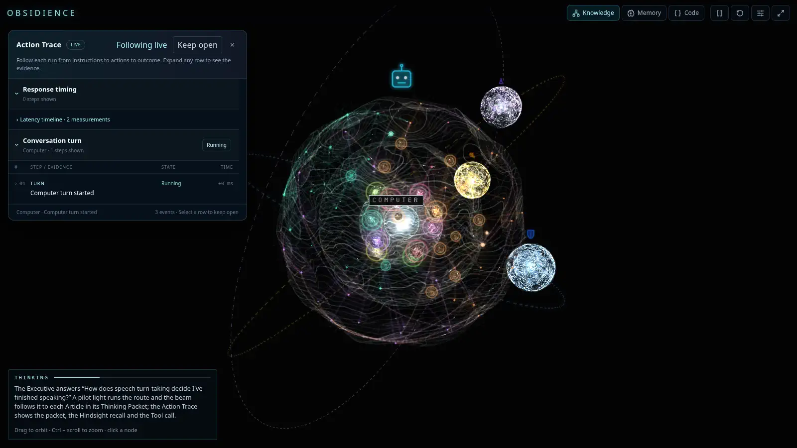
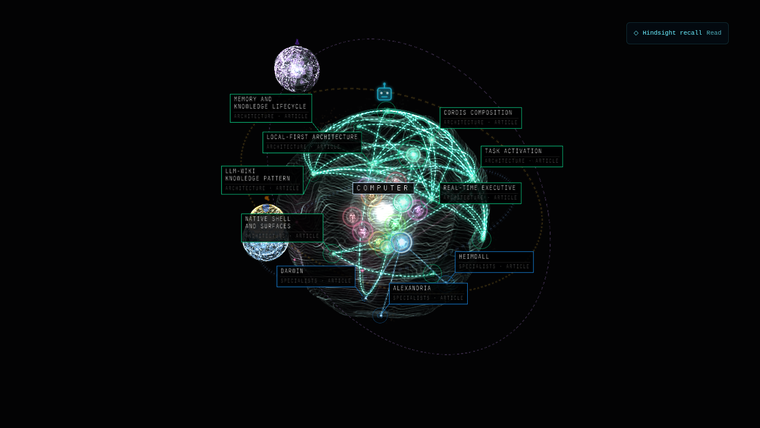
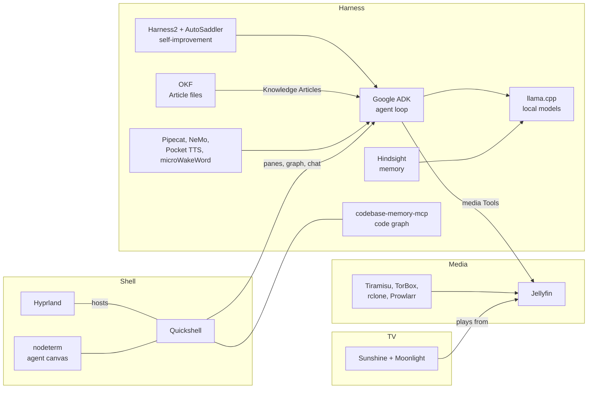

<div align="center">

# Obsidience

**A graph-native, local-first agent harness and Linux desktop shell.**

[](https://github.com/Resource-Hacker/obsidience/actions/workflows/ci.yml)
[](https://resource-hacker.github.io/obsidience/)
[](LICENSE)

<a href="https://resource-hacker.github.io/obsidience/"></a>

**[▶ Try the live, interactive graph](https://resource-hacker.github.io/obsidience/)** · the real graph UI running in your browser on Obsidience's own knowledge, code and history

</div>

Obsidience runs an Executive Agent on your own machine and gives it a maintained
Markdown wiki instead of a pile of prompts. Every Article is a node in one
knowledge graph. Agents, Tasks, Runbooks, Skills and Tools are Articles too,
and explicit dependencies, never similarity, decide what an Agent may run.
Chat and speech enter the same native Executive loop, specialist Agents curate,
research and verify, Hindsight keeps per-Agent memory, and a Hyprland +
Quickshell shell puts it all on the desktop as live 3D graphs that show exactly
which Articles and memories the Agents were given.

The clips below are recorded from the real graph UI on a working installation,
with its own graph settings: a real voice turn, its real memory recall and a real
code lookup. The interactive demo above runs the same UI on public data, the
starter Vault, this repository's code graph and its commit history.

## Knowledge graph


The Executive's knowledge graph: the Agent at the center, its subjects and
Articles in craters on layered glass shells, hierarchy beams in each branch's
colour and links between Articles as quiet threads. Darwin, Alexandria and
Heimdall orbit as their own smaller graphs. When the Executive answers, a thin
pilot light runs the route and the main beam follows it to every Article in its
Thinking Packet, which take labels, while every node on the way ripples its
glass layer. The **Action Trace** follows the same turn: the request, the
Thinking Packet, the Hindsight recall, each Tool call and the outcome, with
timings. The central orb follows the spoken reply's waveform.

## Memory graph


Each Agent's Hindsight bank is a timeline tube: memories run oldest to newest,
spaced by activity, coloured by type (world facts, experiences and consolidated
observations), held together by Hindsight's own links. A `Memories recalled`
result lights exactly the records the provider returned, and nothing it did not
return. In the Action Trace the recall opens into a card per memory with its
type, age, text and recorded date, whether it reached the turn, and how long the
recall took. Memory is historical and unverified, separate from accepted
Knowledge, and the trace says so.

## Code graph


This repository as indexed by
[codebase-memory-mcp](https://github.com/DeusData/codebase-memory-mcp), laid out
with the knowledge graph's spherical solver: folders, files, classes and
functions, with calls and imports as cross-links. When a coding agent (Claude
Code or Codex) searches or traces the code, the matched files and symbols light
up and a card shows who asked, the query, the symbols with their paths and line
ranges, and the call's duration. Saved files light up the same way.

## Voice

<div align="center">
<a href="docs/media/voice-demo.mp4"></a>

**[▶ Play the voice demo](docs/media/voice-demo.mp4)** (52 s, sound on)
</div>

The Executive explaining its own architecture. The words are its answer to a
request for a short spoken overview; the graph is the starter Vault, its
Architecture route lit and the central orb following the speech. The demo uses
Pocket TTS's stock *alba* voice (Alba MacKenna,
[CC BY 4.0](https://huggingface.co/kyutai/tts-voices)); an installation selects
its own voice, which must be one it has the right to use.

<details>
<summary>Transcript</summary>

> When you speak, your voice is captured by a wake word and sent through a
> streaming speech recognition system. This system predicts when you are
> finishing a sentence so I can start processing your request before you even
> stop talking. My core reasoning happens on a local model through the Google ADK
> loop. I use a vast knowledge graph of articles to find information, and every
> change I make goes through a review step to ensure accuracy. For specialized
> tasks, I coordinate with other agents like Alexandria, Darwin, and Heimdall. I
> also rely on hindsight memory to remember our past interactions and provide
> context. Once I have resolved your request, my response is converted back into
> speech and played aloud immediately. This entire process is designed to be
> fast, private, and seamless, making our interaction feel natural and highly
> intelligent.

</details>

Fast voice agents do not wait for silence and then run the whole pipeline from
zero; they predict the end of the turn and start early. The speech path is built
that way:

```text
microphone (hardware echo cancellation)
  → wake word: CPU spotter, ready chirp within ~0.2 s of "Computer"
  → Nemotron streaming recognition: partials, an early final at the first pause
  → end of turn: Silero VAD + Smart Turn, then the Executive's own verdict,
    speculated at pauses together with its first response and memory recall
  → Executive ADK loop on the local model
  → Pocket TTS, sentence by sentence → speaker (ducks when you talk over it)
```

- **Wake word.** A small CPU wake-word model plays the ready chirp within about
  0.2 s of the word. Streaming recognition still has to confirm it; an
  unconfirmed spot is dropped.
- **Streaming recognition.** NVIDIA NeMo with Nemotron Speech Streaming EN 0.6B
  (BF16 encoder) on the speech GPU, with optional phrase boosting for names.
  GPU steps pause during silence. The end-of-turn tail is decoded in one encoder
  call, so the final transcript lands about 16 ms after the turn ends; with
  `realtime_asr_early_final` an early final also arrives at the first pause.
- **End of turn.** Acoustic endpointing proposes an utterance; with
  `realtime_semantic_turns` the Executive itself decides whether it is
  complete, incomplete or worth waiting on, in the same request that drafts its
  first response. That admission starts speculatively at pauses (at most three
  per utterance) with the memory recall already running from the partial
  transcript, so a finished sentence usually has its answer under way. An
  unfinished fragment simply joins the next segment.
- **Speaking early.** A direct answer is handed to speech at its control line
  while it is still generating, sentence by sentence. A verified command ends
  with the completion chirp instead of a sentence, and a long Tool turn says
  "On it." once.
- **Barge-in.** Talking over a reply ducks it, holds it once you keep talking
  and resumes it after a false alarm.
- **Model.** On the development machine the Executive is Gemma 4 26B-A4B on
  llama.cpp, tensor-split across two RTX 4000 Ada cards with a two-token MTP
  draft. The fixed turn rules live in the cached system prompt, and the warm
  model slot is saved and restored across restarts (about 155 ms instead of a
  four-second cold prefill).

[DESIGN.md](DESIGN.md) states the speech admission rules and
[Real-time Executive](obsidience/defaults/vault/Architecture/Harness/real-time-executive.md)
describes the runtime.

## Highlights

- **Executive voice and chat.** Typed Chat and final speech transcripts enter
  one Google ADK conversation for the Executive. Its identity Article
  owns its instructions and its direct Skill catalog; there is no router or
  preliminary model call. Realtime speech uses Pipecat transport, a CPU wake-word
  spotter, NeMo/Nemotron streaming recognition and Pocket TTS; the Executive
  predicts the end of your turn and starts answering before you finish (see
  [Voice](#voice)).
- **A knowledge graph you review.** Knowledge follows the
  [LLM-wiki pattern](https://gist.github.com/karpathy/442a6bf555914893e9891c11519de94f):
  immutable Sources, an agent-maintained Markdown wiki and its schema are plain
  files. Agents stage proposals; accepted changes land through Review and a
  local Git audit trail, then flow into retrieval and the graph.
- **Specialist Agents.** Darwin researches and hands off cited Sources,
  Alexandria curates and links Articles, Heimdall checks evidence and performs
  receipt-safe recovery. They orbit the Executive in the graph.
- **Hindsight memory.** Optional per-Agent memory banks hold facts, experiences
  and consolidated observations with original dates. Recall is bounded, and
  memory stays separate from accepted knowledge.
- **Code graph.** An optional view over codebase-memory-mcp's index of a
  repository, with a Follow mode that zooms into a saved file and unfolds its
  symbols.
- **A real desktop shell.** Hyprland owns composition and input; one Quickshell
  host serves panes (Chat, Reader, Tasks, Reviews, Terminal, Settings and more)
  across Surfaces, and a QtWebEngine stage renders the graphs.
- **Explicit ownership.** Integration follows Cordis-style composition:
  explicit service contracts, declared dependencies, cleanup paired with
  acquisition and one owner per store, conversation, scheduler and model
  reservation. Tool arguments, Review, receipts and completion acceptance stay
  in code, and knowledge links never grant a capability.

## Quick start

This repository distributes a reviewed starter graph in
[`obsidience/defaults/vault/`](obsidience/defaults/vault/), separate from the live
Vault. It includes the Executive, Alexandria, Darwin and Heimdall; their reusable
capability library, project architecture and ordinary knowledge subjects. It
contains no previous owner's computer inventory or personal knowledge.

From the repository root, prepare the Python dependencies (the Executive's Google
ADK loop is a pinned Python requirement) and the pinned optimizer components:

```sh
python -m venv .venv
.venv/bin/python -m pip install -r obsidience/harness/requirements.txt -c obsidience/harness/requirements.lock.txt
python3 obsidience/scripts/install-optimization
./obsidience/scripts/obsidience init
```

Initialization installs the graph once and creates a local Vault Git audit trail
with no remote. It refuses to overwrite any existing Vault. Application updates
never replace live Articles or synchronize local knowledge into shared defaults.
See [installation knowledge](obsidience/defaults/README.md) for the publication
and update workflow.

The live `obsidience/vault/`, `obsidience/evidence/`, and `obsidience/state/` trees
are ignored by the application repository. This includes conversations, local
preferences, Sources and Inbox, archives and proposals, runtime databases,
model assignments and device state. Article approvals commit only
inside the separate local Vault repository.

### Configure this installation

Create an ignored `obsidience/obsidience.toml` from
[`obsidience.example.toml`](obsidience/obsidience.example.toml). Review the
model catalog (`obsidience/harness/models/runtime.py`), model storage and hardware
selections for this machine before running inference. Default Agent and Task Articles select `auto`; the
repository supplies no model weights or saved device assignments.

```toml
llm_model = "obsidience-gemma"
```

This is a development project, not a universal desktop installer. Native shell,
session, application launch and model scripts include Linux integration profiles
that must be reviewed and configured for the target host. Do not apply another
installation's monitor, storage or service settings blindly. Machine-specific
operating instructions belong in the ignored `AGENTS.local.md`.

Durable Auto-curate and periodic schedules are not inherited from the development
machine. Historical observations belong to the optional Hindsight provider.
The optional voice/session unlock capability is documented in the library but
is not granted by the starter Executive; enabling it is a local owner's choice.
The Memory and Code views need their optional providers; see
[Knowledge graph rendering](obsidience/defaults/vault/Architecture/Shell/knowledge-graph-rendering.md)
for setup and limits.

### Run and develop

```sh
./obsidience/scripts/obsidience status
./obsidience/scripts/obsidience serve
./obsidience/scripts/obsidience index
pnpm --dir obsidience/ui install --frozen-lockfile
pnpm --dir obsidience/ui typecheck
pnpm --dir obsidience/ui build
```

The API defaults to loopback port 8765. The native UI is started by the configured
desktop session. Backend
changes require only the Harness reload; graph changes require rebuilding and
reloading the graph presenter. Preserve the secure locker and compositor.
Instruction-only changes need no restart.

Validate the affected behavior directly with the needed build, logs and API/UI
observations. The development build carries no automated test suite; add tests
only when the owner asks.

## Ontology

Obsidience classifies everything by what it does, never by its folder or file
name ([Golden ontology](obsidience/defaults/vault/Architecture/Harness/action-ontology.md)).
Every knowledge-graph node is an **Article**, one
[Open Knowledge Format](docs/ontology/okf.md) Markdown file, and an Article has
one of six types:

| Article type | What it is |
| --- | --- |
| **Knowledge** | Useful context; the default type |
| **Agent** | One accountable executor with its identity, standing instructions and direct Skills |
| **Task** | A reusable outcome with its acceptance condition |
| **Runbook** | Reusable ordered or branching operating instructions |
| **Skill** | How to use exactly one Tool |
| **Tool** | One registered executable interface; its schema and execution live in code |

**Source** (immutable evidence), **Capability** (the code behind a Tool) and
**Module** (a product component: Harness, Shell, Media, TV) are not Article types.
An **Activation** is one requested occurrence, a **Run** one attempt, and Tool
**receipts** prove what was dispatched. The repository, the docs site, the issue
labels and the changelog are organised by the same terms.

## How it works

```text
Chat / speech → Executive identity + context → ADK model / Tool loop
Specialist work → Task → Runbook → Skill → Tool
Explicit research / Source intake → immutable Source → Darwin → Inbox → Alexandria
Accepted Article changes → Review / local audit → graph + retrieval
```

- The Executive answers and operates through its explicit direct Skill catalog.
- Darwin researches and produces bounded, cited Source handoffs.
- Alexandria curates and links maintained knowledge through the existing writers.
- Heimdall independently checks evidence and performs receipt-safe recovery.

Knowledge links never grant a capability. Tool arguments, exact targets,
observation leases, cancellation, Review, receipts and completion acceptance
remain code-owned. Uncertain effects are not replayed. The thinking animation
shows the actual supplied context and remains lit through speech; the central
orb follows the output waveform.

The Harness owns conversation, knowledge, model resources, capability validation,
Review and execution receipts. Hyprland owns composition and desktop input;
Quickshell presents native controls and panes, and a QtWebEngine presenter displays
the shared React/Three.js knowledge graph.

## Built on

Obsidience composes maintained upstream projects, each behind one adapter that
owns it. Pins, licenses and local patches are recorded in
[`artifacts.lock.json`](artifacts.lock.json); each integration has its own page
under [docs/integrations](docs/integrations/index.md).



| Component | Role | Upstream | License |
| --- | --- | --- | --- |
| Google ADK | Model/Tool loop of every Agent | [google/adk-python](https://github.com/google/adk-python) | Apache-2.0 |
| Harness2 | Instruction refinement search | [google-research/harness2](https://github.com/google-research/harness2) | Apache-2.0 |
| AutoSaddler | Durable candidates and trials | [microsoft/AutoSaddler](https://github.com/microsoft/AutoSaddler) | MIT |
| Hindsight | Per-Agent historical memory | [vectorize-io/hindsight](https://github.com/vectorize-io/hindsight) | MIT |
| Open Knowledge Format | Article file format | [GoogleCloudPlatform/open-knowledge-format](https://github.com/GoogleCloudPlatform/open-knowledge-format) | Apache-2.0 |
| llama.cpp | Local model and embedding server | [ggml-org/llama.cpp](https://github.com/ggml-org/llama.cpp) | MIT |
| Pipecat | Speech pipeline and local audio | [pipecat-ai/pipecat](https://github.com/pipecat-ai/pipecat) | BSD-2-Clause |
| NVIDIA NeMo | Streaming speech recognition | [NVIDIA-NeMo/Speech](https://github.com/NVIDIA-NeMo/Speech) | Apache-2.0 |
| Pocket TTS | Speech synthesis | [kyutai-labs/pocket-tts](https://github.com/kyutai-labs/pocket-tts) | MIT |
| microWakeWord | Wake-word spotting | [OHF-Voice/pymicro-wakeword](https://github.com/OHF-Voice/pymicro-wakeword) | Apache-2.0 |
| codebase-memory-mcp | Code graph and agents' code index | [DeusData/codebase-memory-mcp](https://github.com/DeusData/codebase-memory-mcp) | MIT |
| nodeterm | Agent canvas in the Terminal pane | [eneskirca/nodeterm](https://github.com/eneskirca/nodeterm) | BUSL-1.1 |
| Hyprland | Wayland compositor (patched package) | [hyprwm/Hyprland](https://github.com/hyprwm/Hyprland) | BSD-3-Clause |
| Quickshell | Shell runtime and secure lock (patched) | [quickshell](https://git.outfoxxed.me/quickshell/quickshell) | LGPL-3.0-only |
| SearXNG | Local metasearch for web search | [searxng/searxng](https://github.com/searxng/searxng) | AGPL-3.0-or-later |
| Jellyfin | Media catalogue | [jellyfin/jellyfin](https://github.com/jellyfin/jellyfin) | GPL-2.0 |
| Sunshine | TV session streaming | [LizardByte/Sunshine](https://github.com/LizardByte/Sunshine) | GPL-3.0-only |

## Documentation

The full manual is the documentation site, **[resource-hacker.github.io/obsidience](https://resource-hacker.github.io/obsidience/)**: installation, configuration, the ontology and each Article type, every Module and integration, and the live graph demo. In the repository:

- [DESIGN.md](DESIGN.md): the ontology, design laws and execution rules.
- [Architecture](obsidience/defaults/vault/Architecture/Architecture.md): the
  Modules and what each one owns.
- [Shell](obsidience/shell/README.md): native desktop setup, panes and Surfaces.
- [Knowledge graph rendering](obsidience/defaults/vault/Architecture/Shell/knowledge-graph-rendering.md):
  the graph renderer and the Memory and Code views, their providers and limits.
- [Installation knowledge](obsidience/defaults/README.md): the starter Vault and
  how defaults are published.

## Project layout

| Path | Responsibility |
| --- | --- |
| `obsidience/harness/` | **Harness Module:** API, CLI, conversation, execution, capabilities, models, knowledge and speech |
| `obsidience/shell/` | **Shell Module:** native desktop/session adapters, panes and graph presenter |
| `obsidience/ui/` | Shared React/Three.js graph and interface bundle |
| `obsidience/browser/edge/` | Edge Cast extension, its native messaging host and theme policy |
| `obsidience/media/` | **Media Module:** media server units, provider launchers and the TorBox mount |
| `obsidience/tv/` | **TV Module:** PC-hosted TV session (`host/`), its units (`systemd/`) and the Fire TV agent (`firetv-agent/`) |
| `obsidience/defaults/vault/` | Reviewed, distributable starter Articles |
| `obsidience/vault/` | Ignored live Articles and local audit repository |
| `obsidience/evidence/` | Ignored immutable Sources, Inbox and evidence |
| `obsidience/state/` | Ignored SQLite, settings and runtime artifacts |
| `obsidience/scripts/` | Development and runtime entry points |
| `LICENSES/` | License texts of adopted code, recorded in `artifacts.lock.json` |
| `docs/` | The documentation site (MkDocs Material), the live graph demo data and README media |

Unit sources live beside the code that owns them: `obsidience/harness/systemd/`,
`obsidience/shell/systemd/`, `obsidience/tv/systemd/` and the Media units in
`obsidience/media/`. An installation copies them into `~/.config/systemd/user`.

Previously published Git history is distinct from the current installation
snapshot. Removing live files from a new commit does not remove them from older
commits, branches, forks or existing clones.

## Contributing

Issues, ideas and pull requests are welcome: see [CONTRIBUTING.md](CONTRIBUTING.md)
for the development setup, the ontology in practice, the validation policy (builds,
typecheck, lint and direct checks; no test suite unless maintainers ask) and the
commit style. Questions and show-and-tell go to
[Discussions](https://github.com/Resource-Hacker/obsidience/discussions); please
follow the [Code of Conduct](CODE_OF_CONDUCT.md).

## Security

Report vulnerabilities privately through GitHub's
[private vulnerability reporting](https://github.com/Resource-Hacker/obsidience/security/advisories/new);
see [SECURITY.md](SECURITY.md).

## License

Obsidience is released under the [Apache License 2.0](LICENSE). Third-party code
and assets keep their own licenses, listed in [NOTICE](NOTICE), [LICENSES/](LICENSES/)
and [`artifacts.lock.json`](artifacts.lock.json).
