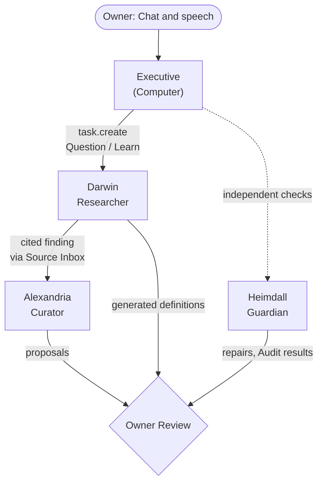

# Agents

An **Agent** Article names one accountable executor: its role, assigned Tasks,
scoped Knowledge and Memory. Each named Agent has one identity Article (its
Brain). A conversational Agent carries its standing instructions in that
identity and declares its available Skills directly.

| Field (under `obsidience`) | Meaning |
| --- | --- |
| `role` | The durable role: `executive`, `curator`, `researcher`, `guardian`. |
| `tasks` | Assigned, independently queueable Tasks. |
| `skills` | The conversational Skill catalog (direct Skills). Each Skill binds one Tool. |
| `knowledge`, `exclude_knowledge` | Knowledge checkouts that scope context. They grant nothing. |
| `model`, `reasoning_effort` | The Agent's model and effort; `auto` resolves to the installation default. |
| `required_context` | Articles that must be checked out and current, or activation fails. |
| `auto_curate` | Owner-authored Auto-curate permission for the Agent's branch. |

There is no Agent Tool list or Runbook list. A personal name (the Executive's
default is *Computer*, which is also the wake word) is identity data only and
creates no other Agent.

## The four core roles

**Executive** (root Agent). Interprets the owner's request, operates through
its direct Skills, delegates separately queueable work and returns verified
results. Chat and final speech transcripts enter its one Google ADK
conversation; its identity Article owns its standing instructions, Skills,
model and reasoning effort. There is no Executive Task, standing Runbook,
router or preliminary classification call. It looks up missing public facts
itself with `web.search` and `web.fetch`.

**Darwin** (Researcher). Question, Learn and Generate. Gathers current
external evidence from direct sources, preserves it as Source and hands off one
bounded, cited finding into the physical Source Inbox. When an assigned Task
lacks an applicable Runbook, Darwin's Generate path proposes one with the
minimal required Skills, which then waits for Review. Darwin never edits
maintained Knowledge directly.

**Alexandria** (Curator). Ingest, Curate, Merge, Link, Improve and Archive.
Turns research handoffs into coherent, current, linked Knowledge, preserving
Sources, provenance and meaningful relationships, and prefers an honest
no-change result over filler. See [Knowledge](knowledge.md#maintenance).

**Heimdall** (Guardian). Audit, Repair and Model. Inspects execution health,
definitions and capability wiring; performs receipt-safe recovery when status
degrades; characterizes local models; and evaluates instruction corrections
through Audit. Definition, wiring and code changes still go through Review. See
[Self-improvement](../modules/harness/self-improvement.md).

The specialists orbit the Executive as satellites in the graph. Each Agent has
its own Hindsight memory bank; owner inspection grants no Agent cross-bank
access. See [Memory](../memory.md).

## Optional integration Agents

Optional integrations use the same identity, direct Skills, Knowledge checkout
and separate Memory contracts. The starter Vault includes the **Obsidience
Discord Bot** (role `OmniBot`), which converses in its own admitted Discord
conversations, shares the execution and model owners with the Executive and
keeps its own history, Skills, scoped Knowledge and Hindsight bank. Discord
members are external speakers and never inherit workstation-owner authority.

## Starter Vault Agents

<!-- catalogue:agents -->

Skills and Knowledge columns show Article names; Tool contracts are listed on
[Tools](tools.md). The optional `session.unlock` Tool and Skill are documented
in the library but not granted to the starter Executive; granting them is a
local owner's choice.
