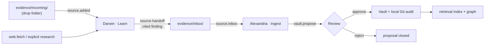

# Knowledge

A **Knowledge** Article states useful context: facts, constraints,
explanations, indexes and domains. It is the default Article type. Knowledge
follows Karpathy's
[LLM-wiki pattern](https://gist.github.com/karpathy/442a6bf555914893e9891c11519de94f):
immutable raw Sources, an agent-maintained Markdown wiki and its schema are
ordinary files. Authored folder-index Articles are the summaries; there is no
automatic recursive summarization.

Knowledge informs; it never grants. Retrieval may put a Knowledge Article in an
Agent's context, but no link, similarity or Knowledge checkout can select a
Task or grant a Tool.

## Subjects in the starter Vault

The starter graph ships the project's own architecture and empty world
subjects for a new owner to fill:

| Subject | Contents |
| --- | --- |
| `Architecture/` | Shared design: the four [Modules](../modules/index.md), with `Harness/` and `Shell/` implementation Articles. The [Ontology](../ontology/index.md) lives here as `Architecture/Harness/action-ontology`. |
| `Agents/Executive/Preferences/` | Owner preferences. Empty in a fresh installation. |
| `Games/`, `Projects/`, `Websites/`, `News & Research/` | World subjects, initially just their folder Articles. |
| `Media/` | Media knowledge, including the Discord Agent's playback leaf. |

Placement rules: established preferences belong under the Executive;
workstation procedures belong under `Runbooks/Operations` with explicit Skill
dependencies; implementation explanations and dated incident evidence belong
in `Architecture/Shell`; project knowledge belongs in `Projects`. The `System`
namespace is reserved for the deterministic inventory publisher (below).

## How Knowledge enters the Vault

Agents never edit accepted Knowledge directly. New evidence arrives as an
immutable Source, is researched by Darwin, handed off through the physical
Inbox, integrated by Alexandria and accepted through Review.

- **Intake.** Finished UTF-8 files in `obsidience/evidence/incoming/` enter
  through filesystem events plus startup reconciliation (no polling; partial,
  hidden, binary, symlinked and oversized files are excluded; originals stay).
  A new durable Source emits `source.added`, which activates Darwin's Learn.
- **Research.** Darwin fully reads the Source, researches from primary sources
  and hands off one cited finding with `source.handoff` into
  `obsidience/evidence/inbox/`. Darwin owns research accuracy.
- **Integration.** `source.inbox` has one subscriber, Alexandria's Ingest,
  which turns the finding into the smallest coherent set of Article creates or
  updates with complete bodies. Alexandria owns integration.
- **Missing knowledge.** A small model must not guess around a gap. The
  Executive looks up public facts itself with `web.search` and `web.fetch`;
  separately queueable research is delegated as one bounded Question or Learn.

## Maintenance

Alexandria's maintenance Tasks keep the wiki current. Each is a separate Task
with its own Runbook (see [Tasks](tasks.md)):

| Task | Does |
| --- | --- |
| **Ingest** | Integrates one Source Inbox handoff. |
| **Curate** | Runs one bounded inspection and may activate exact Merge or Link Tasks; or reviews one changed Hindsight mental-model page and stages at most three recommendations. |
| **Merge** | Consolidates one exact duplicate set, staging one canonical update before any archive and redirecting every inbound reference. |
| **Link** | Adds one meaningful relationship as a first-class Link review, with the exact wikilink, line and endpoint revisions. |
| **Improve** | Edits, categorizes, expands, retitles and splits. |
| **Archive** | Handles one deprecated or evidenced superseded Article, keeping content, Sources and history under `_archived/`. |

## Review

Review is the publication boundary for accepted Knowledge.

- One unresolved proposal per Article, pinned to its base revision; stale or
  overlapping proposals fail closed.
- Approval is atomic. A failed response is reconciled by reading, never by
  replaying the decision.
- The Harness decides whether a proposal is a Link or an Article change; the
  model and the UI never guess it.
- Approved changes commit to the Vault's own local Git repository (with no
  remote) when `git_commit` is on; SQLite remains the Review authority even
  without Git audit.
- Deterministically validated routine maintenance may auto-accept. Conflicts,
  destructive lifecycle changes, authority changes and high-risk effects always
  need Review.

**Auto-curate** is one owner-authored `auto_curate` boolean, inherited from the
nearest explicit ancestor. It is permission, not truth: only scoped
create/update Knowledge proposals may auto-approve. Identity, capability,
authority, archives, conflicts, broken links, stale bases and memory-derived
changes always keep Review. The starter Vault ships with Auto-curate off.

## Retrieval and the Thinking Packet

Conversation and Tasks share one activation compiler. Each activation gives
the model one visible **Thinking Packet**, each Article once, in order: the
Agent identity; the Task and its acceptance (Tasks only); the immutable
Objective; Tool Articles; paired Skills; applicable Runbooks (Tasks only);
bindings and exclusions, including the newest Shell Scene; up to five Knowledge
Articles; and the projected conversation history.

Knowledge comes from weighted reciprocal-rank fusion of a lexical and a dense
lane over one accepted snapshot, with the Agent's Knowledge scope applied
before each top-K. Staged, archived, temporary, expired, deprecated and
`retrieval: false` Articles never enter. Hits are leads, not authority. The
graph's thinking animation lights exactly this packet; see
[Graph UI](../modules/shell/graph-ui.md).

## System inventory

The `System` namespace is published by deterministic code (no model, Task or
Review) at startup and on Refresh System: Compute, Devices, Drives, Network and
one leaf per application, each citing its observed evidence. A failed collector
keeps the last good Article and reports degraded coverage. Previous evidence is
not proof of current state; current device claims require fresh observation.
