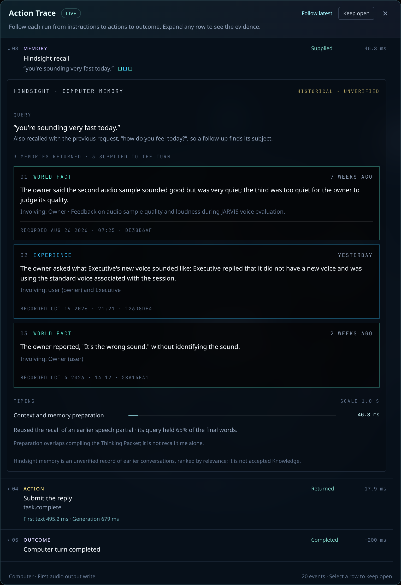
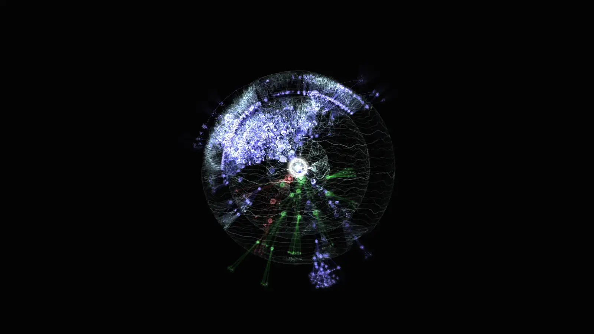

<div class="demo-hero" data-demo-hero>
<div class="demo-hero-frame">
<iframe src="demo/?embed=1" title="Live Obsidience graph demo: the real graph UI on the project's own starter Vault, code graph and repository history" allow="fullscreen"></iframe>
<button type="button" class="demo-hero-close" aria-label="Close the floating graph" title="Close" hidden>×</button>
</div>
</div>

# Obsidience

**A graph-native, local-first agent harness and Linux desktop shell.**

<p class="demo-hint">The graph above is live: the real graph UI, running in your
browser on Obsidience's own starter Vault, code graph and commit history. Drag to
orbit, hold Ctrl and scroll to zoom, click a node, or switch to Memory and Code.
<a href="live-demo/">About the demo</a> · <a href="demo/">Full screen</a></p>

Obsidience runs an Executive Agent on your own machine and gives it a maintained
Markdown wiki instead of a pile of prompts. Every Article is a node in one
knowledge graph. Agents, Tasks, Runbooks, Skills and Tools are Articles too, and
explicit dependencies, never similarity, decide what an Agent may run. Chat and
speech enter the same native Executive loop; specialist Agents curate, research
and verify; Hindsight keeps per-Agent memory; and a Hyprland + Quickshell shell
puts it all on the desktop as live 3D graphs that show exactly which Articles
and memories the Agents were given.

This site is the manual. The [README on GitHub](https://github.com/Resource-Hacker/obsidience#readme)
is the short landing page.

!!! warning "A development project"
    Obsidience is a development project, not a universal desktop installer. Its
    native shell, session, model and device scripts are Linux integration
    profiles that must be reviewed and configured for the target host. Read
    [Requirements](getting-started/requirements.md) before installing.

## What you are looking at

The demo's tour loops through three moments. **Thinking:** the Executive answers
a question about its own voice pipeline; a thin pilot light runs the route and
the main beam follows it to each Article in its Thinking Packet, while the
Action Trace lists the packet, the Hindsight recall (unfolded into memory cards)
and the Tool call. **Recall:** Hindsight lights exactly the memories it returned
on the memory timeline. **Code:** a coding agent's code-graph lookup lights the
matching files and symbols, with a card in the graph labels' style.

The clips below are recorded from the real graph UI on a working installation,
with its own graph settings: a real voice turn, its memory recall and a code lookup.

### Knowledge graph


A pilot light runs the route and the beam follows it to each Article in the
Thinking Packet; the Action Trace follows the turn step by step.

### Memory graph




A recall lights exactly the memories the provider returned, and the Action Trace
opens into a card per memory with its type, age and recorded date.

### Code graph



A coding agent's lookup lights the matched files and symbols, with a card showing
the query, the symbols, their paths and the call's duration.

## Voice

<video controls preload="none" poster="media/voice-demo.png" width="760">
  <source src="media/voice-demo.mp4" type="video/mp4">
  <a href="media/voice-demo.mp4">Play the voice demo</a>
</video>

The Executive explaining its own architecture (52 s, sound on). The graph is the
starter Vault with its Architecture route lit, and the central orb follows the
speech. The demo uses Pocket TTS's stock *alba* voice (Alba MacKenna,
[CC BY 4.0](https://huggingface.co/kyutai/tts-voices)); an installation selects
its own voice, which must be one it has the right to use.

Fast voice agents do not wait for silence and then run the whole pipeline from
zero; they predict the end of the turn and start early:

```text
microphone (hardware echo cancellation)
  → wake word: CPU spotter, ready chirp within ~0.2 s of "Computer"
  → Nemotron streaming recognition: partials, an early final at the first pause
  → end of turn: Silero VAD + Smart Turn, then the Executive's own verdict,
    speculated at pauses together with its first response and memory recall
  → Executive ADK loop on the local model
  → Pocket TTS, sentence by sentence → speaker (ducks when you talk over it)
```

See [Realtime voice](modules/harness/voice.md) for how the speech path works.

## Highlights

- **Executive voice and chat.** Typed Chat and final speech transcripts enter
  one Google ADK conversation for the Executive. Its identity Article owns its
  instructions and its direct Skill catalog; there is no router or preliminary
  model call.
- **A knowledge graph you review.** Immutable Sources, an agent-maintained
  Markdown wiki and its schema are plain files. Agents stage proposals;
  accepted changes land through Review and a local Git audit trail, then flow
  into retrieval and the graph.
- **Specialist Agents.** Darwin researches and hands off cited Sources,
  Alexandria curates and links Articles, Heimdall checks evidence and performs
  receipt-safe recovery. They orbit the Executive in the graph.
- **Hindsight memory.** Optional per-Agent memory banks hold facts, experiences
  and consolidated observations with original dates, separate from accepted
  knowledge.
- **Code graph.** An optional view over codebase-memory-mcp's index of a
  repository; coding-agent lookups light the exact files and symbols involved.
- **A real desktop shell.** Hyprland owns composition and input; one Quickshell
  host serves panes across Surfaces, and a QtWebEngine stage renders the graphs.
- **Explicit ownership.** Explicit service contracts, declared dependencies,
  cleanup paired with acquisition and one owner per store, conversation,
  scheduler and model reservation. Knowledge links never grant a capability.

## At a glance

```text
Chat / speech → Executive identity + context → ADK model / Tool loop
Specialist work → Task → Runbook → Skill → Tool
Explicit research / Source intake → immutable Source → Darwin → Inbox → Alexandria
Accepted Article changes → Review / local audit → graph + retrieval
```

Knowledge links never grant a capability. Tool arguments, exact targets,
observation leases, cancellation, Review, receipts and completion acceptance
remain code-owned, and uncertain effects are never replayed.

## Built on

Obsidience composes maintained upstream projects, each behind one adapter that
owns it: Google ADK for the model and Tool loop, Hindsight for memory, the Open
Knowledge Format for Article files, llama.cpp for local models, Pipecat, NeMo,
Pocket TTS and microWakeWord for speech, codebase-memory-mcp for the code graph,
and Hyprland and Quickshell for the desktop. Pins, licenses and local patches
are recorded in `artifacts.lock.json`; [Integrations](integrations/index.md)
has one page per component.

## How the manual is organized

The navigation follows the project's own ontology
([Golden ontology](ontology/index.md)): Obsidience classifies a thing by what it
does.

| Section | What it covers |
| --- | --- |
| [Live demo](live-demo.md) | The interactive graph demo and where its data comes from |
| [Getting started](getting-started/requirements.md) | Host expectations, installation and the first run |
| [Configuration](configuration.md) | Every `obsidience.toml` key the code reads |
| [Ontology](ontology/index.md) | The six Article types, the non-Article identities and the Cordis principles |
| [Articles](articles/index.md) | One page per Article type, with the starter Vault's actual instances |
| [Sources and Capabilities](sources-and-capabilities.md) | The evidence layer and the code-owned Tool contracts, receipts and no-replay |
| [Memory](memory.md) | Hindsight banks per Agent: historical, unverified, separate from Knowledge |
| [Modules](modules/index.md) | Harness, Shell, Media and TV, the four product components |
| [Integrations](integrations/index.md) | The adopted upstream components and how they are wired in |
| [Development](development.md) | The development loop, validation policy and checks |
