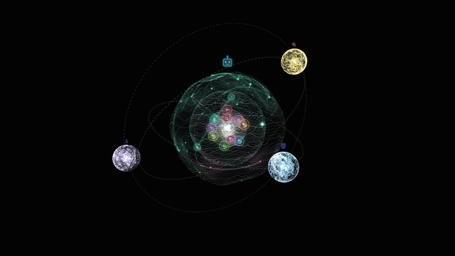
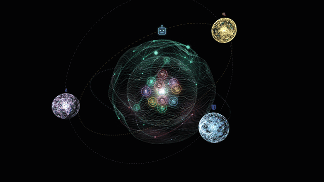
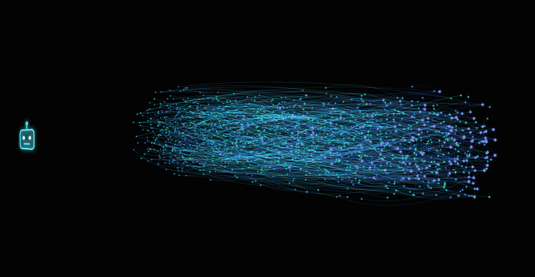
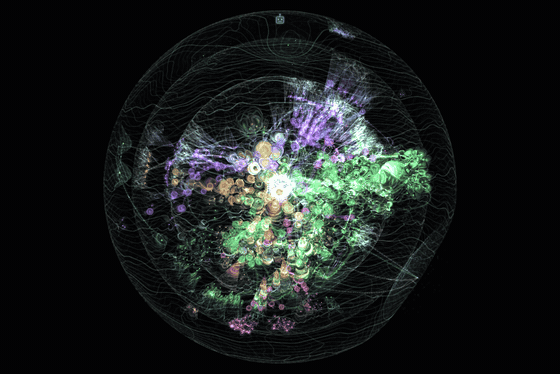
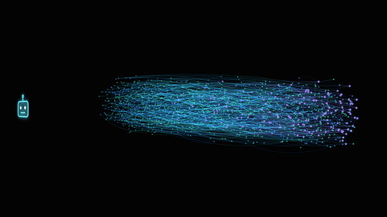

# Obsidience

**A graph-native, local-first agent harness and Linux desktop shell.**

<div class="hero" markdown>
{ width="760" }
</div>

Obsidience runs an Executive Agent on your own machine and gives it a maintained
Markdown wiki instead of a pile of prompts. Every Article is a node in one
knowledge graph. Agents, Tasks, Runbooks, Skills and Tools are Articles too, and
explicit dependencies, never similarity, decide what an Agent may run. Chat and
speech enter the same native Executive loop; specialist Agents curate, research
and verify; Hindsight keeps per-Agent memory; and a Hyprland + Quickshell shell
puts it all on the desktop as live 3D graphs that show exactly which Articles
and memories the Agents were given.

This site is the manual. The [README on GitHub](https://github.com/Resource-Hacker/obsidience#readme)
is the short landing page.

!!! warning "A development project"
    Obsidience is a development project, not a universal desktop installer. Its
    native shell, session, model and device scripts are Linux integration
    profiles that must be reviewed and configured for the target host. Read
    [Requirements](getting-started/requirements.md) before installing.

## What you are looking at

These clips are recorded from the real graph UI (the same React/Three.js bundle
the shell runs), fed from the public starter Vault, the code index of this
repository and a set of invented demo memories. The rotating clips are
time-lapsed.

<div class="clips" markdown>
<div class="clip" markdown>


**Thinking.** When the Executive answers, the Articles in its context packet
light up along the route from the Agent to each supplied Article.
</div>
<div class="clip" markdown>


**Recall.** A Hindsight recall lights exactly the memories the provider
returned. Nothing glows that the provider did not return.
</div>
<div class="clip" markdown>


**Code.** This repository as indexed by codebase-memory-mcp: folders, files,
classes and functions, with calls and imports as cross-links.
</div>
<div class="clip" markdown>


**Memory.** An Agent's Hindsight bank as a timeline tube, oldest to newest,
colored by memory type.
</div>
</div>

## Voice

<video controls preload="none" poster="media/voice-demo.png" width="760">
  <source src="media/voice-demo.mp4" type="video/mp4">
  <a href="media/voice-demo.mp4">Play the voice demo</a>
</video>

The Executive explaining its own architecture (52 s, sound on). The graph is the
starter Vault with its Architecture route lit, and the central orb follows the
speech. The demo uses Pocket TTS's stock *alba* voice (Alba MacKenna,
[CC BY 4.0](https://huggingface.co/kyutai/tts-voices)); an installation selects
its own voice, which must be one it has the right to use. See
[Realtime voice](modules/harness/voice.md) for how the speech path works.

## How the manual is organized

The navigation follows the project's own ontology
([Golden ontology](ontology/index.md)): Obsidience classifies a thing by what it
does.

| Section | What it covers |
| --- | --- |
| [Getting started](getting-started/requirements.md) | Host expectations, installation and the first run |
| [Configuration](configuration.md) | Every `obsidience.toml` key the code reads |
| [Ontology](ontology/index.md) | The six Article types, the non-Article identities and the Cordis principles |
| [Articles](articles/index.md) | One page per Article type, with the starter Vault's actual instances |
| [Sources and Capabilities](sources-and-capabilities.md) | The evidence layer and the code-owned Tool contracts, receipts and no-replay |
| [Memory](memory.md) | Hindsight banks per Agent: historical, unverified, separate from Knowledge |
| [Modules](modules/index.md) | Harness, Shell, Media and TV, the four product components |
| [Integrations](integrations/index.md) | The adopted upstream components and how they are wired in |
| [Development](development.md) | The development loop, validation policy and checks |

## At a glance

```text
Chat / speech → Executive identity + context → ADK model / Tool loop
Specialist work → Task → Runbook → Skill → Tool
Explicit research / Source intake → immutable Source → Darwin → Inbox → Alexandria
Accepted Article changes → Review / local audit → graph + retrieval
```

Knowledge links never grant a capability. Tool arguments, exact targets,
observation leases, cancellation, Review, receipts and completion acceptance
remain code-owned, and uncertain effects are never replayed.
