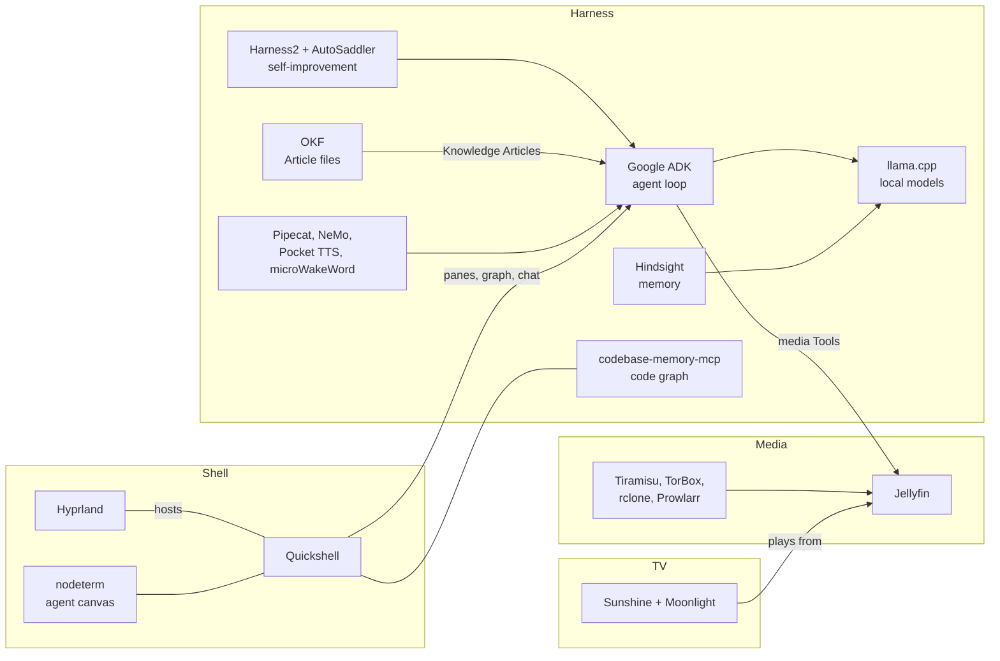

## Built on

Obsidience composes maintained upstream projects, each behind one adapter that
owns it. Pins, licenses and local patches are recorded in
[`artifacts.lock.json`](artifacts.lock.json); each integration has its own page
under [docs/integrations](docs/integrations/index.md).

| Component | Role | Upstream | License |
| --- | --- | --- | --- |
| Google ADK | Model/Tool loop of every Agent | [google/adk-python](https://github.com/google/adk-python) | Apache-2.0 |
| Harness2 | Instruction refinement search | [google-research/harness2](https://github.com/google-research/harness2) | Apache-2.0 |
| AutoSaddler | Durable candidates and trials | [microsoft/AutoSaddler](https://github.com/microsoft/AutoSaddler) | MIT |
| Hindsight | Per-Agent historical memory | [vectorize-io/hindsight](https://github.com/vectorize-io/hindsight) | MIT |
| Open Knowledge Format | Article file format | [GoogleCloudPlatform/open-knowledge-format](https://github.com/GoogleCloudPlatform/open-knowledge-format) | Apache-2.0 |
| llama.cpp | Local model and embedding server | [ggml-org/llama.cpp](https://github.com/ggml-org/llama.cpp) | MIT |
| Pipecat | Speech pipeline and local audio | [pipecat-ai/pipecat](https://github.com/pipecat-ai/pipecat) | BSD-2-Clause |
| NVIDIA NeMo | Streaming speech recognition | [NVIDIA-NeMo/Speech](https://github.com/NVIDIA-NeMo/Speech) | Apache-2.0 |
| Pocket TTS | Speech synthesis | [kyutai-labs/pocket-tts](https://github.com/kyutai-labs/pocket-tts) | MIT |
| microWakeWord | Wake-word spotting | [OHF-Voice/pymicro-wakeword](https://github.com/OHF-Voice/pymicro-wakeword) | Apache-2.0 |
| codebase-memory-mcp | Code graph and agents' code index | [DeusData/codebase-memory-mcp](https://github.com/DeusData/codebase-memory-mcp) | MIT |
| nodeterm | Agent canvas in the Terminal pane | [eneskirca/nodeterm](https://github.com/eneskirca/nodeterm) | BUSL-1.1 |
| Hyprland | Wayland compositor (patched package) | [hyprwm/Hyprland](https://github.com/hyprwm/Hyprland) | BSD-3-Clause |
| Quickshell | Shell runtime and secure lock (patched) | [quickshell](https://git.outfoxxed.me/quickshell/quickshell) | LGPL-3.0-only |
| SearXNG | Local metasearch for web search | [searxng/searxng](https://github.com/searxng/searxng) | AGPL-3.0-or-later |
| Jellyfin | Media catalogue | [jellyfin/jellyfin](https://github.com/jellyfin/jellyfin) | GPL-2.0 |
| Sunshine | TV session streaming | [LizardByte/Sunshine](https://github.com/LizardByte/Sunshine) | GPL-3.0-only |
