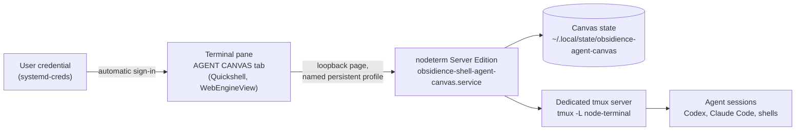

# Agent canvas

The Terminal pane's **AGENT CANVAS** tab is a canvas of live coding-agent
sessions served by [nodeterm](https://github.com/eneskirca/nodeterm). Obsidience
runs the unmodified Server Edition as an optional local provider and only
presents its page.

| | |
| --- | --- |
| Upstream | [eneskirca/nodeterm](https://github.com/eneskirca/nodeterm) |
| Pinned | 0.4.0, revision `17ee12adaa6b` |
| License | [BUSL-1.1](https://github.com/eneskirca/nodeterm/blob/main/LICENSE); personal, non-hosted use under its Additional Use Grant |
| Local build deviation | The server bundle marks ssh2's optional `cpu-features` native module external (ssh2 loads it inside `try`/`catch`) |
| Upstream checked 2026-10-19 | v0.4.4 (2026-10-17), patch releases ahead |

## Why nodeterm

It already provides what the pane needed: a spatial canvas of terminal nodes,
agent sessions that survive restarts in their own tmux server, and a web UI that
the Shell can embed. No nodeterm code is copied into Obsidience.

## Flow

- nodeterm owns its canvas state, its password login and its dedicated tmux
  server. Stopping the service stops only its Node process
  (`KillMode=process`), so agent sessions survive restarts.
- The login stays enabled because it blocks DNS rebinding against the loopback
  port; the pane signs in automatically from a user-scoped encrypted
  credential, so the owner never sees a password.
- The pane is created on first use and then kept, so switching tabs never
  reloads it; if the provider is absent it degrades to a reconnect control.

## Boundary

| File | Owns |
| --- | --- |
| `shell/systemd/obsidience-shell-agent-canvas.service` | The provider process: loopback host and port, data directory, restart and kill policy; part of the Shell session target |
| `shell/qml/panes/terminal/TerminalPane.qml` | Presentation: the WebEngineView, origin pinning, automatic sign-in, reconnect control |

The service runs from an immutable install generation under
`~/.local/opt/obsidience-agent-canvas/current`.

## Configuration

| Setting | Where | Value |
| --- | --- | --- |
| `NODETERM_HOST`, `NODETERM_PORT` | The unit | `127.0.0.1`, `8770` |
| `NODETERM_DATA_DIR` | The unit | `~/.local/state/obsidience-agent-canvas` |
| Sign-in credential | `~/.config/credentials/obsidience-agent-canvas-password.cred` (name `password`) | Seeded at install, never shown |

Upgrade by building a new generation from a pinned upstream revision and
retargeting `current`; record the revision in `artifacts.lock.json`.
