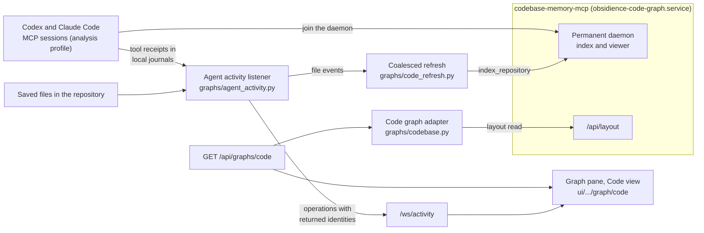

# Code graph

The graph pane's **Code** view shows this repository as a rotating sphere of
files and symbols, lit as coding agents search and read it. The index behind
it is [codebase-memory-mcp](https://github.com/DeusData/codebase-memory-mcp),
the same MCP server that Codex and Claude Code sessions use to understand the
codebase.

| | |
| --- | --- |
| Upstream | [DeusData/codebase-memory-mcp](https://github.com/DeusData/codebase-memory-mcp) |
| Pinned | 0.10.8, installed unmodified |
| License | MIT |
| Upstream checked 2026-10-19 | v0.12.1 (2026-10-16), two minor releases ahead |

## Why codebase-memory-mcp

It already builds a code knowledge graph with a native 3D layout endpoint and
serves it to agents over MCP. Obsidience shows that one index instead of
building a second parser, graph store or layout: agents and the owner look at
the same graph, and every lookup an agent makes lights the nodes it returned.

## Flow



- The **service** keeps the provider's permanent daemon and graph viewer
  running. It starts before restored agent sessions, because a daemon spawned by
  an agent's MCP session stops with its last session. Agent sessions join it with
  the read-only analysis tool profile; nothing else starts a second owner.
- The **adapter** reads the native layout, maps stable qualified names to compact
  display identities, and adds bounded in-repository SHA-256 fingerprints of
  each symbol's saved source span (never source text) so the view can tell which
  symbols changed.
- The **refresh** coalesces saved-file events for 750 ms into one native
  `index_repository` pass; a failed refresh shows the snapshot as stale.
- The **activity listener** turns new tool calls in the local Codex and Claude
  Code journals into fixed operation labels and the identities they returned,
  without reasoning, arguments, source or command output.

## Boundary

| File | Owns |
| --- | --- |
| `harness/graphs/codebase.py` | The one connection to the provider: URL and project settings, the layout client, refresh and activity lifecycles, the display projection |
| `harness/graphs/code_refresh.py` | Coalesced saved-file index refreshes through the provider's CLI |
| `harness/graphs/agent_activity.py` | Display-only agent tool receipts and repository file events |
| `harness/interfaces/api/routes/graphs.py` | HTTP serialization of the projection |
| `harness/systemd/obsidience-code-graph.service` | The provider daemon and viewer |
| `ui/src/renderer/src/graph/code/` | The Code view's renderer (spherical layout shared with Knowledge) |

The derived index stays outside the Vault and Source; no index artifact enters
the repository.

## Configuration

Optional keys in `obsidience/obsidience.toml`:

```toml
[graphs]
codebase_url = "http://127.0.0.1:9749"   # the provider's viewer
codebase_project = "home-user-Projects-obsidience"   # default: repository path with "/" replaced by "-"
```

The view reports unavailable while the provider is absent and never polls.
