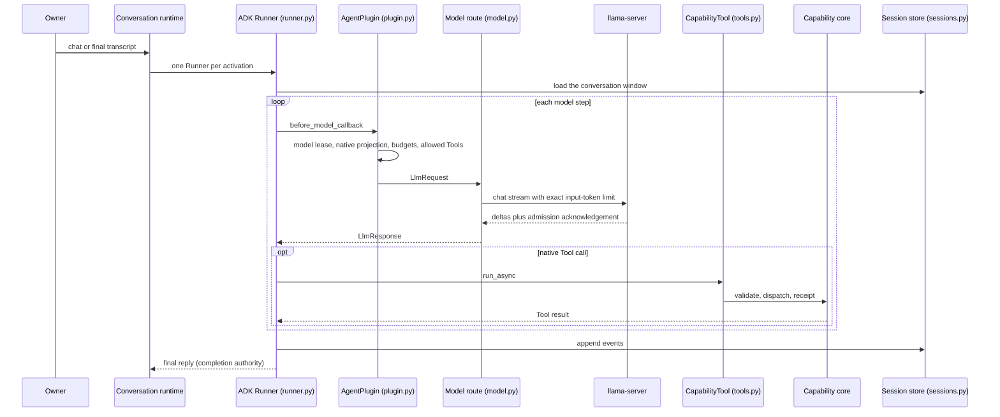

# Google ADK

Every Obsidience Agent, the conversational Executive and each specialist Task,
runs on one model/Tool loop: Google's
[Agent Development Kit for Python](https://github.com/google/adk-python).

| | |
| --- | --- |
| Upstream | [google/adk-python](https://github.com/google/adk-python), docs at [google.github.io/adk-docs](https://google.github.io/adk-docs/) |
| Pinned | `google-adk` 2.11.0 (hash-pinned wheel) |
| License | Apache-2.0 |
| Companions | `google-genai` 2.29.0 (Content/Part types only, no Gemini client), `aiosqlite` 0.22.1 (session store backend), `litellm` 1.101.0 (rollback model route only) |
| Upstream checked 2026-10-19 | ADK v2.12.0 (2026-10-13); google-genai v2.31.0; LiteLLM v1.106.0 |

## Why ADK

Obsidience adopted ADK on 2026-10-09 to replace two home-grown loops with one
maintained framework: one per concern, through its supported extension points.
ADK owns the model/Tool loop, the conversation log and Tool sequencing.
Obsidience keeps everything that makes an effect safe: argument validation,
receipts, no replay of uncertain effects, target verification, observation
witnesses, the model lease, cancellation and the completion authority.

ADK's memory, artifact, A2A, Gemini and event-compaction services are not used.
The conversation window and Hindsight recall bound the prompt instead.

## How a turn runs

## Boundary

| File | Owns |
| --- | --- |
| `execution/adk/runner.py` | One ADK `Runner` per activation; HassIL commands without a model; continuation only for owner clarifications or controller feedback; foreground cancellation of unfinished inference |
| `execution/adk/plugin.py` | One `BasePlugin` per activation with the loop policy: model lease per step, native projection of `LlmRequest` contents, budgets, owner steering, argument validation with three strikes, narrowing dispatch, finite-choice lane, early speech, plain-text completion |
| `execution/adk/tools.py` | One `BaseTool` per granted capability; `run_async` is one call of the shared capability core |
| `execution/adk/model.py` | The model route, the only importer of LiteLLM: `route` (local streaming `BaseLlm` by default, ADK's `LiteLlm` as rollback), `engine_guard`, `admitted_input_tokens`, `owned` (a caller-closed stream for speech admission), LiteLLM's lifecycle |
| `execution/adk/sessions.py` | The Executive conversation log: one `SqliteSessionService` file; specialist Tasks and evaluation trials use an in-memory session for their run |
| `execution/capability_core.py` | Receipts, uncertain-effect rules, completion authority, observation witnesses |

Consumers outside the package use these contracts: the conversation runtime
and speech admission (`execution/speech_admission.py`, first-step admission
of a spoken turn) call the route and the session store; instruction
optimization runs trials through `run_adk_session`.

## What Obsidience adds

- **Local model route.** `LocalLlm` sends the same request ADK's `LiteLlm` route
  sends for an `LlmRequest` and yields the same partial and final responses, at
  about a quarter of LiteLLM's CPU per step. It fails closed on a stream
  without a finish reason, never retries, and drops the connection as soon as
  ADK closes its generator.
- **Exact input-token admission.** Every model step carries an exact
  `input_token_limit`; the server must acknowledge it in response headers or the
  step fails closed. The admitted count is recorded with the step's metrics.
- **Native Tool schemas.** Code-owned capability definitions are advertised as
  native function declarations; Tool and Skill Articles explain them but impose
  no second call format.
- **Specialist Task policy.** A Task step advertises only the Tools its
  controller state allows, requires a Tool call, refuses a third identical call
  before dispatch, and only `task.complete` finishes.

## Configuration

| Key (`obsidience/obsidience.toml`) | Default | Effect |
| --- | --- | --- |
| `adk_model_client` | `"local"` | `"litellm"` restores ADK's `LiteLlm` route (same requests, more CPU) |
| `llm_model` | `"obsidience-gemma"` | Served model id |
| `llm_temperature` | `0.4` | Sampling temperature of every route |

`LITELLM_LOCAL_MODEL_COST_MAP=True` is set before LiteLLM can load, so it never
fetches a remote cost map; its debug output and telemetry are off.

Restart only the Harness after changing this loop. Module documentation:
[`execution/adk/README.md`](https://github.com/Resource-Hacker/obsidience/blob/main/obsidience/harness/execution/adk/README.md).
