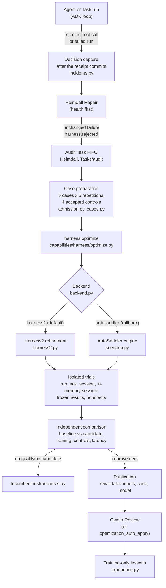

# Harness2 and AutoSaddler

Obsidience improves the instructions of its own Agents and Runbooks from real
failures. A rejected Tool call or a failed run becomes a frozen evaluation case;
Heimdall's Audit Task searches for a better instruction body with
[Harness2](https://github.com/google-research/harness2), trials every candidate
in an isolated copy of the real model/Tool loop, and publishes only a measured,
independently compared improvement, normally through owner Review.

| | Harness2 | AutoSaddler V2 |
| --- | --- | --- |
| Upstream | [google-research/harness2](https://github.com/google-research/harness2) | [microsoft/AutoSaddler](https://github.com/microsoft/AutoSaddler) |
| Pinned | `1cfe254e8d25` (packaged as `0.1.0+obsidience.1`) | `6a2b7a9ab241` (0.2.0) |
| License | Apache-2.0 | MIT |
| Role | Default refinement search (Propose, Probe, Compose) | Immutable candidates, causal lineage, durable attempt journal, isolated evaluator; explicit rollback search backend |
| Upstream checked 2026-10-19 | Pin is the current head (last commit 2026-10-14) | Head `e841543` (2026-09-25) |

## Why these two

- **Harness2** contributes a published search method for improving an agent's
  harness: propose a general and a task-specific change, probe each on training
  cases, and compose the two. Obsidience uses its recursion, prompt and tree
  functions as a library.
- **AutoSaddler V2** contributes the artifact discipline that makes such a search
  safe to resume: immutable candidates with parent lineage, a durable attempt
  journal that keeps completed trials across an interruption, and a split
  between the engine and the scenario that evaluates candidates.

Neither project's own executors, provider caches, scheduler, grader or mutable
experience library is used. Obsidience keeps one model owner, one scheduler,
one writer and Review. The [Harness2 integration notes](../harness2.md) record
the reviewed upstream issues and pull requests that shaped those choices.

## The pipeline



1. **Capture.** After a Tool receipt commits, the capability core records a
   bounded, receipt-attested decision capture (`execution/optimization/incidents.py`).
   Visual prompts, partial transcripts, leases and live context never qualify.
2. **Repair first.** Health findings go to Heimdall Repair. A rejection that is
   unchanged after Repair enters the Audit queue once (`harness.rejected`),
   behind foreground work.
3. **Cases.** The Audit Task prepares five distinct cases with five repetitions
   each; automatic suites pair the rejection with four accepted controls from
   other runs. Cases are private evaluation Sources that freeze the model,
   backend, dependency Articles, implementation revision and prior lessons.
4. **Search.** `harness.optimize` runs the selected backend. Candidates may only
   replace or add one whole paragraph or list item in the bound Agent identity or
   Runbook body; links, metadata, grants, model settings and code are out of
   scope.
5. **Trials.** Every trial runs the real ADK loop through `run_adk_session` in an
   isolated in-memory session with no memory recall or writeback. Each Tool call
   is answered from frozen results or by the contract validator; nothing is
   dispatched and no receipt is written.
6. **Acceptance.** Harness2's preference for a candidate is not acceptance. The
   final candidate is measured again against the baseline: it must pass every
   training trial (at least four of which the baseline failed), must not regress
   the controls, must stay within the Tool-count and, for the Executive, latency
   bounds. Missing evidence and execution errors cannot become success.
7. **Publication.** Publication revalidates the case inputs, code revision, model
   and returned receipt, then stages the new body for owner Review. The
   owner-set `optimization_auto_apply` on the Audit Task (default off) may publish
   instruction bodies directly; metadata, grants, model configuration and code
   always keep Review. Lessons from a validated publication become bounded,
   training-only optimizer evidence for later cases.

## Boundary

The package `obsidience/harness/execution/optimization/` is the only code that
imports either engine.

| File | Owns |
| --- | --- |
| `execution/optimization/backend.py` | Backend selection (`OBSIDIENCE_OPTIMIZER_BACKEND`) and the installed-source contract: the AutoSaddler revision and the Harness2 build manifest are verified before any run |
| `execution/optimization/harness2.py` | Harness2 refinement over the AutoSaddler artifact layer |
| `execution/optimization/scenario.py` | AutoSaddler V2 scenario ports: trials, evaluator, acceptance policy, reserved-model proposer, the original search backend |
| `execution/optimization/admission.py` | Incident admission, case preparation, the optimize run, publication |
| `execution/optimization/incidents.py` | Receipt-bound decision captures and contract evaluation |
| `execution/optimization/evaluation.py`, `cases.py`, `store.py` | Frozen trials, paired per-case acceptance, frozen Runbook cases, the immutable artifact store |
| `execution/optimization/experience.py` | Training-only lessons |
| `models/cloud.py` | Codex and Claude Code CLI sessions for a cloud Audit model (discovery, one structured tool-less session, the dedicated Codex home) |
| `execution/revision.py` | The source files whose bytes identify the evaluating and optimizing code; a change invalidates prepared cases |
| `capabilities/harness/optimize.py` | The `harness.optimize` Tool |
| `scripts/install-optimization` | Builds the attested Harness2 wheel from the pinned archive and installs both engines |
| `scripts/patches/harness2/0001-embedded-python314.patch` | The local patch |
| `harness/requirements-optimization.txt` | The dependency lock for both engines |

The ADK package (`execution/adk/`) does not import either engine; the
optimization package consumes it only through `run_adk_session`.

## What Obsidience adds or patches

- One local Harness2 patch: admits Python 3.14, adds source provenance to the
  wheel and disables implicit working-directory `.env` loading. The refinement
  implementation is unchanged.
- A reserved-model proposer that uses the existing model owner, isolated ADK
  trials and the independent acceptance gate described above. When the Audit
  Task selects a Codex or Claude Code session model, the same structured
  sessions run through that signed-in CLI without tools (`models/cloud.py`);
  trials keep the affected Agent's model. See the
  [integration notes](../harness2.md#cloud-proposer-sessions-codex-claude-code).
- Content-bound job and attempt records instead of upstream provider caches, so
  a resumed search cannot pick up a changed model, case or experience input.

## Configuration

| Key | Where | Default | Effect |
| --- | --- | --- | --- |
| `OBSIDIENCE_OPTIMIZER_BACKEND` | Harness environment | `harness2` | `autosaddler` selects the retained original engine; changing it invalidates prepared cases |
| `optimization_auto_apply` | `Tasks/audit` Article (owner) | off | Publish qualifying instruction bodies without Review |

Install or rebuild the engines from the repository root:

```sh
python3 obsidience/scripts/install-optimization            # build and install
python3 obsidience/scripts/install-optimization --build-only
```

See the [Harness2 integration notes](../harness2.md) for the retained behaviour,
rollback and the upstream research table.
