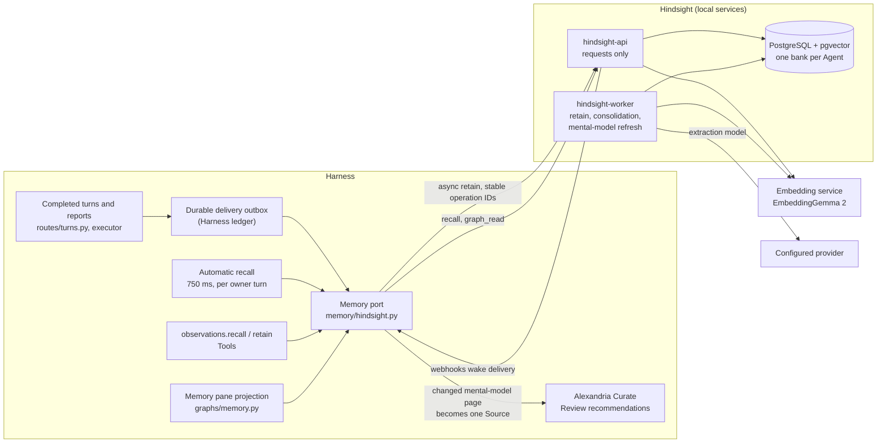

# Hindsight

Each Obsidience Agent has its own historical memory bank in a local
[Hindsight](https://github.com/vectorize-io/hindsight) server. Hindsight
extracts facts, experiences and observations from completed conversations and
reports, consolidates them, keeps entities and original dates, and answers
bounded recall. Its memories are historical and unverified: they inform the
model, but accepted Knowledge stays in Articles and changes only through Review.

| | |
| --- | --- |
| Upstream | [vectorize-io/hindsight](https://github.com/vectorize-io/hindsight) |
| Pinned | `hindsight-api-slim[local-onnx]==0.10.3` (hash-pinned wheel, isolated environment) with twelve local patches |
| License | MIT |
| Companions | [FlashRank](https://github.com/PrithivirajDamodaran/FlashRank) 0.2.10 (Apache-2.0) CPU reranker; PostgreSQL 18 with pgvector 0.8.6; the shared EmbeddingGemma 2 embedding service (see [llama.cpp](llama-cpp.md)) |
| Upstream checked 2026-10-19 | v1.0.0 (2026-10-13), a major release. It includes an API fix that refuses tag-scoped callers on bank-wide operations, Codex stream error handling and a mental-model edit race fix. Upgrading means rebasing the local patches; patch 0012 is already a backport of upstream #5747 |

## Why Hindsight

Obsidience needed long-lived memory that is separate from accepted Knowledge,
attributed to who reported it, dated by when it happened and searchable inside
a voice turn's latency budget. Hindsight provides native extraction,
consolidation, temporal and entity links, mental models and a graph API, as a
separate local service with its own store. Obsidience adds no second memory
owner and no second wiki.

## Flow

- **Delivery.** Accepted public conversation turns and completed specialist
  reports enter a durable outbox in the Harness ledger. Stable operation and
  document IDs make acceptance idempotent; a row becomes `accepted` only when
  Hindsight acknowledges the exact operation, and `extracted` only when the
  native batch and every child completed without extraction errors.
- **Recall.** The Executive loop takes one bounded automatic recall per owner
  turn (750 ms deadline, two concurrent queries, at most three memories). The
  explicit `observations.recall` Tool allows six seconds. Neither calls
  generative Reflect, and memory is never treated as current screen evidence.
- **Mental models.** The Executive bank keeps three native mental models (owner
  preferences and permissions, workstation changes, recent decisions). A changed
  page becomes one attested Source and one Curate occurrence for Alexandria,
  which stages at most three recommendations for owner Review.
- **Dedicated worker.** The API process serves requests only; upstream's
  `hindsight-worker` runs retain, consolidation and refresh in its own process,
  so background model work cannot stall voice-time recall. One SIGTERM drains it
  (patch 0012).
- **Memory pane.** The graph pane's Memory view reads each bank's native graph
  through the port's `graph_read`; `graphs/memory.py` projects it with delta
  cursors. No raw memory node enters the accepted Article graph.

## Boundary

| File | Owns |
| --- | --- |
| `harness/memory/hindsight.py` | The port: delivery outbox, recall, mental-model handoff, webhooks, health, the async API client and the synchronous graph client; the only reader of `hindsight_url` and the Hindsight credential |
| `harness/memory/README.md` | Deployment, provider configuration, recovery and rollback |
| `harness/memory/requirements.txt` | The isolated server environment |
| `scripts/patches/hindsight/` | Patches 0001 to 0012 with a README; each is recorded with preimage and installed hashes in the lock |
| `harness/graphs/memory.py` | The Memory pane and Discord projection of a bank graph |
| `harness/interfaces/api/routes/turns.py` | `POST /api/turns/complete` intake for external completed turns |
| `harness/interfaces/api/routes/memory.py` | Status and the optional private local-model port for Hindsight |
| `harness/capabilities/observations/` | The `observations.recall` and `observations.retain` Tools |

Other Harness modules use the port's public object (`MEMORY`) and functions,
never Hindsight's HTTP API.

## What Obsidience patches

The twelve patches keep upstream behaviour and storage formats and address
specific measured problems: graph rendering off the event loop, bounded and
cancellable CPU reranking, OpenRouter quota resets, the owner's local day for
parsed dates, combined-scope observation updates, speaker perspective in
extraction, fact text before provenance in reranker input, calendar-date
reranker queries, month-only date ranges, Codex stream volume accounting, the
semantic arm's similarity floor outside its ANN limit (index use instead of an
exact scan) and a graceful single-SIGTERM worker stop. Each patch's purpose and
hashes are in `artifacts.lock.json`.

## Configuration

| Key | Where | Effect |
| --- | --- | --- |
| `[memory] hindsight_url` | `obsidience/obsidience.toml` | Enables the port (for example `http://127.0.0.1:8790`); leave unset until the service is configured |
| Hindsight environment | private `state/hindsight.env` | Database DSN, extraction provider, embeddings, reranker and worker settings; see the module README |
| `memory_writeback` | per conversation turn | `false` withholds a diagnostic turn from memory before it runs |

Missing provider configuration fails startup rather than falling back silently.
Module documentation:
[`memory/README.md`](https://github.com/Resource-Hacker/obsidience/blob/main/obsidience/harness/memory/README.md).
