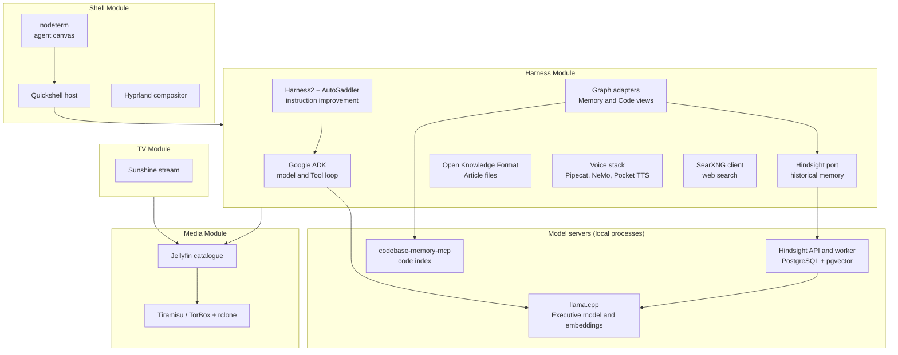

# Integrations

Obsidience is built from maintained upstream projects wherever one does the job
well. Each adopted project sits behind **one adapter that owns it**: one module
holds the connection, the lifecycle and the configuration, and the rest of
Obsidience talks to that adapter rather than to the upstream project. This
follows the Cordis principles in the
[Golden ontology](https://github.com/Resource-Hacker/obsidience/blob/main/obsidience/defaults/vault/Architecture/Harness/action-ontology.md):
explicit contracts, cleanup paired with acquisition, one owner per concern, and
the best available component recorded with its pin and license.

Every adopted component is recorded in
[`artifacts.lock.json`](https://github.com/Resource-Hacker/obsidience/blob/main/artifacts.lock.json)
with its repository, pinned version or revision, license, local patches (with
preimage and result hashes where Obsidience patches installed files) and a
one-paragraph description of how it is integrated. The pages below explain
each integration in prose; the lock file is the authoritative record.

## Where each integration sits

The product's Modules are its physical components: the **Harness** (agent
runtime and API), the **Shell** (desktop session and panes), **Media** (catalogue
and acquisition) and the **TV** (a separate streaming session). Integrations
plug into one Module each.

## Pages

| Integration | Upstream | Role in Obsidience |
| --- | --- | --- |
| [Harness2 and AutoSaddler](harness2.md) | Google Research, Microsoft | Improves Agent and Runbook instructions from real failures (incident, Audit, trials, Review) |
| [Google ADK](google-adk.md) | Google | The one model/Tool loop for the Executive and every specialist Task |
| [Hindsight](hindsight.md) | Vectorize | Per-Agent historical memory with recall, consolidation and mental models |
| [Open Knowledge Format](okf.md) | Google Cloud | The file format of every Article |
| [llama.cpp](llama-cpp.md) | ggml-org | Local model server for the Executive and the shared embedding model |
| [Voice stack](voice-stack.md) | Pipecat, NVIDIA NeMo, Kyutai, microWakeWord | Wake word, speech recognition, turn-taking and speech synthesis |
| [Code graph](code-graph.md) | codebase-memory-mcp | The Code view of the graph pane and the agents' code index |
| [Agent canvas](agent-canvas.md) | nodeterm | The Terminal pane's canvas of agent sessions |
| [Media](media.md) | Jellyfin, Tiramisu, rclone, Prowlarr, TorBox | Optional media catalogue and acquisition |

Smaller dependencies (Markdown parsing, HTML extraction, JSON Schema
validation, SQLite, NVML, the 3D force layout and the desktop plumbing such as
Hyprland, Quickshell, UWSM, Sunshine and Snapcast) are recorded in the lock
file with their integration notes.

## Upstream status (checked 2026-10-19)

Pins are deliberate: each was measured on the installation before it was
selected. The table compares them with the upstream projects on the date
above so that upgrades can be planned; "behind" is not by itself a defect.

| Component | Pinned | Upstream latest | Note |
| --- | --- | --- | --- |
| Google ADK | 2.11.0 | v2.12.0 (2026-10-13) | Minor release behind |
| LiteLLM (ADK rollback route only) | 1.101.0 | v1.106.0 (2026-10-18) | Critical advisory GHSA-7hp6-4w63-5g45 affects LiteLLM's Proxy server (fixed in 1.101.3); Obsidience imports only the SDK and only when `adk_model_client = "litellm"`. Upgrade recommended |
| Hindsight | 0.10.3 | v1.0.0 (2026-10-13) | Major release behind; 1.0 includes an API access-control fix for tag-scoped callers and Codex stream fixes. Twelve local patches must be rebased |
| Pipecat | 0.0.98 (2025-12-17) | v1.13.0 (2026-10-19) | Far behind. Its published advisories concern the development runner, telephony WebSocket and LiveKit serializer, none of which Obsidience runs (local audio transport only) |
| NVIDIA NeMo Speech | b17490a (2026-08-26) | v3.0.0 / main | Local patch to rebase on upgrade |
| Pocket TTS | 9aa7a7f (3.3.0+) | same commit | Current |
| llama.cpp | b11509 (1167d3f, 2026-10-08) | 241 commits newer on master | Local tensor-split and slot series; rebuild needed to move |
| codebase-memory-mcp | 0.10.8 | v0.12.1 (2026-10-16) | Two minor releases behind |
| nodeterm | 0.4.0 | v0.4.4 (2026-10-17) | Patch releases behind |
| Harness2 | 1cfe254 | same commit (2026-10-14) | Current |
| AutoSaddler | 6a2b7a9 (0.2.0, 2026-09-13) | e841543 (2026-09-25) | A few commits behind |
| Jellyfin | 12.2.0 | v12.2 | Current; includes the 12.0 security fixes |
| Tiramisu | 1.11.4 (patched) | v1.11.8 (2026-10-17) | Local socket patch to rebase |
| SearXNG | 2026.10.7 image | rolling | Pinned by image digest |
