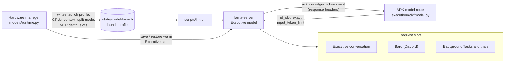

# llama.cpp

All local inference runs on [llama.cpp](https://github.com/ggml-org/llama.cpp)'s
`llama-server`: the Executive model that every Agent shares, and the one
resident embedding model used by the Knowledge index and Hindsight.

| | |
| --- | --- |
| Upstream | [ggml-org/llama.cpp](https://github.com/ggml-org/llama.cpp) |
| Pinned | Build b11509, revision `1167d3f42c2b` (2026-10-08), in three local builds (below) |
| License | MIT |
| Companions | `llama-fit-params` from revision `b21e4de` for memory estimates; `nvidia-ml-py` 13.610.43 (BSD-3-Clause) for free-VRAM accounting; the EmbeddingGemma 2 text GGUF (Apache-2.0) |
| Upstream checked 2026-10-19 | 241 commits newer on master; moving requires rebasing the local series below |

## Why llama.cpp

It serves quantized GGUF models on the workstation's own GPUs or CPU with an
OpenAI-compatible API, speculative decoding, several request slots, saved slot
state and an extensible server. Obsidience keeps the model local, measures
every change on the real hardware, and patches the server only where a
measured gap required it.

## The builds

| Lock entry | Used by | Adds to b11509 |
| --- | --- | --- |
| `llama_cpp_executive_admission` | Embedding service (`scripts/embed.sh`) | Exact input-token admission |
| `llama_cpp_executive_g4grammar` | Rollback for the Executive | Admission plus decoder-enforced Gemma 4 Tool-argument grammar |
| `llama_cpp_executive_tp9` | Executive (`scripts/llm.sh`) | Both of the above plus a local series for tensor split, MTP drafting, slot and checkpoint handling and upstream backports |

Tracked patches live in `obsidience/scripts/patches/`
(`llama-cpp-exact-input-admission-b11509.patch`,
`llama-cpp-gemma4-tool-argument-grammar-b11509.patch`, and
`gemma4-template-linear-scans.patch` for the installed chat template). The
tensor-split series is kept with the local engine sources and summarised in
the lock entry.

## How the Executive server is used

- **Tensor split.** The launch profile chooses one GPU or an even split across
  the model GPUs, in llama.cpp's `layer` or `tensor` mode. Tensor mode adds a
  hybrid all-reduce and per-backend KV views from the local series.
- **MTP drafting.** When the profile names a multi-token-prediction head, the
  server drafts that many tokens per step (`--spec-type draft-mtp`) and verifies
  them with the target model; outputs are identical to plain decoding.
- **Slots.** The Harness pins the Executive conversation, Bard (the Discord
  Agent) and background work to their own slot (`id_slot`), so an Audit trial no longer
  evicts the conversation's cached prefix. Idle slots are not copied to host
  memory, and the warm Executive slot is saved and restored across a server
  restart instead of a cold prefill.
- **Admission guard.** Each request carries the exact `input_token_limit`; the
  server refuses longer input before queueing and acknowledges the admitted
  count in `X-LLAMA-Input-Token-Limit` and `X-LLAMA-Input-Tokens`. The model
  route fails closed without that acknowledgement.

## Boundary

| File | Owns |
| --- | --- |
| `scripts/llm.sh` | The Executive server launch from the launch profile |
| `scripts/embed.sh`, `harness/systemd/obsidience-embeddings.service` | The CPU-only embedding server (`/v1/embeddings`) |
| `harness/models/runtime.py` | The one model owner: residency, launch profiles, health, slot pins (`slot_fields`), warm-slot save and restore, NVML accounting |
| `harness/models/vram_plan.py` | Memory estimates (`llama-fit-params`) |
| `harness/models/llm.py`, `harness/models/context.py` | The API-lifetime HTTP client and token accounting |
| `harness/execution/adk/model.py` | The ADK model route and the admission guard |

## Configuration

| Key | Where | Effect |
| --- | --- | --- |
| `llm_model` | `obsidience/obsidience.toml` | Served model id (default `obsidience-gemma`) |
| Launch profile (`gpu_uuids`, `context_tokens`, `max_num_seqs`, `split_mode`, `mtp_path`, `mtp_tokens`, `projector_path`, `chat_template_path`) | Written by the hardware manager | The exact server launch; the Hardware pane changes it, never a hand edit of live state |
| `OBSIDIENCE_MODEL`, `OBSIDIENCE_EMBED_MODEL` | Service environment | Override the model file paths |

Both servers listen on loopback only and require the model service key for
inference; health stays public.
