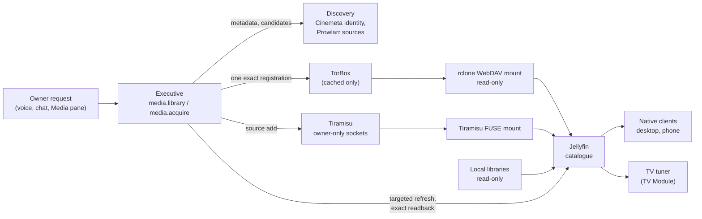

# Media

Obsidience Media is an optional, independent media server and catalogue.
Jellyfin owns the catalogue, client delivery and per-user resume; Obsidience
adds discovery, explicit acquisition, a native Media pane and ordinary
capability receipts. The television is one optional client. Media bytes never
pass through the model or the Harness, and the integration defaults disabled.

| Component | Upstream | Pinned | License | Role |
| --- | --- | --- | --- | --- |
| Jellyfin | [jellyfin/jellyfin](https://github.com/jellyfin/jellyfin) | 12.2.0 (`ca0f16eb7c19`), official image by digest | GPL-2.0 | Catalogue, native clients, resume, native live TV |
| Tiramisu | [MrRobotoGit/tiramisu](https://github.com/MrRobotoGit/tiramisu) | 1.11.4 (`1d761b88b9cd`) plus one local patch | GPL-3.0 | Virtual-file (FUSE) provider and source-search bridge |
| rclone | [rclone/rclone](https://github.com/rclone/rclone) | 1.75.2 (distribution package) | MIT | Read-only WebDAV mount of TorBox's cached files |
| Prowlarr | [Prowlarr/Prowlarr](https://github.com/Prowlarr/Prowlarr) | 2.6.5.5623 (official release) | GPL-3.0 | Authenticated source discovery (indexers) only |
| TorBox | [torbox.app](https://torbox.app) (service) | API, no code | service terms | Cached-only debrid acquisition |

Upstream checked 2026-10-19: Jellyfin 12.2 is current and contains the security
fixes published with 12.0; rclone 1.75.2 and Prowlarr 2.6.5.5623 are the latest
releases; Tiramisu v1.11.8 (2026-10-17) is ahead of the patched 1.11.4.

## Why these components

Jellyfin is a mature, self-hosted catalogue with native clients on every device,
so the TV, desktop and phones play the same library without a custom player
protocol. Tiramisu, rclone and Prowlarr each fill one narrow role behind
authenticated loopback interfaces; none of their dashboards, schedulers or
automation stacks is enabled.

## Flow

- **Acquisition is explicit.** One owner request registers one exact, opaque
  candidate; registration reconciles existing account state first and never
  replays an uncertain request. TorBox acquisitions are cached-only; there is no
  fallback to uncached transfer or local BitTorrent.
- **Catalogue refresh is targeted.** Registration queues a refresh of the exact
  configured library and reads back the exact path; it never starts a
  whole-library scan.
- **Mount lifecycles are owned.** Each provider service drains its readers
  before an ordinary unmount; Jellyfin is bound to the mounts it reads.

## Boundary

| File | Owns |
| --- | --- |
| `obsidience/media/` | Units and helpers: `obsidience-media-jellyfin.container`, `-tiramisu`, `-torbox` and `-prowlarr` services, `torbox-mount`, `connect-torbox` (device login), `provider-launch`, the Tiramisu patch and the module README |
| `harness/media/service.py`, `config.py` | The API-lifetime catalogue client and the private configuration contract |
| `harness/media/jellyfin.py`, `progress.py` | Jellyfin REST reads, exact library refresh and resume reporting |
| `harness/media/tiramisu.py`, `torbox.py`, `torbox_files.py`, `discovery.py`, `sources.py` | Provider adapters and the local file admission contract |
| `harness/capabilities/media/` | The `media.library` and `media.acquire` Tools; they use only the adapters' public functions |
| `tv/host/tuner.py` | Playback on the TV destination (TV Module) |

## Configuration

The private `obsidience/state/media.json` (never committed) selects:

| Key | Content |
| --- | --- |
| `enabled` | Master switch (default false) |
| `catalogue` | `url`, `instance_id`, `user_id` and the encrypted `credential` name of one Jellyfin user |
| `roots` | Non-overlapping `id`, `path`, `catalogue_path` mappings; virtual roots add `mount_path`, optional `provider: torbox` and `library_name` |
| `acquisition`, `discovery`, `debrid`, `music` | Optional acquisition, source discovery, TorBox and music delivery settings |

No credential value belongs in this file, the repository, command arguments or
logs. Connect a TorBox account with `obsidience/media/connect-torbox` (the
provider's device login; the token is stored as a user-scoped encrypted
credential). Module documentation:
[`obsidience/media/README.md`](https://github.com/Resource-Hacker/obsidience/blob/main/obsidience/media/README.md).
