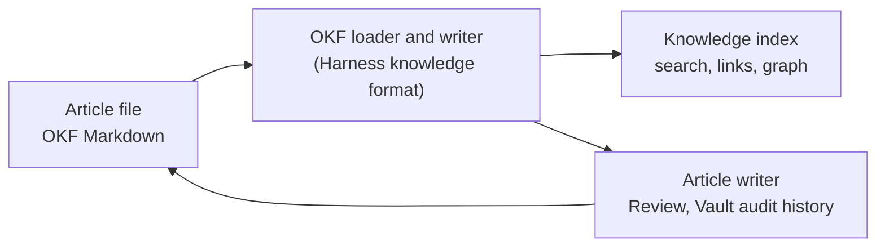

# Open Knowledge Format

Every Obsidience Article is one native
[Open Knowledge Format](https://github.com/GoogleCloudPlatform/open-knowledge-format)
(OKF) Markdown file: YAML framing with a required `type`, common document fields
at the root, and Obsidience bindings, triggers and permission metadata under an
`obsidience` key. OKF supplies the portable document contract only, not an
agent runtime.

| | |
| --- | --- |
| Upstream | [GoogleCloudPlatform/open-knowledge-format](https://github.com/GoogleCloudPlatform/open-knowledge-format) |
| Pinned | OKF 0.2, revision `ad30107c31c0` |
| License | Apache-2.0 (notice in `LICENSES/OpenKnowledgeFormat-Apache-2.0.txt`) |
| What is adapted | The small YAML framing and timestamp-preserving loader from the reference agent's `bundle/document.py`, with attribution |
| What is not used | The reference agent runtime, its ADK or Gemini services, or a second knowledge store |
| Upstream checked 2026-10-19 | The pin is the current head (last commit 2026-08-21) |

The format adapter is being separated into its own module; the
[document format page](../ontology/okf.md) describes the fields, types and
link rules in full, and the lock file entry `open_knowledge_format` records the
pin.
