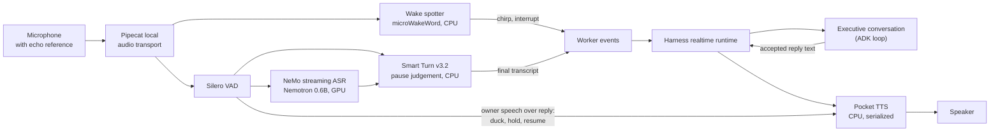

# Voice stack

Obsidience's voice is speech connection infrastructure, never a second agent:
final transcripts enter the same Executive conversation as Chat, and replies
are spoken from the same accepted text. The stack is assembled from upstream
speech components in one speech worker process.

| Component | Upstream | Pinned | License | Role |
| --- | --- | --- | --- | --- |
| Pipecat | [pipecat-ai/pipecat](https://github.com/pipecat-ai/pipecat) | 0.0.98 (`f9fef7807090`) | BSD-2-Clause | Typed streaming frames, local audio transport, VAD and interruption frames, pipeline lifecycle |
| Silero VAD | bundled with Pipecat ([snakers4/silero-vad](https://github.com/snakers4/silero-vad)) | as bundled | MIT | Voice activity onsets and pauses |
| Smart Turn v3.2 | [pipecat-ai/smart-turn-v3](https://huggingface.co/pipecat-ai/smart-turn-v3) | `f766f81d3cfd`, CPU ONNX | BSD-2-Clause | Judges whether a pause ends the turn |
| NeMo Voice Agent | [NVIDIA-NeMo/Speech](https://github.com/NVIDIA-NeMo/Speech) | `b17490a70570` plus one local patch | Apache-2.0 | Streaming ASR service and turn taking |
| Nemotron streaming ASR | [nvidia/nemotron-speech-streaming-en-0.6b](https://huggingface.co/nvidia/nemotron-speech-streaming-en-0.6b) | `ebe59e5a8171` | see model card | English recognition in 160 ms chunks on the reserved speech GPU |
| Pocket TTS | [kyutai-labs/pocket-tts](https://github.com/kyutai-labs/pocket-tts) | 3.3.0+9aa7a7f | MIT | 24 kHz streaming speech synthesis on CPU |
| pymicro-wakeword | [OHF-Voice/pymicro-wakeword](https://github.com/OHF-Voice/pymicro-wakeword) | 2.5.0 (with pymicro-features 2.0.2) | Apache-2.0 | Streaming microWakeWord runtime on CPU |
| Wake word model | trained with [kahrendt/microWakeWord](https://github.com/kahrendt/microWakeWord) | `4665173cd35f` | Training code Apache-2.0; the locally trained weights used CC-BY-NC-4.0 negative features, so personal non-commercial use | The "Computer" keyword spotter |

Upstream checked 2026-10-19: Pipecat v1.13.0 (2026-10-19) is far ahead of the
0.0.98 pin. Its published advisories concern the development runner, the
telephony WebSocket and the LiveKit serializer, none of which Obsidience runs;
an upgrade is still worth planning. NeMo Speech v3.0.0 and main are ahead of the
pin; Pocket TTS's pin is its current head.

## Why these components

Each piece is the best available local component for its stage, and Pipecat's
frame model lets them compose without custom audio plumbing: no browser audio,
audio WebSocket, custom capture or playback, or UI microphone. Everything runs on
the workstation with the network disabled at runtime.

## Pipeline

- **Wake.** A CPU keyword spotter hears "Computer" about 0.2 s after it is
  spoken and, at a segment start, chirps and interrupts before ASR text arrives;
  recognized text still opens the command window.
- **Recognition.** NeMo owns acoustic turns and interruptions. ASR skips GPU
  steps shortly after speech or the last recognized word and replays a 320 ms
  pre-roll at each onset, so continuous listening does not keep the GPU busy.
- **Endpointing.** Smart Turn judges each pause; short complete replies ("yes",
  "never mind") can end the turn at its verdict. A turn never ends on missing ASR
  words while VAD still hears speech.
- **Speaking.** Pocket TTS is serialized; cancellation stops the producer and
  drains cleanup, and a synthesis failure never erases the reply. Owner speech
  over a reply ducks it, holds it once speech continues and resumes it after a
  false alarm.

## Boundary

The speech worker runs in its own Python environment and process; the Harness
side talks to it through bounded JSON events.

| File | Owns |
| --- | --- |
| `harness/realtime/speech/worker.py` | The speech worker: Pipecat pipeline, NeMo ASR and turn taking, Silero VAD, the Smart Turn gate, Pocket TTS, echo reference |
| `harness/realtime/speech/wakeword.py` | The microWakeWord adapter |
| `harness/realtime/speech/cues.py` | Installation audio cues as Pipecat frames |
| `harness/realtime/speech/discord.py` | Discord voice members as a Pipecat input transport (shared models, per-member state) |
| `harness/realtime/speech/nemo-stt-playback.patch` | The local NeMo patch: blocking transcription off the audio loop, one lock for streaming cache, VAD reset and model replacement, cancellation that drains native work |
| `harness/requirements-speech.txt` | The worker environment |
| `harness/realtime/runtime.py`, `harness/realtime/devices.py` | The Harness side: worker lifecycle, modes (wake word, realtime, mute), device selection, events to the conversation |

Nothing outside `harness/realtime/speech/` imports Pipecat, NeMo, Pocket TTS or
the wake-word runtime.

## Configuration

Keys in `obsidience/obsidience.toml` (all optional):

| Key | Default | Effect |
| --- | --- | --- |
| `realtime_smart_turn` | `true` | `false` restores the fixed 700 ms pause |
| `realtime_smart_turn_model` | v3.2 | `"bundled"` selects Pipecat's bundled v3.1 |
| `realtime_short_replies` | `true` | Complete short replies end the turn at the model's verdict |
| `realtime_early_speech` | `true` | Speak claim-checked sentences before completion acceptance |
| `realtime_asr_silence_gate` | `true` | `false` runs ASR continuously |
| `realtime_wake_spotter` | `true` | `false` keeps ASR-only wake detection |
| `realtime_semantic_turns` | off | Contextual speech admission at speech pauses |
| `realtime_asr_early_final` | off | Decode the tail once more at a 200 ms pause |
| `realtime_barge_in_ducking` | `true` | `false` stops playback on speech onset instead |
| `realtime_tts_quantize` | off | Pocket TTS with dynamic int8 weights |

The model files, voices and their hashes are recorded in `artifacts.lock.json`.
