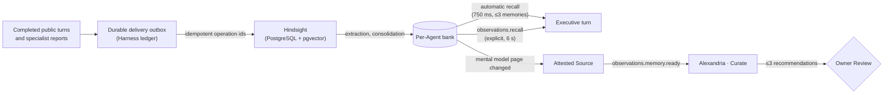

# Memory

Obsidience keeps four kinds of context with four different owners:

| Context | Owner | Status |
| --- | --- | --- |
| The active conversation | The ADK conversation log (`state/adk-sessions.sqlite3`) | Current dialogue |
| **Historical memory** | **Hindsight**, one bank per Agent | Historical, attributed, **unverified** |
| Accepted Knowledge | The Vault, through Review | Accepted |
| Current inventory | The System publisher | Observed evidence |

Memory is optional. It is provided by a local
[Hindsight](https://hindsight.vectorize.io/) service behind a native port
(`obsidience/harness/memory/hindsight.py`); see the
[Hindsight integration](integrations/hindsight.md) for how it is wired in.

## Banks per Agent

Each accepted Agent identity has its own Hindsight bank of native records:

- **world** facts about others and the environment;
- **experience** records of the bank Agent's own actions;
- **observations** that Hindsight consolidates from them, with entities,
  relationships, original dates and evidence.

These types are a perspective distinction, not a confidence rating. Memory is
history: it does not prove current screen or device state, grant permissions or
approve wiki changes. An Agent recalls only from its own bank; owner
inspection of every bank grants no Agent cross-bank access, and handoffs
supply only their exact evidence.

## Flow



- **Delivery.** Accepted conversation turns and completed specialist reports
  enter a durable outbox with stable operation ids, so upstream acceptance is
  idempotent. `accepted` (native acknowledgement) is distinct from `extracted`
  (the exact completed extraction with error-free children).
- **Automatic recall.** Each owner turn takes one bounded recall under a
  750 ms deadline: the request alone and, concurrently, the request joined with
  the one it follows. A failed query leaves the successful results with a
  compact `partial` notice; if both fail, the model receives an `unavailable`
  notice. Each memory shows its local recording time and age.
- **Explicit recall and notes.** `observations.recall` allows six seconds for a
  scoped query; `observations.retain` adds an unverified note to the Agent's own
  bank. Neither publishes Knowledge.
- **The conversation window.** The provider sees the conversation from an
  anchor that rebases at idle edges (normally beyond six exchanges or 4,000
  estimated tokens, down to the newest three within 2,000). Eligible exchanges
  wait for confirmed extraction before they leave the window, so recall can
  supply them later. There is no summary compaction.

## Mental models and curation

The Executive bank carries three native mental models: owner preferences and
standing permissions, workstation state changes, and recent decisions and
commitments. Hindsight regenerates them after consolidation. When a page's
content changes, it becomes one immutable Source and one
`observations.memory.ready` occurrence for Alexandria's Curate Task, which reads
the whole page, compares accepted Knowledge and stages at most three
recommendations, always through owner Review. Curation output never re-enters
Hindsight. `memory_summary = false` keeps the cached pages out of the prompt
while recall continues ([Configuration](configuration.md#conversation)).

## The Memory view

The Graph pane's Memory view shows one bank as a chronological timeline tube,
spaced by activity, colored by record type, with native relationships as
links. A recall lights exactly the returned memories. Time comes from
Hindsight's `mentioned_at`; import or consolidation time never substitutes. See
[Graph UI](modules/shell/graph-ui.md#memory-view).

## Setting up Hindsight

The full deployment contract is in the
[memory README](https://github.com/Resource-Hacker/obsidience/blob/main/obsidience/harness/memory/README.md).
In outline:

1. Run a **private PostgreSQL cluster** with pgvector as the owner: no TCP
   listener, an owner-only Unix socket directory, a dedicated database.
2. Run the pinned **Hindsight API** on loopback (the development installation
   uses port 8790) as a user service with a low CPU/IO weight. Reviewed native
   patches for the pinned version are in `obsidience/scripts/patches/hindsight/`.
3. Configure Hindsight's own extraction and consolidation provider. Missing
   provider configuration or credentials fail startup rather than silently
   selecting another model. An optional local-model route borrows only
   preemptible idle capacity from the Harness's resident model owner.
4. Use the shared CPU embedder (EmbeddingGemma 2) and a CPU reranker
   (FlashRank), which consume no GPU model allocation.
5. Enable the port in `obsidience/obsidience.toml` and restart only the idle
   Harness:

    ```toml
    [memory]
    hindsight_url = "http://127.0.0.1:8790"
    ```

6. Check `/api/memory/status`, an actual retained turn, the Memory view and the
   Executive's mental models. Service liveness alone is not acceptance.

### Dedicated worker option

Hindsight can run its background task queue in a dedicated `hindsight-worker`
process while the API serves requests only, with
`HINDSIGHT_API_WORKER_ENABLED=false` on the API service. The tracked patch `0012` backports an upstream fix so that worker
drains in-flight tasks on one SIGTERM instead of force-exiting, which lets
systemd stop it cleanly. An installation may also keep the API available with
the worker disabled after a one-off rebuild, until the owner selects the
ongoing provider.

### Disabling

Remove only the `[memory]` URL and restart the idle Harness. The database and
the outbox are preserved for re-enabling; do not delete memories to clear a
health warning. Disabling Hindsight does not enable another memory
implementation.

### Health

`/api/memory/status` reports provider, storage and operation failures
separately from content-free recall telemetry. Three recall failures among the
latest twenty in fifteen minutes mark the provider degraded through Heimdall's
ordinary status and Repair path. Failed upstream operations get one inspected
retry; uncertain retries are not repeated.
