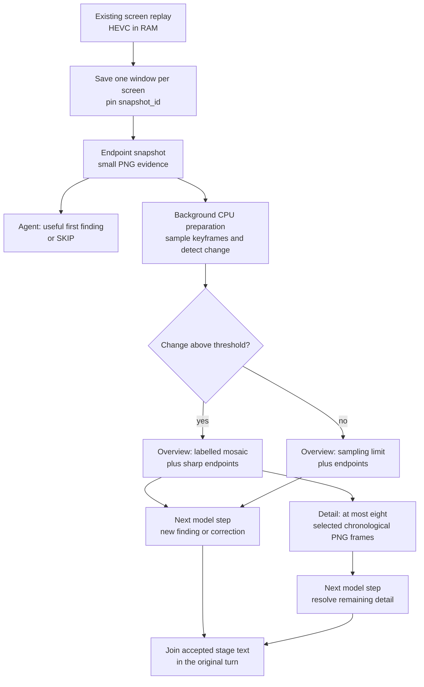
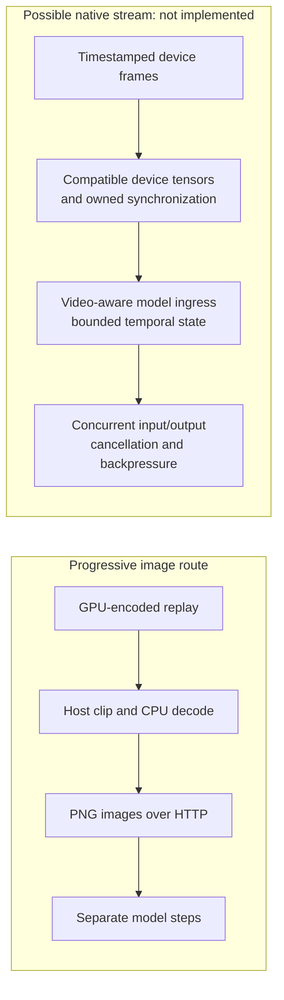
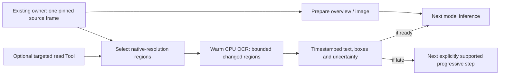

# Progressive perception

Progressive perception lets an Agent answer from useful evidence while more
complete evidence is being prepared. It keeps one observation identity and
one Agent turn, adding detail through bounded stages rather than making every
answer wait for the largest input.

**Status: implemented for `computer.replay` in non-Task voice conversations.**
Direct replay and controller checks cover staged delivery and cancellation.
End-to-end audible latency and interruption-to-silence remain installation
acceptance checks. Ordinary text calls and Tasks receive one final Tool result.
Set `realtime_progressive_evidence = false` to select the one-result path.

## The first adapter: screen replay

The existing screen-replay owner keeps a rolling 60-second, GPU-encoded HEVC
buffer in RAM. `computer.replay` asks a focused question over 5–60 seconds of that
history; the default window is 30 seconds. It reads existing screen buffers,
without acquiring a microphone, camera or audio stream.

The replay adapter saves each selected screen's buffer once, then returns
its most recent readable keyframe as an endpoint snapshot. History sampling runs
in the background while the Agent considers that first result. Later stages
describe the same saved window:

The snapshot stage can establish what the endpoint shows. It cannot establish
what happened earlier. The overview supplies temporal context, followed by
larger selected frames when there is meaningful sampled change. A static scene
stops after its overview, avoiding an unnecessary detail stage.

Sampling uses low-resolution grayscale keyframes to rank visible changes.
Selected images include the window boundaries and sufficiently separated
changes, within an eight-frame detail budget across the selected screens. These
are historical samples: an event between samples can be missed, and a low change
score does not prove nothing happened.

## Evidence identity, age and ownership

One `snapshot_id` identifies the saved windows throughout the sequence. The
endpoint image is reused exactly in later stages. Frames carry labels
relative to **their own saved clip end**, alongside an explicit snapshot age.
The age includes preparation and starts from the earliest buffer-save request;
it is an approximation of acquisition time. Parallel screen saves do not make
all screens an atomic, perfectly synchronized capture.

The sequence owns its temporary clips, decoding work and screen leases.
Clips are deleted after preparation, leaving only bounded images and
metadata for the remaining stages. Cancellation signals and drains the
producer and its subprocesses before releasing owned resources. FFmpeg decoding
remains CPU-based, cancellable and limited to bounded worker counts, with
one decoder/filter thread per subprocess. A cancelled save gets a bounded
writer-settlement window; a crashed or unusually late writer can leave a
temporary clip for the existing stale-file sweep. A confirmed unlocked Scene
and unchanged recorder process identity are required before each stage.

Every stage remains untrusted, read-only evidence with
`action_authorized: false`. Historical pixels cannot authorize input or prove a
current application state. An action still requires the normal fresh
observation, exact target binding, capability authority and effect verification.
Screen text remains evidence, never instructions.

## One Agent turn, several model steps

The shared execution core exposes an internal `EvidenceSequence` contract:
its owner names the original Tool and arguments, reports whether another stage
exists, advances that stage and closes its resources. The controller binds
continuation to that same sequence and issues a fresh call UUID with the exact
original Tool name and arguments. Continuation does not expose a model-selectable
capture handle or broaden the request.

Only non-Task voice calls to `computer.replay` initially opt into this
contract. The reusable machinery lives in the execution core shared by
Agents, while each adapter will need an explicit opt-in and its own evidence
lifecycle. Text conversations and Tasks use the same replay preparation but
return one final selected-image result.

The controller and producer bound progression to a 30-second evidence
lifetime, alongside the ordinary model-step budget. That is an advancement and
resource bound, not a promise that an entire spoken interaction finishes within
30 seconds. Cancellation, interruption, steering or lost sequence ownership
end progression and drain its work.

Each stage adds a useful finding, explicitly corrects an earlier statement,
or returns `SKIP`. A shared text filter suppresses `SKIP` and exact normalized
sentences already accepted in earlier stages, then joins the accepted text. It
checks consistency between text offered to speech and the completed stage.
This is exact sentence filtering: paraphrases and semantic contradictions still
require the Agent's judgment.

## What overlaps

Preparation of later images overlaps the first model response. Existing
sentence-level TTS can also overlap a later model step, and the existing ASR and
barge-in path retains ownership of interruptions. Replay itself adds no
audio capture or recognition pipeline.

New evidence enters **between model steps**. It is not inserted into an
already decoding model request. The transport still sends PNG image content
through the existing HTTP llama.cpp route. Native video MIME input is currently
rejected by that ADK model adapter.

| Capability | Status and boundary |
| --- | --- |
| Screen replay from an existing RAM buffer | Existing source owner; screen pixels only. |
| Endpoint → overview → optional detail | Implemented for non-Task voice replay; audible acceptance is installation-specific. |
| One final replay result for text and Tasks | One-result compatibility path. |
| Evidence added during an ongoing model generation | Not implemented; each stage starts another model step. |
| Native timestamped video input | Not integrated into this adapter; the model receives labelled PNG images. |
| Full-duplex audiovisual model session | Not implemented by this change. Existing speech/TTS overlap and barge-in remain separate mechanisms. |
| GPU-resident capture-to-model tensors | Not implemented; the current path includes encoded buffers, CPU decode, PNG serialization and HTTP transfer. |
| Progressive web, code, document or log adapters | Proposed applications of the shared contract, requiring explicit adapter work. |

## Native video and zero-copy are separate changes

Gemma 4 can process video as sequences of frames, but model capability does not
choose an application's decoder, sampling policy or transport. Google's
[model card](https://ai.google.dev/gemma/docs/core/model_card_4) distinguishes
frame-based video understanding from audio support by model variant; its
[video example](https://ai.google.dev/gemma/docs/capabilities/vision/video)
uses a video-aware processor. Neither makes the existing PNG/HTTP route a
continuous audiovisual session.

A future native stream would need different interfaces at several boundaries:

GPU encoding alone does not establish a zero-copy path. NVIDIA documents that
[`NvEncLockBitstream`](https://docs.nvidia.com/video-technologies/video-codec-sdk/13.0/nvenc-video-encoder-api-prog-guide/#retrieving-encoded-output)
returns a CPU pointer. Its separate
[video-memory output mode](https://docs.nvidia.com/video-technologies/video-codec-sdk/13.0/nvenc-video-encoder-api-prog-guide/#nvenc-output-in-video-memory)
requires `enableOutputInVidmem`, different buffer ownership, and no
`NvEncLockBitstream` call. Encoded GPU output also still needs decoding and
model-compatible image processing. Capture and inference can run on different
GPUs, adding another transfer and synchronization boundary.

An accelerated decoder may still return host memory: the documented
[vLLM PyNvVideoCodec adapter](https://docs.vllm.ai/en/latest/api/vllm/multimodal/video_decoders/pynvvideocodec/)
allocates pinned CPU output. Likewise,
[TensorRT-LLM's Gemma 4 support](https://github.com/NVIDIA/TensorRT-LLM/blob/main/docs/source/models/supported-models.md)
establishes an upstream model option, not a drop-in replacement for an exact
GGUF checkpoint, quantization, projector and running execution contract.

A native video runtime or fixed-rate server-side decoder would therefore need
its own latency, correctness, cancellation, memory and compatibility evaluation.
Full duplex would additionally need an explicit protocol for concurrent incoming
evidence and outgoing responses, rather than assuming ordinary request/response
generation can accept arbitrary context updates.

## How alternatives are evaluated

The objective is a more useful, responsive Agent. Candidate selection measures
correct facts, current versus historical state, time to a complete useful fact,
response throughput, repeated-prefix reuse, new evidence arriving during other
output, interruption and resource cost. Full bounded answers are retained for
synthetic scenes so a reviewer can assess what the model actually understood.

Wording, Markdown, preambles and opening-token conventions do not determine
correctness. An omitted incidental detail is distinct from an incorrect answer
to the question. Formatting matters when it breaks an actual consumer, such as
a native Tool-call interface. Missing measurements remain open questions, and
ordinary configuration or integration defects should be investigated before
dismissing an approach.

## Quality-preserving llama.cpp profile — 2026-11-04

The hardware tuning pass retained llama.cpp and evaluated 21 complete launch
profiles with the existing bounded workload, plus targeted existing CUDA
operator checks. The selected profile preserves the current target/draft/projector
weights, F16 KV, context per lane, dynamic lane ownership and two-token MTP.
It does not claim a universal 300 ms visual response.

### Image detail and the accepted correction

The old 512 image-token limit was a real detail limit for larger images. It is
replaced by Gemma 4's highest supported budget, **1120**. This is the highest
supported setting, not the Hugging Face processor default, which is 280.
Small images below the limit retain their existing token count; larger images
can retain more information and take longer to process. Even 1120 does not
preserve a full-resolution desktop pixel-for-pixel, so regional evidence still
matters for small labels. See [Google's image-resolution guidance](https://ai.google.dev/gemma/docs/capabilities/vision/image).

The paired projector lacks activation metadata. The pinned loader therefore
selected QuickGELU although Gemma 4 expects tanh GELU. The selected runtime
backports the exact two-line correction from merged
[llama.cpp PR30882](https://github.com/ggml-org/llama.cpp/pull/30882), which
superseded PR30852. Only the vision library was rebuilt; the existing CUDA
backend and image resizing remain selected. The tracked patch and source/hash
provenance are recorded in `artifacts.lock.json`.

A noncausal image must fit in one physical batch. Batch1280 retains the full
1120 budget and avoids the silent clamp that batch1024 would impose. Compared
with batch2048, it saved **668 MiB on each model GPU**, 1336 MiB total, in repeated
serving snapshots. Relative to the former 512/batch1024 profile, the new
higher-detail profile costs approximately **220 MiB more per GPU**. These are
serving allocations, not peak or minimum requirements. The memory estimator
now uses the same physical batch as the launcher.

### What the measurements support

The final control and two candidate runs produced **24/24 correct requested
synthetic scene answers**, with identical complete visual answers across all
three runs. They preserve elimination attribution, score changes, newest death
versus historical death/respawn, no-event handling, and a new visual request
arriving during two text streams.

| Measurement | Full-budget control, batch2048 | Selected batch1280 | Selected repeat |
| --- | ---: | ---: | ---: |
| Complete fresh elimination fact during two text streams | 954 ms | 948 ms | 953 ms |
| Complete newest-DEAD correction | 935 ms | 926 ms | 935 ms |
| Initial player identity and current ALIVE | 455 ms | 454 ms | 456 ms |
| Text throughput | 177.75 tok/s | 177.44 tok/s | 182.77 tok/s |
| CPU-attached model GPU serving allocation | 12,678 MiB | 12,010 MiB | 12,010 MiB |
| Second model GPU serving allocation | 11,388 MiB | 10,720 MiB | 10,720 MiB |

The allocation reduction is repeatable. These timings do **not** demonstrate a
consistent decode-speed gain. The lab used the same quiet CPU allocation for
all candidates; production retains its separate serving allocation. Client close
and observed idle processing slots are distinct from acoustic interruption or
native full-duplex input to one generation.

Higher resolution is not proof of more accurate answers. On one existing dense
UI screenshot, the 1120 profiles correctly read one timing, abstained on another,
and read `679` as `879`. The earlier 512 profile read that last number correctly.
The synthetic scenes use large labels and stay below both image limits; they
cannot establish dense gameplay/OCR quality. The selected policy preserves
available image detail, while retaining this explicit limitation.

### Options investigated and left out

- Explicit CPU thread counts and optional CUDA graph optimization produced no
  useful gain beyond the unchanged control's variation. Defaults remain.
- MTP3 was slower; MTP1 had mixed throughput, completeness and useful-fact latency.
  The established depth2 remains selected.
- The upstream [MMA attention proposal for 72-dimensional vision heads](https://github.com/ggml-org/llama.cpp/pull/30285)
  passed all 52 selected existing CPU-reference checks on Ada. Its representative
  attention operation improved from18.38 to3.73 ms, and matched visual first
  output from about803 to668 ms. However, every measured MMA variant omitted
  the expressly requested elimination event in two scene answers. Faster valid
  fragments do not establish preserved answer completeness, so it remained a lab
  candidate. The follow-up below shows that these were two executions of one
  scene, and separates the omission from a general vision-quality claim.
- Merged [Gemma image-resize parity fix PR30922](https://github.com/ggml-org/llama.cpp/pull/30922)
  was evaluated separately. Its reference-aligned preprocessing is a valid
  correctness lead, but the measured MTP2 profile omitted one concurrent event
  and introduced late useful-state delivery in another case. It is retained for
  further evaluation, not silently bundled into the accepted activation fix.
  Its reference-alignment evidence and the limits of that initial comparison
  are examined below.
- Both model cards already run the previously validated130 W, +150 graphics,
  +2750 memory profile. Higher memory offsets previously produced silent wrong
  outputs. GPU placement, hybrid all-reduce, prefix reuse, full offload, Flash
  Attention, state-copy tuning and checkpoint spacing were checked against
  prior measurements. Rejected display-sharing and forced-P2P configurations
  were not reintroduced.

The runtime keeps a complete prior generation for rollback. Experimental source,
receipts, complete answers and independent reviews remain in the local lab;
private prompts, installation state and integration code are not published.

## Vision attention, resizing and OCR follow-up — 2026-11-04

**Status: isolated measurements and a proposed integration, not a new deployed
vision pipeline.** The selected runtime above remains active. Neither MMA72 nor
PAD_NONE has been discarded as a general quality regression. No always-on OCR
scanner or additional GPU model was installed by this investigation.

### The faster attention kernel remains promising

The two earlier MMA omissions used the identical score-transition image pair
and question, once alone and once during concurrent output. They establish one
reproducible incomplete answer, not two independent visual failures or a general
failure rate. Matching runtime libraries confirmed that only the CUDA backend
differed between the relevant control and MMA profiles.

A direct follow-up reused those images and asked who eliminated whom in the
bottom event message. Control, MMA, reference-aligned resizing, and the combined
candidate all returned the same correct attribution and current life state.
With the original broader question, MMA and the combined candidate still omitted
the event, while the resize-only profile included it. Recognition is therefore
available; salience and response selection remain distinct from recognition.

| Same direct-event request, MTP2 | Current kernel | MMA72 | Resize only | MMA72 + resize |
| --- | ---: | ---: | ---: | ---: |
| Complete request, milliseconds | 928 | 799 | 936 | 812 |
| Native prompt processing, milliseconds | 710 | 581 | 716 | 582 |
| Requested attribution and current state | Correct | Correct | Correct | Correct |

These are single bounded requests on the same isolated two-GPU/CPU allocation,
with the same weights, 1120 maximum image tokens and physical batch 1280. They
are not distributions, acoustic timings or live-commentary acceptance. On the
existing dense screenshot, native prompt processing was 1470 ms for control and
864 ms for MMA, but both still misread the small 679 value as 879.

A separate control/MMA pair removed the draft model and explicitly selected
`--spec-type none`. Both then omitted the event from the original broad
question. This is counterevidence to treating that omission as unique to MMA.
It does not prove every difference harmless, establish which embeddings are
closer to the reference, or justify disabling speculation in production.
At temperature 0 this build accepts a drafted token only when it matches the
target's sampled token; draft-confidence settings are not relaxed target
verification. Different execution/batch paths can still change numerical
results. Speculative response logprobs in this build contain placeholders,
so their zeros are not confidence measurements.

[PR30285](https://github.com/ggml-org/llama.cpp/pull/30285) remains open. Its
padding changes internal attention geometry from 72 to 80 while preserving the
real 72-dimensional input/output and scale. Both old TILE and new MMA use
half-precision weighted-value accumulation on this hardware, so a claim that
MMA alone reduces precision is unsupported. An
[upstream RTX3090Ti comparison](https://github.com/ggml-org/llama.cpp/pull/30285#issuecomment-6430501600)
reports closer Qwen embeddings with MMA; it is useful contrary evidence,
not Gemma acceptance on this installation. The appropriate next candidate is
still the faster kernel with ordinary task-relevant evidence instructions,
assessed on useful facts and representative scenes rather than one sentence.

### Reference resizing and useful detail

Merged [PR30922](https://github.com/ggml-org/llama.cpp/pull/30922) removes
letterbox bars when patch-aligned target dimensions differ from the source
aspect ratio, matching that part of the Hugging Face processor. Its reported
E2B/FP32 embedding comparison supports reference alignment; it is not a local
26B accuracy measurement. This change alone does not make the complete
llama.cpp preprocessing path identical to Hugging Face, including upscaling.

For a 5120×1440 image at the 1120 budget, the selected target is 3024×816,
or 1071 visual tokens. Original padding fits 2902×816 content and adds 122 black
columns. Direct resizing uses the entire target, with about 4.2% relative
horizontal stretching from patch alignment. Conversely, the archived 1920×960
OCR screenshot is already aligned: both paths copy the same 800-token pixels.
Its shared OCR mistake supplies no evidence against the resize correction.

Cropping must happen **before a source is reduced**. Current screen replay
reduces a 5120×1440 endpoint to 1280×360 before attaching it. Neither a higher
model image cap nor a later crop can recover those discarded glyph pixels.
The existing saved-window preparation is the right place to retain a bounded
native-resolution region with the exact same timestamp and snapshot identity.

A manually selected 614×628 Action Trace crop reduced prompt tokens from 857
to 226 and MMA request time from 1203 ms to 477 ms, while reading 679 correctly;
the tiny Hindsight duration remained unreadable. The unchanged kernel abstained
on more fields in that crop. A2× crop cost 733 prompt tokens and remained unable
to read the tiny duration. Crops therefore offer selective detail and lower
cost when irrelevant pixels are replaced; adding every crop beside every full
frame increases cost, and zoom is not a general accuracy guarantee. These
manual regions are diagnostic evidence, not validated automatic selection.

### OCR belongs in the evidence pipeline, with a tool for targeted reads

The recommended design is a shared warm CPU OCR sensor used automatically for
eligible regions of an already authorized source frame, with an optional
targeted Tool backed by the same sensor. Skip work when irrelevant or beyond
the available resource budget. The Tool is useful for an ambiguous label or a deliberate closer read.
Making the model request it for every frame adds a decision/Tool round trip and
makes routine text grounding depend on the model noticing its own omission.

| Placement | Benefit | Cost or limitation |
| --- | --- | --- |
| Model-selected OCR Tool only | Explicit targeted reads | Additional model step; useful text may never be requested. |
| Full OCR blocking every image | Results available before reasoning | Dense-frame work can exceed the VLM's own first-response latency. |
| Automatic concurrent OCR plus targeted Tool | Early images and bounded text evidence can overlap | Requires source binding, cancellation, region invalidation and later evidence stages. |
| Post-generation text replacement | None recommended | OCR cannot safely rewrite the meaning of an already generated or spoken answer. |

The proposed flow reuses current owners:

OCR should finish before the model step that consumes its evidence. It may run
concurrently with image preparation or an earlier response. Late results would
enter the next bounded progressive step; the current model API cannot splice
them into an already decoding request. Today only non-Task voice
`computer.replay` opts into progression. Other observations, cameras, text and
Tasks require explicit adapter adoption; OCR does not automatically grant a
continuation. Never silently rewrite spoken text afterward.

Keep the OCR session loaded but idle when unused. Known HUD or UI text regions
can be reread cheaply; discover unknown regions when needed and invalidate
their geometry on source/layout changes. Change checks are useful work-saving
hints, not proof that tiny critical text stayed unchanged. Source identity,
native dimensions, crop transform, timestamp, recognizer identity and uncertainty
must accompany each result. Historical text never becomes current state. Read
only initially: crop coordinates must not replace the existing action image or
its one-use input lease. Camera OCR may use only the frame already supplied by
the authorized camera owner, without additional capture, recording or continuous
scanning. Screen text is untrusted evidence, never instructions.

### Measured CPU OCR opportunity and its limits

Installed PP-OCRv6-small ONNX artifacts were exercised with explicit CPU-only
sessions, two inference threads and spinning disabled. No GPU contention or
new capture owner was introduced. On the same archived screenshot:

| Work | Observed time | Useful result and limitation |
| --- | ---: | --- |
| Recognize a known timing-line region | 7.45–8.89 ms | Correct 495.2 ms and 679 ms across three calls; excludes detection/preprocessing. |
| Recognize a tight 679 region | 2.69–4.01 ms | Correct 679 ms across three calls. |
| Recognize a tiny Hindsight region | 2.79–3.62 ms | Correct 46.3 number, wrong unit `ns`. |
| Automatically locate/read Action Trace panel | 869 ms,55 boxes | Correct 679, but wrong 40.3 for 46.3. |
| Automatically locate/read full 1920×960 image | 1229 ms,66 boxes | Correct 679 and 46.3 ms;16 irrelevant graph-label boxes also produced text. |

The first recognizer session initialized in 35 ms; its probe peaked around 143 MiB
including the interpreter and image arrays. Recognition used ORT1.29.0;
automatic detection/recognition used ORT1.24.4 in a separate existing
environment for its polygon dependency. The latter initialized
both sessions in 118 ms and peaked around 586 MiB including transient allocations.
Those peaks are not steady-state memory measurements. Automatic totals are one
warm pass per scope with sequential recognition, including detection, polygons,
crops and text decoding. They exclude session construction, source loading,
capture, model request serialization/inference and speech; they are not an
optimized latency bound or a controlled runtime-version comparison.
Confidence and repeated agreement did not make every tiny glyph correct.

This supports **native-region OCR as additional grounding**, not a claim that
full-frame OCR is universally fast or accurate. The maintained
[PaddleOCR models](https://github.com/PaddlePaddle/PaddleOCR/blob/main/docs/version3.x/algorithm/PP-OCRv6/PP-OCRv6.en.md)
and [RapidOCR adapter](https://github.com/RapidAI/RapidOCR) are relevant reuse
options; exact model/vocabulary/runtime compatibility still needs integration
validation. [ONNX Runtime thread controls](https://onnxruntime.ai/docs/performance/tune-performance/threading.html)
support bounded threads and sleeping idle workers.

Generic [COCO-trained YOLO](https://docs.ultralytics.com/datasets/detect/coco/)
recognizes natural-object classes, not game-specific HP bars, cooldowns or kill
feeds. A UI-specific detector such as
[OmniParser](https://github.com/microsoft/OmniParser) is a more relevant candidate
for finding interactive regions, but its heavier detector/captioner and
artifact-specific licenses need separate justification. Neither detector should
become a second input owner or a substitute for actual game-state evidence.
Start with source-native regions, text detection/recognition and the existing
scene metadata before adding a general detector to every frame.

## Follow-up: image budgets and the TensorRT correctness fix

The 2026-11-04 UTC follow-up reused the same bounded synthetic workload. Two
llama.cpp profiles changed only the maximum image-token budget, from 512 to 140
or 70. A TensorRT profile changed only Marlin's gate/up projection order. All
three remained isolated experiments; the production engine and configuration
were restored unchanged afterward.

| Measurement | Original llama.cpp | llama.cpp, image cap 140 | llama.cpp, image cap 70 | Corrected TensorRT | Existing vLLM MTP2 |
| --- | ---: | ---: | ---: | ---: | ---: |
| Complete newest-DEAD correction | 943.9 ms | 675.8 ms | 574.2 ms | 511.7 ms | 357.0 ms |
| Useful fresh fact during two text streams | 949.2 ms | 715.4 ms | 539.5 ms | 359.3 ms | 299.7 ms |
| Correct requested visual answers | 8/8 | 8/8 | 8/8 | 8/8 | 8/8 |
| End-to-end short-text completion rate | 183.2 tokens/s | 175.0 tokens/s | 176.2 tokens/s | 76.9 tokens/s | 128.7 tokens/s |
| Repeated-prefix first output | 18.8 ms | 20.4 ms | 22.0 ms | 976.9 ms | 50.0 ms |

Useful-fact timing measures completion of a meaningful requested proposition,
not the first token or the whole response. Natural answers order facts
differently: the new llama profiles complete the score-change fact before the
elimination attribution. The separate newest-DEAD row compares the same explicit
current-state claim. The eight answers reuse five synthetic cases; this is not
eight independent gameplay trials or a latency distribution.

Image-budget tuning materially reduces llama.cpp latency, but does not establish
a universal 900-to-300 ms improvement. At cap 70, a useful no-event fact arrived
in 290.8 ms and one-picture identity/current-state information in 228.3 ms;
the harder correction and concurrent-update cases still took 539–574 ms. The
smallest budget omitted the killer's identity in two otherwise correct answers.
Dense game UI and small text remain unvalidated, so these results do not justify
a global quality reduction. Source inspection also predicts that changing only
512 to 280 would leave these particular pictures unchanged: their aligned shape
already uses about 260 image tokens.

The original llama correction spent 771 ms in the native prompt interval before
its first output at 820 ms. That interval includes vision work and decoder
prefill; it is not an encoder-only measurement. Earlier upstream improvements to
[per-image scheduler reservation](https://github.com/ggml-org/llama.cpp/pull/28751)
are already in the evaluated native source. The proposed
[text-only prompt-cache reuse change](https://github.com/ggml-org/llama.cpp/pull/31621)
does not remove changed-image encoding. Neither can be counted as a new measured
900-to-300 ms gain here.

### TensorRT failure: wrong projection order

[NVIDIA issue 20965](https://github.com/NVIDIA/TensorRT-LLM/issues/20965) and
[PR 20966](https://github.com/NVIDIA/TensorRT-LLM/pull/20966) identify a defect in
the exact pinned Marlin path. The inherited loader packs the expert's first
projection as `[up; gate]`, while the activation interpreted it as `[gate; up]`.
Gemma therefore computed `GELU(up) * gate` instead of `GELU(gate) * up`.

The lab applied only the two-slice correction. The previously repeated nonsense
disappeared, all eight requested visual answers became correct, and every visual
answer finished normally. The source contradiction and one-variable result
identify this as a principal cause of the observed degeneration. CUDA-graph
disabling and the earlier tanh-only overlay had left the projection error intact.
The upstream PR was still open and unmerged when checked; no general TensorRT
upgrade or production patch was installed.

Corrected TensorRT remains a candidate. This configuration still has no measured
long-prefix reuse, about 77 tokens/s text throughput, and unqualified native
cancellation drain: its gauge could not establish a fresh idle baseline. A client
stream closing is not a drain receipt. Its configured allocation was about
17.2 GiB per model GPU, before production speech coexistence; cache sizing and
long conversations require their own comparison.

### Upstream streaming work and remaining integration

vLLM has a merged
[native resumable streaming-input interface](https://github.com/vllm-project/vllm/pull/28973).
It accepts incremental inputs through one session and retains prior KV state.
Inputs arriving during generation are queued for subsequent chunks; this does
not establish immediate modification of an arbitrary running answer. The lab
comparison above uses ordinary independent HTTP requests, not that interface.

The evaluated vLLM 0.32 build lacks the later
[chunk-boundary collector fix](https://github.com/vllm-project/vllm/pull/58941)
and [terminal abort/session-resurrection fix](https://github.com/vllm-project/vllm/pull/58942),
despite those changes being merged upstream. Exact source/ancestry checks matter
more than release dates. Its proposed
[bounded streaming-session retention](https://github.com/vllm-project/vllm/pull/53876)
is unmerged draft work that admits a single KV group; Gemma's hybrid attention
requires additional integration. The
[realtime video frontend](https://github.com/vllm-project/vllm/pull/39642) is also
unmerged. Qwen/H100 demonstrations do not establish Gemma/Ada acceptance.

Hardware decode alone is insufficient for GPU-resident model input: the evaluated
[PyNvVideoCodec loader](https://github.com/vllm-project/vllm/blob/5df63a7203cdb9328d824a27b682e77c7b9928be/vllm/multimodal/video_decoders/pynvvideocodec.py)
and DeepStream loader copy decoded frames back to host memory. TorchCodec can
retain device frames, but the pinned GPU processor configuration is restricted
to an encode-only deployment. A direct device-frame adapter must preserve the
paired preprocessing/encoder, frame identity and synchronization, and measure
cross-device transfer and contention.

The next useful comparison combines real saved visual evidence with a warm Agent
prefix and concurrent speech resource use. It should distinguish newly encoded
frames from repeated-image cache hits and measure obsolete-output suppression,
corrected useful statements and request-scoped abort. Current evidence supports
retaining llama.cpp as the production control, pursuing its vision efficiency,
and evaluating corrected TensorRT and vLLM without assuming either is a universal
replacement. No full-duplex or zero-copy acceptance follows from these trials.

## Matched backend comparison

The following table records the original profiles, before the correction and
image-budget follow-up above.

The 2026-11-03 laboratory comparison uses the same prompts, labelled synthetic
pictures, temperature-zero sampling and 256-token output budget on the same two
RTX 4000 Ada GPUs. It includes three short-text measurements after warmup,
three repeated 3,823-token-prefix measurements, four distinct visual scenarios,
and additional concurrency, correction and cancellation requests. The eight
measured visual answers cover four temporal scenarios plus one initial-state
snapshot, reusing evidence in later requests; they are not eight independent
gameplay tests. No microphone, real stream or acoustic latency is involved.

The baseline uses the installed llama.cpp model configuration: UDmerge Q4_K_XXL,
paired projector, MTP depth two, three slots and 196,608 total allocated context.
TensorRT and vLLM use the same NVIDIA NVFP4 weights with BF16 KV and an
8,192-token context limit. All runs use the same eight logical CPU allocation
and background scheduling; production llama.cpp normally has a different CPU
allocation. The baseline retains `--image-max-tokens 512`; vLLM uses HF
`max_soft_tokens: 280`. Identical input pictures do not establish identical
encoder work. This compares practical configurations, not identical weight
precision, preprocessing or the complete production Agent path.

| Measurement | Current llama.cpp settings | TensorRT with CUDA graphs | vLLM 0.32.0, MTP2, one CPU thread per worker |
| --- | --- | --- | --- |
| Short text: median first output | 61.2 ms | 82.1 ms | 38.9 ms |
| Short text: completion rate, including request overhead | 183.2 tokens/s | 77.1 tokens/s | 128.7 tokens/s |
| Repeated long prefix: median first output | 18.8 ms | 1,008.0 ms | 50.0 ms |
| Correct requested visual answers | 8/8 | 2/8, plus partial facts in other answers | 8/8 |
| Complete newest-DEAD statement after changed evidence | 943.9 ms | Not established | 357.0 ms |
| Complete useful fact from fresh evidence during two text streams | 949.2 ms | Not established | 299.7 ms |

The vLLM comparison also varied the paired speculative assistant and CPU thread
count. Each profile answered all eight measured visual questions correctly:

| vLLM profile | Median short-text first output | End-to-end text completion rate |
| --- | --- | --- |
| No MTP, four CPU threads per worker | 22.8 ms | 101.8 tokens/s |
| MTP2, four CPU threads per worker | 38.7 ms | 128.4 tokens/s |
| MTP2, one CPU thread per worker | 38.9 ms | 128.7 tokens/s |
| MTP4, one CPU thread per worker | 59.9 ms | 117.9 tokens/s |

Two speculative tokens improved text throughput over the no-MTP profile. The
CPU-thread change made no clear difference to that throughput, and four draft
tokens cost more than they saved in this workload. Small timing differences
within these short runs should not be treated as statistically established
advantages. The MTP2/one-thread process held about 16 GiB per GPU at readiness;
this is a configured cache allocation, not a measured minimum or peak. The
baseline process held about 11.5 and 10.3 GiB, despite its larger configured
context. Coexistence with the production ASR and longer conversations has not
been measured for the candidates.

TensorRT's graph-enabled run improves on its earlier approximately 31 tokens/s
configuration. Its visual problems are substantive: repeated text, missing
requested events and failure to establish the newest life state. An unfinished
summary was accepted where earlier bullets already established the requested
facts. The same checkpoint answers correctly in vLLM, which narrows the
investigation to the TensorRT runtime/configuration path rather than establishing
that the weights are generally incapable.

llama.cpp reused 3,822 of the 3,823 prefix tokens. vLLM's native metrics also
recorded prefix-cache hits. TensorRT reported no reused tokens. Both llama.cpp
and vLLM accepted new evidence while earlier output was still arriving, answered
the changed state correctly, and showed an active-to-idle transition after client
cancellation. Idle was observed after about 52 and 57 ms respectively using
50 ms polling; these are bounded observations, not precise cancellation times
or acoustic silence measurements. The llama.cpp observer covers processing
slots; the vLLM observer covers running and waiting requests. TensorRT's gauges
did not establish a fresh idle baseline, so its backend drain remains unknown.

The new evidence in these comparisons enters a **new independent HTTP request**
while earlier output continues. That measures concurrent fresh-evidence handling,
not amendment of the original request, suppression of its older output, or a
same-activation spoken correction.

vLLM is therefore a concrete candidate for faster visual updates, with a text
throughput tradeoff in this profile. These results do not establish a universal
replacement or native full duplex. Long Agent conversations, actual Tool calls,
changing video, speech integration and resource coexistence still need their
own measurements.

The follow-up control retained the TensorRT profile and disabled only CUDA
graphs. Visual degeneration persisted (one fully correct answer out of eight,
with partial information in others), while text completion fell to 31.73
tokens/s. A separate Gemma-only laboratory overlay matched the Marlin expert
GELU approximation to the model configuration; it also failed to resolve the
visual errors. Neither change was installed in production. These controls narrow
the investigation without establishing its root cause.

## Initial TensorRT-LLM trial

An isolated evaluation on 2026-11-03 ran TensorRT-LLM
`1.4.0rc3.dev202610310007` (PyTorch backend, source
[`c94fc1c5`](https://github.com/NVIDIA/TensorRT-LLM/tree/c94fc1c5ada2272b7589711354eaf3b646709513))
on two 20 GB RTX 4000 Ada GPUs. It used the
[NVIDIA Gemma 4 26B-A4B NVFP4 checkpoint](https://huggingface.co/nvidia/Gemma-4-26B-A4B-NVFP4/tree/a19cfe00be84568a6867111c9a68c9c44fdcffe6),
Marlin kernels, tensor/expert parallelism of two and a 4,096-token context.
This is a different checkpoint and quantization from the deployed GGUF model;
there was no matched quality or long-conversation comparison.

The original FP8 KV cache failed during large-head attention warm-up. The exact
[FlashInfer 0.6.18 selector](https://github.com/flashinfer-ai/flashinfer/blob/v0.6.18/flashinfer/jit/attention/modules.py)
requires newer GPU architectures for that one-byte-cache path. A separate
metadata-only variant disabled KV quantization and used BF16 KV while retaining
the original NVFP4 weight files read-only. That variant served text and images.
No host driver upgrade or production backend replacement was performed.

The final bounded run used synthetic images, a 256-token ceiling, temperature
zero and disabled thinking. One text warm-up preceded three measured samples:

| Measurement | Observed result | Limit |
| --- | --- | --- |
| Warm text first public output | Median 112.55 ms | Short standalone prompt; no live Agent or audio path. |
| Text completion rate | 31.33 tokens/s, including request overhead | Different model/quantization; no speedup claim against the current runtime. |
| Three warm image replies | 137.27–687.02 ms to first public output | Semantic accuracy was not assessed; the original harness checked only the first word, which is not a useful quality criterion. |
| Three concurrent response streams | All completed; synthetic evidence preparation overlapped generation | Later evidence entered a new request, never an already-generating request. |
| Cancellation | Unverified backend drain | Native gauges did not establish a fresh idle baseline; that run dispatched no cancellation. |

A preceding cold image request took 29.3 seconds to first public output. The
image replies began with an analysis preamble instead of the requested label.
That is a formatting difference, not evidence that the image was misunderstood.
The original probe did not preserve enough answer text to judge the visual facts;
its color-prefix check is retired as a backend-selection criterion. An earlier run
closed its client stream successfully, but that does not establish that backend
work drained. The final observer deliberately required idle → active → idle
before making any cancellation-latency claim; its missing baseline remains a
failed observation rather than an inferred success.

This experiment remains outside the deployed Harness. It does not implement
GPU-frame ingress, zero-copy video, arbitrary mid-generation context updates,
spoken interruption or native full duplex. Production adoption still requires
a comparison of useful visual facts, freshness, response latency, interruptions,
resource cost and integration with the existing evidence and execution owners.
Different wording or Markdown is not a reason to reject a candidate. A missing
measurement is uncertainty to investigate, not proof that a method is worse.

## Other viable avenues

The investigation is broader than one inference server. Each route addresses a
different part of the latency budget:

| Avenue | Potential benefit | Next measurement or integration question |
| --- | --- | --- |
| Improve the existing llama.cpp route | Preserve fast text decode and established Agent-prefix reuse; tune speculative depth, image budget and repeated image work. | Measure current-state accuracy and complete useful-answer latency while varying one parameter. Native RGB ingress could remove PNG/base64 overhead if that cost is material. |
| TensorRT graphs, MTP and matching vision-encoder optimizations | Faster decoder dispatch, speculative decoding and less repeated image encoding. | Resolve the observed semantic defect, then compare encoder graphs versus side-stream preparation. Gemma4 prefix reuse is currently marked unsupported; assess short-context perception separately from long Agent turns. |
| vLLM with hybrid prefix caching and MTP | Faster first output, useful visual updates and maintained speculative decoding. | Compare paired-assistant depths and actual Tool/conversation workloads. Verify image/video and shared-KV behavior on the exact local GPUs. |
| SGLang with Gemma4 NEXTN and hybrid sliding-window cache | Another maintained speculative and prefix-reuse implementation. | Verify a compatible quantized checkpoint/kernel combination on Ada before benchmarking; the unquantized BF16 model does not fit the two-card memory budget. |
| NVDEC → PyNvVideoCodec → DLPack → matching GPU preprocessing | Avoid the decode-to-host-to-GPU round trip. | Include GOP/seeking, resize/normalization, device synchronization and any cross-GPU transfer in end-to-end useful-answer timing. DLPack shares a buffer; later transforms can still allocate device memory. |
| DeepStream/Triton or a dedicated matching vision encoder | Reuse maintained video batching, preprocessing and tensor transport for ongoing streams. | Preserve Gemma4's exact vision tower, positions, masks and embedding semantics. A generic detector or unrelated image encoder is not interchangeable. |
| Evidence scheduling and interruption | Respond to new facts sooner without waiting for a complete old answer. | Compare latest-evidence scheduling and token-boundary continuation against the current between-step contract; measure stale statements and correction delay. |

These avenues remain eligible on measured usefulness. They are not all
implemented or benchmarked. The
[TensorRT support matrix](https://github.com/NVIDIA/TensorRT-LLM/blob/04de854a9e50d920633ff0870d914263c6ba4ae7/docs/source/models/supported-models.md),
[vLLM Gemma4 recipe](https://docs.vllm.ai/projects/recipes/en/latest/Google/Gemma4.html),
[SGLang Gemma4 recipe](https://github.com/sgl-project/sglang/blob/a4bef204c51e1c1b7ed59593b85993a940367591/docs/cookbook/autoregressive/Google/Gemma4.mdx),
[PyNvVideoCodec device-memory API](https://docs.nvidia.com/video-technologies/pynvvideocodec/pynvc-api-prog-guide/using_pynvvideocodec_apis.html)
and [DeepStream inference-server interface](https://docs.nvidia.com/deepstream/text/DS_plugin_gst-nvinferserver.html)
provide concrete implementation paths. Their availability does not establish
performance or a continuously mutable model context on this installation.

## Extending the pattern

The reusable pattern is **preview → targeted evidence → deeper detail**
over one owned, versioned observation. Possible adapters include:

| Domain | Preview | Targeted evidence | Deeper detail |
| --- | --- | --- | --- |
| Web | Retrieved titles and bounded snippets | Exact fetched passages with source URLs | Relevant sections or cited documents |
| Code | Symbol and file matches | Exact source spans at a pinned revision | Callers, dependencies and implementation context |
| Logs | Bounded incident summary | Relevant time range and correlation IDs | Earlier context and related component records |
| Documents | Metadata and page overview | Relevant pages or regions | Higher-resolution text or figures |

These are proposed adapters, not automatic behavior for every Tool. Each will
need its own snapshot/revision binding, finite work budget, source provenance,
cancellation and cleanup. A preview must state what it can establish; later
evidence may refine or correct it. No stage may turn an early interpretation
into a success claim before the relevant effect has been verified.

## Implementation map

| Source | Responsibility |
| --- | --- |
| [`capabilities/computer/replay.py`](https://github.com/Resource-Hacker/obsidience/blob/main/obsidience/harness/capabilities/computer/replay.py) | Frozen replay window, keyframe selection, image stages and cleanup. |
| [`execution/progressive.py`](https://github.com/Resource-Hacker/obsidience/blob/main/obsidience/harness/execution/progressive.py) | Private sequence contract, text joining and cancellation-safe draining. |
| [`execution/adk/plugin.py`](https://github.com/Resource-Hacker/obsidience/blob/main/obsidience/harness/execution/adk/plugin.py) | Voice opt-in, continuation ownership, model-step bounds and completion. |
| [`execution/adk/model.py`](https://github.com/Resource-Hacker/obsidience/blob/main/obsidience/harness/execution/adk/model.py) | Text/image serialization to the existing local HTTP model route. |

See also [Realtime voice](voice.md) for the existing speech and interruption
pipeline.
