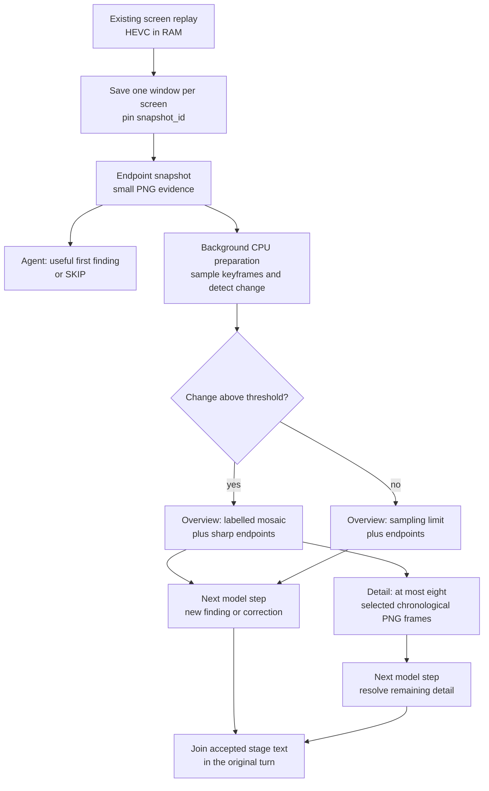

# Progressive perception

Progressive perception lets an Agent answer from useful evidence while more
complete evidence is being prepared. It keeps one observation identity and
one Agent turn, adding detail through bounded stages rather than making every
answer wait for the largest input.

**Status: implemented for `computer.replay` and regional `computer.observe`
readings in non-Task voice conversations.**
Direct replay and controller checks cover staged delivery and cancellation.
End-to-end audible latency and interruption-to-silence remain installation
acceptance checks. Ordinary text calls and Tasks receive one final Tool result.
Set `realtime_progressive_evidence = false` to select the one-result path.

## The first adapter: screen replay

The existing screen-replay owner keeps a rolling 60-second, GPU-encoded HEVC
buffer in RAM. `computer.replay` asks a focused question over 5–60 seconds of that
history; the default window is 30 seconds. It reads existing screen buffers,
without acquiring a microphone, camera or audio stream.

The replay adapter saves each selected screen's buffer once, then returns
its most recent readable keyframe as an endpoint snapshot. History sampling runs
in the background while the Agent considers that first result. Later stages
describe the same saved window:

The snapshot stage can establish what the endpoint shows. It cannot establish
what happened earlier. The overview supplies temporal context, followed by
larger selected frames when there is meaningful sampled change. A static scene
stops after its overview, avoiding an unnecessary detail stage.

Sampling uses low-resolution grayscale keyframes to rank visible changes.
Selected images include the window boundaries and sufficiently separated
changes, within an eight-frame detail budget across the selected screens. These
are historical samples: an event between samples can be missed, and a low change
score does not prove nothing happened.

## Regional detail and text

`computer.observe` and `computer.replay` accept an optional `region` with
integer `left`, `top`, `right` and `bottom` edges on the full image's 0–999
grid. Replay requires an explicit Surface for a region. The native crop is
derived before image downscaling and stays beside the original overview.
It never replaces the complete observation's coordinate basis for input.

A region requests bounded CPU text reading by default. Use `read:false` for
image detail alone, or `read_mode:"line"` when the region deliberately encloses
one complete text row. The default `detect` mode finds text inside a panel.
`read:true` requires a region; line mode is not suitable for multiple rows.

The optional PP-OCRv6-small sensor loads locally installed, hash-verified ONNX
models once and stays idle without work. Configure `vision_ocr_model_directory`
with the detector and recognizer directories; `vision_ocr_cpus` can constrain
its dedicated background workers. It uses two nonspinning CPU inference threads,
no GPU and no capture loop. Busy or unavailable readers leave the image usable.

For voice, the first image can precede the reading. Later evidence enters only
at a model boundary in the same activation. For ordinary text and Tasks, the
Tool returns one bounded result. Replay OCR covers only the saved endpoint
region; historical crops are separately labelled images. OCR carries source
identity, coverage, omissions and uncalibrated confidence. It can misread text
even with high confidence, so the Agent must compare it with the pixels.

The text and regional metadata are private, ephemeral attachments. Session
events keep opaque attachment IDs; receipts and traces do not contain the raw
reading. Consumption, cancellation and owner clarification discard attachments.
Native inference already in progress must drain before cleanup; it is not
instantly preemptible. A reading continuation never renews an input lease.

## Evidence identity, age and ownership

One `snapshot_id` identifies the saved windows throughout the sequence. The
endpoint image is reused exactly in later stages. Frames carry labels
relative to **their own saved clip end**, alongside an explicit snapshot age.
The age includes preparation and starts from the earliest buffer-save request;
it is an approximation of acquisition time. Parallel screen saves do not make
all screens an atomic, perfectly synchronized capture.

The sequence owns its temporary clips, decoding work and screen leases.
Clips are deleted after preparation, leaving only bounded images and
metadata for the remaining stages. Cancellation signals and drains the
producer and its subprocesses before releasing owned resources. FFmpeg decoding
remains CPU-based, cancellable and limited to bounded worker counts, with
one decoder/filter thread per subprocess. A cancelled save gets a bounded
writer-settlement window; a crashed or unusually late writer can leave a
temporary clip for the existing stale-file sweep. A confirmed unlocked Scene
and unchanged recorder process identity are required before each stage.

Every stage remains untrusted, read-only evidence with
`action_authorized: false`. Historical pixels cannot authorize input or prove a
current application state. An action still requires the normal fresh
observation, exact target binding, capability authority and effect verification.
Screen text remains evidence, never instructions.

## One Agent turn, several model steps

The shared execution core exposes an internal `EvidenceSequence` contract:
its owner names the original Tool and arguments, reports whether another stage
exists, advances that stage and closes its resources. The controller binds
continuation to that same sequence and issues a fresh call UUID with the exact
original Tool name and arguments. Continuation does not expose a model-selectable
capture handle or broaden the request.

Non-Task voice calls to `computer.replay` and regional `computer.observe`
readings opt into this contract. The reusable machinery lives in the execution core shared by
Agents, while each adapter will need an explicit opt-in and its own evidence
lifecycle. Text conversations and Tasks use the same replay preparation but
return one final selected-image result.

The controller and producer bound progression to a 30-second evidence
lifetime, alongside the ordinary model-step budget. That is an advancement and
resource bound, not a promise that an entire spoken interaction finishes within
30 seconds. Cancellation, interruption, steering or lost sequence ownership
end progression and drain its work.

Each stage adds a useful finding, explicitly corrects an earlier statement,
or returns `SKIP`. A shared text filter suppresses `SKIP` and exact normalized
sentences already accepted in earlier stages, then joins the accepted text. It
checks consistency between text offered to speech and the completed stage.
This is exact sentence filtering: paraphrases and semantic contradictions still
require the Agent's judgment.

## What overlaps

Preparation of later images overlaps the first model response. Existing
sentence-level TTS can also overlap a later model step, and the existing ASR and
barge-in path retains ownership of interruptions. Replay itself adds no
audio capture or recognition pipeline.

New evidence enters **between model steps**. It is not inserted into an
already decoding model request. The transport still sends PNG image content
through the existing HTTP llama.cpp route. Native video MIME input is currently
rejected by that ADK model adapter.

| Capability | Status and boundary |
| --- | --- |
| Screen replay from an existing RAM buffer | Existing source owner; screen pixels only. |
| Endpoint → overview → optional detail | Implemented for non-Task voice replay; audible acceptance is installation-specific. |
| One final replay result for text and Tasks | One-result compatibility path. |
| Evidence added during an ongoing model generation | Not implemented; each stage starts another model step. |
| Native timestamped video input | Not integrated into this adapter; the model receives labelled PNG images. |
| Full-duplex audiovisual model session | Not implemented by this change. Existing speech/TTS overlap and barge-in remain separate mechanisms. |
| GPU-resident capture-to-model tensors | Not implemented; the current path includes encoded buffers, CPU decode, PNG serialization and HTTP transfer. |
| Progressive web, code, document or log adapters | Proposed applications of the shared contract, requiring explicit adapter work. |

## Transport and accuracy limits

The current model route receives labelled PNG images over HTTP. Replay includes
encoded host clips, CPU decoding, image serialization and separate model steps.
It does not accept new evidence inside an already decoding request, native
continuous audiovisual input or GPU-resident capture-to-model tensors.

Image budgets and source preparation bound detail. A small thumbnail can lose
labels that a later crop cannot recover. Historical samples can miss brief
events, and larger images do not guarantee correct small-text recognition.
Answers should distinguish visible facts, uncertainty and current versus
historical state. Backend or preprocessing changes require their own useful-fact,
freshness, latency, cancellation and resource-cost validation in the existing
execution path.

## Implementation map

| Source | Responsibility |
| --- | --- |
| `capabilities/computer/observe.py`, `computer/regions.py` | Original-frame observations, native crops and finite regional reading. |
| `computer/ocr.py`, `computer/reading.py` | CPU text sensor, artifact verification and Harness lifecycle. |
| [`capabilities/computer/replay.py`](https://github.com/Resource-Hacker/obsidience/blob/main/obsidience/harness/capabilities/computer/replay.py) | Frozen replay window, keyframe selection, image stages and cleanup. |
| [`execution/progressive.py`](https://github.com/Resource-Hacker/obsidience/blob/main/obsidience/harness/execution/progressive.py) | Private sequence contract, text joining and cancellation-safe draining. |
| [`execution/adk/plugin.py`](https://github.com/Resource-Hacker/obsidience/blob/main/obsidience/harness/execution/adk/plugin.py) | Voice opt-in, continuation ownership, model-step bounds and completion. |
| [`execution/adk/model.py`](https://github.com/Resource-Hacker/obsidience/blob/main/obsidience/harness/execution/adk/model.py) | Text/image serialization to the existing local HTTP model route. |

See also [Realtime voice](voice.md) for the existing speech and interruption
pipeline.
