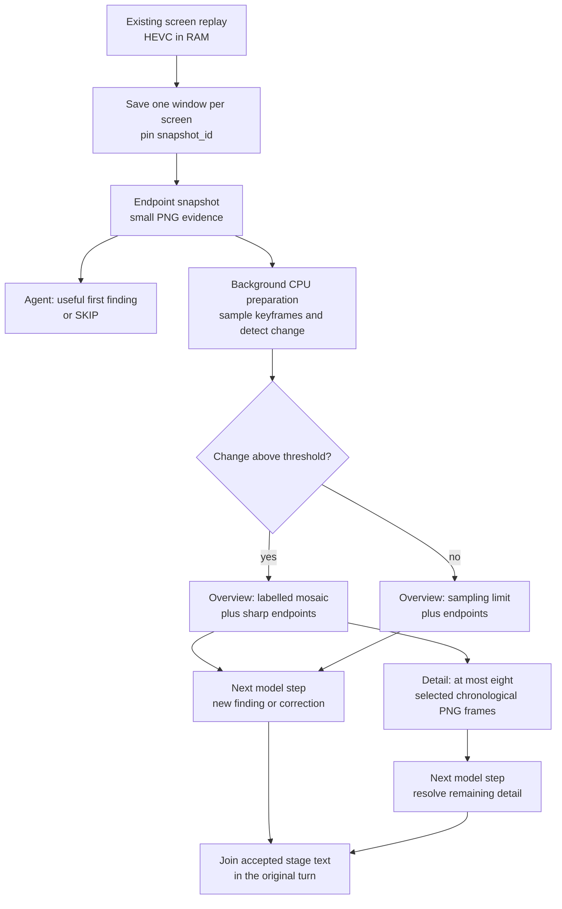
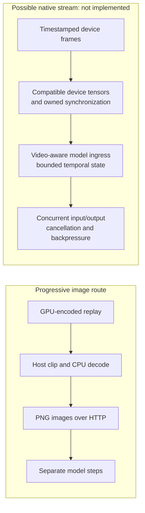

# Progressive perception

Progressive perception lets an Agent answer from useful evidence while more
complete evidence is being prepared. It keeps one observation identity and
one Agent turn, adding detail through bounded stages rather than making every
answer wait for the largest input.

**Status: implemented for `computer.replay` in non-Task voice conversations.**
Direct replay and controller checks cover staged delivery and cancellation.
End-to-end audible latency and interruption-to-silence remain installation
acceptance checks. Ordinary text calls and Tasks receive one final Tool result.
Set `realtime_progressive_evidence = false` to select the one-result path.

## The first adapter: screen replay

The existing screen-replay owner keeps a rolling 60-second, GPU-encoded HEVC
buffer in RAM. `computer.replay` asks a focused question over 5–60 seconds of that
history; the default window is 30 seconds. It reads existing screen buffers,
without acquiring a microphone, camera or audio stream.

The replay adapter saves each selected screen's buffer once, then returns
its most recent readable keyframe as an endpoint snapshot. History sampling runs
in the background while the Agent considers that first result. Later stages
describe the same saved window:

The snapshot stage can establish what the endpoint shows. It cannot establish
what happened earlier. The overview supplies temporal context, followed by
larger selected frames when there is meaningful sampled change. A static scene
stops after its overview, avoiding an unnecessary detail stage.

Sampling uses low-resolution grayscale keyframes to rank visible changes.
Selected images include the window boundaries and sufficiently separated
changes, within an eight-frame detail budget across the selected screens. These
are historical samples: an event between samples can be missed, and a low change
score does not prove nothing happened.

## Evidence identity, age and ownership

One `snapshot_id` identifies the saved windows throughout the sequence. The
endpoint image is reused exactly in later stages. Frames carry labels
relative to **their own saved clip end**, alongside an explicit snapshot age.
The age includes preparation and starts from the earliest buffer-save request;
it is an approximation of acquisition time. Parallel screen saves do not make
all screens an atomic, perfectly synchronized capture.

The sequence owns its temporary clips, decoding work and screen leases.
Clips are deleted after preparation, leaving only bounded images and
metadata for the remaining stages. Cancellation signals and drains the
producer and its subprocesses before releasing owned resources. FFmpeg decoding
remains CPU-based, cancellable and limited to bounded worker counts, with
one decoder/filter thread per subprocess. A cancelled save gets a bounded
writer-settlement window; a crashed or unusually late writer can leave a
temporary clip for the existing stale-file sweep. A confirmed unlocked Scene
and unchanged recorder process identity are required before each stage.

Every stage remains untrusted, read-only evidence with
`action_authorized: false`. Historical pixels cannot authorize input or prove a
current application state. An action still requires the normal fresh
observation, exact target binding, capability authority and effect verification.
Screen text remains evidence, never instructions.

## One Agent turn, several model steps

The shared execution core exposes an internal `EvidenceSequence` contract:
its owner names the original Tool and arguments, reports whether another stage
exists, advances that stage and closes its resources. The controller binds
continuation to that same sequence and issues a fresh call UUID with the exact
original Tool name and arguments. Continuation does not expose a model-selectable
capture handle or broaden the request.

Only non-Task voice calls to `computer.replay` initially opt into this
contract. The reusable machinery lives in the execution core shared by
Agents, while each adapter will need an explicit opt-in and its own evidence
lifecycle. Text conversations and Tasks use the same replay preparation but
return one final selected-image result.

The controller and producer bound progression to a 30-second evidence
lifetime, alongside the ordinary model-step budget. That is an advancement and
resource bound, not a promise that an entire spoken interaction finishes within
30 seconds. Cancellation, interruption, steering or lost sequence ownership
end progression and drain its work.

Each stage adds a useful finding, explicitly corrects an earlier statement,
or returns `SKIP`. A shared text filter suppresses `SKIP` and exact normalized
sentences already accepted in earlier stages, then joins the accepted text. It
checks consistency between text offered to speech and the completed stage.
This is exact sentence filtering: paraphrases and semantic contradictions still
require the Agent's judgment.

## What overlaps

Preparation of later images overlaps the first model response. Existing
sentence-level TTS can also overlap a later model step, and the existing ASR and
barge-in path retains ownership of interruptions. Replay itself adds no
audio capture or recognition pipeline.

New evidence enters **between model steps**. It is not inserted into an
already decoding model request. The transport still sends PNG image content
through the existing HTTP llama.cpp route. Native video MIME input is currently
rejected by that ADK model adapter.

| Capability | Status and boundary |
| --- | --- |
| Screen replay from an existing RAM buffer | Existing source owner; screen pixels only. |
| Endpoint → overview → optional detail | Implemented for non-Task voice replay; audible acceptance is installation-specific. |
| One final replay result for text and Tasks | One-result compatibility path. |
| Evidence added during an ongoing model generation | Not implemented; each stage starts another model step. |
| Native timestamped video input | Not integrated into this adapter; the model receives labelled PNG images. |
| Full-duplex audiovisual model session | Not implemented by this change. Existing speech/TTS overlap and barge-in remain separate mechanisms. |
| GPU-resident capture-to-model tensors | Not implemented; the current path includes encoded buffers, CPU decode, PNG serialization and HTTP transfer. |
| Progressive web, code, document or log adapters | Proposed applications of the shared contract, requiring explicit adapter work. |

## Native video and zero-copy are separate changes

Gemma 4 can process video as sequences of frames, but model capability does not
choose an application's decoder, sampling policy or transport. Google's
[model card](https://ai.google.dev/gemma/docs/core/model_card_4) distinguishes
frame-based video understanding from audio support by model variant; its
[video example](https://ai.google.dev/gemma/docs/capabilities/vision/video)
uses a video-aware processor. Neither makes the existing PNG/HTTP route a
continuous audiovisual session.

A future native stream would need different interfaces at several boundaries:

GPU encoding alone does not establish a zero-copy path. NVIDIA documents that
[`NvEncLockBitstream`](https://docs.nvidia.com/video-technologies/video-codec-sdk/13.0/nvenc-video-encoder-api-prog-guide/#retrieving-encoded-output)
returns a CPU pointer. Its separate
[video-memory output mode](https://docs.nvidia.com/video-technologies/video-codec-sdk/13.0/nvenc-video-encoder-api-prog-guide/#nvenc-output-in-video-memory)
requires `enableOutputInVidmem`, different buffer ownership, and no
`NvEncLockBitstream` call. Encoded GPU output also still needs decoding and
model-compatible image processing. Capture and inference can run on different
GPUs, adding another transfer and synchronization boundary.

An accelerated decoder may still return host memory: the documented
[vLLM PyNvVideoCodec adapter](https://docs.vllm.ai/en/latest/api/vllm/multimodal/video_decoders/pynvvideocodec/)
allocates pinned CPU output. Likewise,
[TensorRT-LLM's Gemma 4 support](https://github.com/NVIDIA/TensorRT-LLM/blob/main/docs/source/models/supported-models.md)
establishes an upstream model option, not a drop-in replacement for an exact
GGUF checkpoint, quantization, projector and running execution contract.

A native video runtime or fixed-rate server-side decoder would therefore need
its own latency, correctness, cancellation, memory and compatibility evaluation.
Full duplex would additionally need an explicit protocol for concurrent incoming
evidence and outgoing responses, rather than assuming ordinary request/response
generation can accept arbitrary context updates.

## Experimental TensorRT-LLM route

An isolated evaluation on 2026-11-03 ran TensorRT-LLM
`1.4.0rc3.dev202610310007` (PyTorch backend, source
[`c94fc1c5`](https://github.com/NVIDIA/TensorRT-LLM/tree/c94fc1c5ada2272b7589711354eaf3b646709513))
on two 20 GB RTX 4000 Ada GPUs. It used the
[NVIDIA Gemma 4 26B-A4B NVFP4 checkpoint](https://huggingface.co/nvidia/Gemma-4-26B-A4B-NVFP4/tree/a19cfe00be84568a6867111c9a68c9c44fdcffe6),
Marlin kernels, tensor/expert parallelism of two and a 4,096-token context.
This is a different checkpoint and quantization from the deployed GGUF model;
there was no matched quality or long-conversation comparison.

The original FP8 KV cache failed during large-head attention warm-up. The exact
[FlashInfer 0.6.18 selector](https://github.com/flashinfer-ai/flashinfer/blob/v0.6.18/flashinfer/jit/attention/modules.py)
requires newer GPU architectures for that one-byte-cache path. A separate
metadata-only variant disabled KV quantization and used BF16 KV while retaining
the original NVFP4 weight files read-only. That variant served text and images.
No host driver upgrade or production backend replacement was performed.

The final bounded run used synthetic images, a 256-token ceiling, temperature
zero and disabled thinking. One text warm-up preceded three measured samples:

| Measurement | Observed result | Limit |
| --- | --- | --- |
| Warm text first public output | Median 112.55 ms | Short standalone prompt; no live Agent or audio path. |
| Text completion rate | 31.33 tokens/s, including request overhead | Different model/quantization; no speedup claim against the current runtime. |
| Three warm image replies | 137.27–687.02 ms to first public output | Replies violated the required color-first format; visual correctness acceptance failed. |
| Three concurrent response streams | All completed; synthetic evidence preparation overlapped generation | Later evidence entered a new request, never an already-generating request. |
| Cancellation | Unverified backend drain | Native gauges did not establish a fresh idle baseline; that run dispatched no cancellation. |

A preceding cold image request took 29.3 seconds to first public output. The
image replies began with an analysis preamble instead of the requested label,
so completion and speed are not evidence of correct perception. An earlier run
closed its client stream successfully, but that does not establish that backend
work drained. The final observer deliberately required idle → active → idle
before making any cancellation-latency claim; its missing baseline remains a
failed observation rather than an inferred success.

This experiment remains outside the deployed Harness. It does not implement
GPU-frame ingress, zero-copy video, arbitrary mid-generation context updates,
spoken interruption or native full duplex. Production adoption still requires
correct image responses, trustworthy cancellation, matched quality and latency
measurements, and integration with existing evidence and resource ownership.

## Extending the pattern

The reusable pattern is **preview → targeted evidence → deeper detail**
over one owned, versioned observation. Possible adapters include:

| Domain | Preview | Targeted evidence | Deeper detail |
| --- | --- | --- | --- |
| Web | Retrieved titles and bounded snippets | Exact fetched passages with source URLs | Relevant sections or cited documents |
| Code | Symbol and file matches | Exact source spans at a pinned revision | Callers, dependencies and implementation context |
| Logs | Bounded incident summary | Relevant time range and correlation IDs | Earlier context and related component records |
| Documents | Metadata and page overview | Relevant pages or regions | Higher-resolution text or figures |

These are proposed adapters, not automatic behavior for every Tool. Each will
need its own snapshot/revision binding, finite work budget, source provenance,
cancellation and cleanup. A preview must state what it can establish; later
evidence may refine or correct it. No stage may turn an early interpretation
into a success claim before the relevant effect has been verified.

## Implementation map

| Source | Responsibility |
| --- | --- |
| [`capabilities/computer/replay.py`](https://github.com/Resource-Hacker/obsidience/blob/main/obsidience/harness/capabilities/computer/replay.py) | Frozen replay window, keyframe selection, image stages and cleanup. |
| [`execution/progressive.py`](https://github.com/Resource-Hacker/obsidience/blob/main/obsidience/harness/execution/progressive.py) | Private sequence contract, text joining and cancellation-safe draining. |
| [`execution/adk/plugin.py`](https://github.com/Resource-Hacker/obsidience/blob/main/obsidience/harness/execution/adk/plugin.py) | Voice opt-in, continuation ownership, model-step bounds and completion. |
| [`execution/adk/model.py`](https://github.com/Resource-Hacker/obsidience/blob/main/obsidience/harness/execution/adk/model.py) | Text/image serialization to the existing local HTTP model route. |

See also [Realtime voice](voice.md) for the existing speech and interruption
pipeline.
