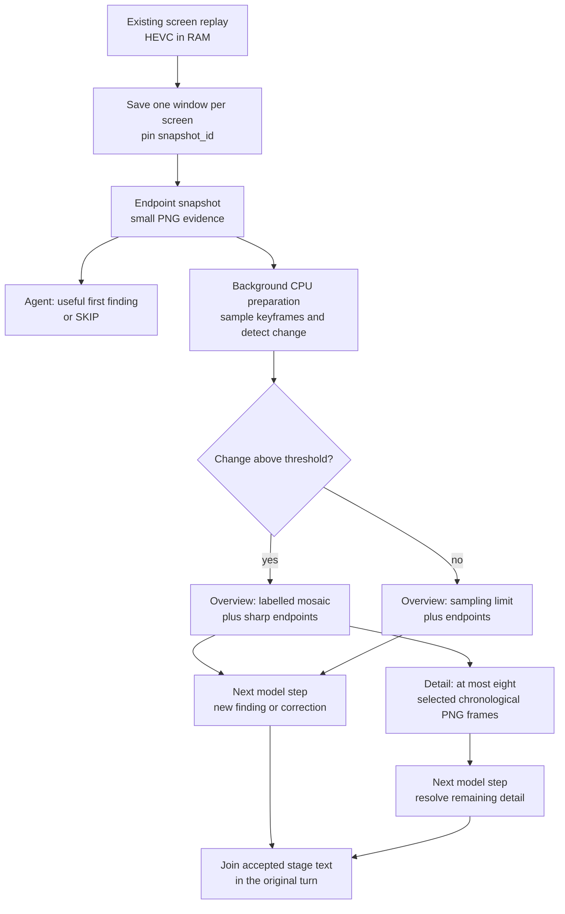
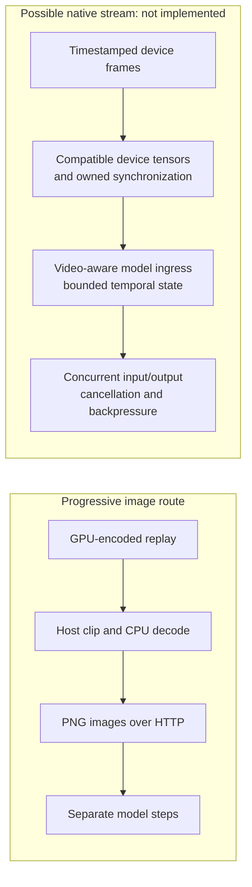

# Progressive perception

Progressive perception lets an Agent answer from useful evidence while more
complete evidence is being prepared. It keeps one observation identity and
one Agent turn, adding detail through bounded stages rather than making every
answer wait for the largest input.

**Status: implemented for `computer.replay` in non-Task voice conversations.**
Direct replay and controller checks cover staged delivery and cancellation.
End-to-end audible latency and interruption-to-silence remain installation
acceptance checks. Ordinary text calls and Tasks receive one final Tool result.
Set `realtime_progressive_evidence = false` to select the one-result path.

## The first adapter: screen replay

The existing screen-replay owner keeps a rolling 60-second, GPU-encoded HEVC
buffer in RAM. `computer.replay` asks a focused question over 5–60 seconds of that
history; the default window is 30 seconds. It reads existing screen buffers,
without acquiring a microphone, camera or audio stream.

The replay adapter saves each selected screen's buffer once, then returns
its most recent readable keyframe as an endpoint snapshot. History sampling runs
in the background while the Agent considers that first result. Later stages
describe the same saved window:

The snapshot stage can establish what the endpoint shows. It cannot establish
what happened earlier. The overview supplies temporal context, followed by
larger selected frames when there is meaningful sampled change. A static scene
stops after its overview, avoiding an unnecessary detail stage.

Sampling uses low-resolution grayscale keyframes to rank visible changes.
Selected images include the window boundaries and sufficiently separated
changes, within an eight-frame detail budget across the selected screens. These
are historical samples: an event between samples can be missed, and a low change
score does not prove nothing happened.

## Evidence identity, age and ownership

One `snapshot_id` identifies the saved windows throughout the sequence. The
endpoint image is reused exactly in later stages. Frames carry labels
relative to **their own saved clip end**, alongside an explicit snapshot age.
The age includes preparation and starts from the earliest buffer-save request;
it is an approximation of acquisition time. Parallel screen saves do not make
all screens an atomic, perfectly synchronized capture.

The sequence owns its temporary clips, decoding work and screen leases.
Clips are deleted after preparation, leaving only bounded images and
metadata for the remaining stages. Cancellation signals and drains the
producer and its subprocesses before releasing owned resources. FFmpeg decoding
remains CPU-based, cancellable and limited to bounded worker counts, with
one decoder/filter thread per subprocess. A cancelled save gets a bounded
writer-settlement window; a crashed or unusually late writer can leave a
temporary clip for the existing stale-file sweep. A confirmed unlocked Scene
and unchanged recorder process identity are required before each stage.

Every stage remains untrusted, read-only evidence with
`action_authorized: false`. Historical pixels cannot authorize input or prove a
current application state. An action still requires the normal fresh
observation, exact target binding, capability authority and effect verification.
Screen text remains evidence, never instructions.

## One Agent turn, several model steps

The shared execution core exposes an internal `EvidenceSequence` contract:
its owner names the original Tool and arguments, reports whether another stage
exists, advances that stage and closes its resources. The controller binds
continuation to that same sequence and issues a fresh call UUID with the exact
original Tool name and arguments. Continuation does not expose a model-selectable
capture handle or broaden the request.

Only non-Task voice calls to `computer.replay` initially opt into this
contract. The reusable machinery lives in the execution core shared by
Agents, while each adapter will need an explicit opt-in and its own evidence
lifecycle. Text conversations and Tasks use the same replay preparation but
return one final selected-image result.

The controller and producer bound progression to a 30-second evidence
lifetime, alongside the ordinary model-step budget. That is an advancement and
resource bound, not a promise that an entire spoken interaction finishes within
30 seconds. Cancellation, interruption, steering or lost sequence ownership
end progression and drain its work.

Each stage adds a useful finding, explicitly corrects an earlier statement,
or returns `SKIP`. A shared text filter suppresses `SKIP` and exact normalized
sentences already accepted in earlier stages, then joins the accepted text. It
checks consistency between text offered to speech and the completed stage.
This is exact sentence filtering: paraphrases and semantic contradictions still
require the Agent's judgment.

## What overlaps

Preparation of later images overlaps the first model response. Existing
sentence-level TTS can also overlap a later model step, and the existing ASR and
barge-in path retains ownership of interruptions. Replay itself adds no
audio capture or recognition pipeline.

New evidence enters **between model steps**. It is not inserted into an
already decoding model request. The transport still sends PNG image content
through the existing HTTP llama.cpp route. Native video MIME input is currently
rejected by that ADK model adapter.

| Capability | Status and boundary |
| --- | --- |
| Screen replay from an existing RAM buffer | Existing source owner; screen pixels only. |
| Endpoint → overview → optional detail | Implemented for non-Task voice replay; audible acceptance is installation-specific. |
| One final replay result for text and Tasks | One-result compatibility path. |
| Evidence added during an ongoing model generation | Not implemented; each stage starts another model step. |
| Native timestamped video input | Not integrated into this adapter; the model receives labelled PNG images. |
| Full-duplex audiovisual model session | Not implemented by this change. Existing speech/TTS overlap and barge-in remain separate mechanisms. |
| GPU-resident capture-to-model tensors | Not implemented; the current path includes encoded buffers, CPU decode, PNG serialization and HTTP transfer. |
| Progressive web, code, document or log adapters | Proposed applications of the shared contract, requiring explicit adapter work. |

## Native video and zero-copy are separate changes

Gemma 4 can process video as sequences of frames, but model capability does not
choose an application's decoder, sampling policy or transport. Google's
[model card](https://ai.google.dev/gemma/docs/core/model_card_4) distinguishes
frame-based video understanding from audio support by model variant; its
[video example](https://ai.google.dev/gemma/docs/capabilities/vision/video)
uses a video-aware processor. Neither makes the existing PNG/HTTP route a
continuous audiovisual session.

A future native stream would need different interfaces at several boundaries:

GPU encoding alone does not establish a zero-copy path. NVIDIA documents that
[`NvEncLockBitstream`](https://docs.nvidia.com/video-technologies/video-codec-sdk/13.0/nvenc-video-encoder-api-prog-guide/#retrieving-encoded-output)
returns a CPU pointer. Its separate
[video-memory output mode](https://docs.nvidia.com/video-technologies/video-codec-sdk/13.0/nvenc-video-encoder-api-prog-guide/#nvenc-output-in-video-memory)
requires `enableOutputInVidmem`, different buffer ownership, and no
`NvEncLockBitstream` call. Encoded GPU output also still needs decoding and
model-compatible image processing. Capture and inference can run on different
GPUs, adding another transfer and synchronization boundary.

An accelerated decoder may still return host memory: the documented
[vLLM PyNvVideoCodec adapter](https://docs.vllm.ai/en/latest/api/vllm/multimodal/video_decoders/pynvvideocodec/)
allocates pinned CPU output. Likewise,
[TensorRT-LLM's Gemma 4 support](https://github.com/NVIDIA/TensorRT-LLM/blob/main/docs/source/models/supported-models.md)
establishes an upstream model option, not a drop-in replacement for an exact
GGUF checkpoint, quantization, projector and running execution contract.

A native video runtime or fixed-rate server-side decoder would therefore need
its own latency, correctness, cancellation, memory and compatibility evaluation.
Full duplex would additionally need an explicit protocol for concurrent incoming
evidence and outgoing responses, rather than assuming ordinary request/response
generation can accept arbitrary context updates.

## How alternatives are evaluated

The objective is a more useful, responsive Agent. Candidate selection measures
correct facts, current versus historical state, time to a complete useful fact,
response throughput, repeated-prefix reuse, new evidence arriving during other
output, interruption and resource cost. Full bounded answers are retained for
synthetic scenes so a reviewer can assess what the model actually understood.

Wording, Markdown, preambles and opening-token conventions do not determine
correctness. An omitted incidental detail is distinct from an incorrect answer
to the question. Formatting matters when it breaks an actual consumer, such as
a native Tool-call interface. Missing measurements remain open questions, and
ordinary configuration or integration defects should be investigated before
dismissing an approach.

## Matched backend comparison

The 2026-11-03 laboratory comparison uses the same prompts, labelled synthetic
pictures, temperature-zero sampling and 256-token output budget on the same two
RTX 4000 Ada GPUs. It includes three short-text measurements after warmup,
three repeated 3,823-token-prefix measurements, four distinct visual scenarios,
and additional concurrency, correction and cancellation requests. The eight
measured visual answers cover four temporal scenarios plus one initial-state
snapshot, reusing evidence in later requests; they are not eight independent
gameplay tests. No microphone, real stream or acoustic latency is involved.

The baseline uses the installed llama.cpp model configuration: UDmerge Q4_K_XXL,
paired projector, MTP depth two, three slots and 196,608 total allocated context.
TensorRT and vLLM use the same NVIDIA NVFP4 weights with BF16 KV and an
8,192-token context limit. All runs use the same eight logical CPU allocation
and background scheduling; production llama.cpp normally has a different CPU
allocation. The baseline retains `--image-max-tokens 512`; vLLM uses HF
`max_soft_tokens: 280`. Identical input pictures do not establish identical
encoder work. This compares practical configurations, not identical weight
precision, preprocessing or the complete production Agent path.

| Measurement | Current llama.cpp settings | TensorRT with CUDA graphs | vLLM 0.32.0, MTP2, one CPU thread per worker |
| --- | --- | --- | --- |
| Short text: median first output | 61.2 ms | 82.1 ms | 38.9 ms |
| Short text: completion rate, including request overhead | 183.2 tokens/s | 77.1 tokens/s | 128.7 tokens/s |
| Repeated long prefix: median first output | 18.8 ms | 1,008.0 ms | 50.0 ms |
| Correct requested visual answers | 8/8 | 2/8, plus partial facts in other answers | 8/8 |
| Complete newest-DEAD statement after changed evidence | 943.9 ms | Not established | 357.0 ms |
| Complete useful fact from fresh evidence during two text streams | 949.2 ms | Not established | 299.7 ms |

The vLLM comparison also varied the paired speculative assistant and CPU thread
count. Each profile answered all eight measured visual questions correctly:

| vLLM profile | Median short-text first output | End-to-end text completion rate |
| --- | --- | --- |
| No MTP, four CPU threads per worker | 22.8 ms | 101.8 tokens/s |
| MTP2, four CPU threads per worker | 38.7 ms | 128.4 tokens/s |
| MTP2, one CPU thread per worker | 38.9 ms | 128.7 tokens/s |
| MTP4, one CPU thread per worker | 59.9 ms | 117.9 tokens/s |

Two speculative tokens improved text throughput over the no-MTP profile. The
CPU-thread change made no clear difference to that throughput, and four draft
tokens cost more than they saved in this workload. Small timing differences
within these short runs should not be treated as statistically established
advantages. The MTP2/one-thread process held about 16 GiB per GPU at readiness;
this is a configured cache allocation, not a measured minimum or peak. The
baseline process held about 11.5 and 10.3 GiB, despite its larger configured
context. Coexistence with the production ASR and longer conversations has not
been measured for the candidates.

TensorRT's graph-enabled run improves on its earlier approximately 31 tokens/s
configuration. Its visual problems are substantive: repeated text, missing
requested events and failure to establish the newest life state. An unfinished
summary was accepted where earlier bullets already established the requested
facts. The same checkpoint answers correctly in vLLM, which narrows the
investigation to the TensorRT runtime/configuration path rather than establishing
that the weights are generally incapable.

llama.cpp reused 3,822 of the 3,823 prefix tokens. vLLM's native metrics also
recorded prefix-cache hits. TensorRT reported no reused tokens. Both llama.cpp
and vLLM accepted new evidence while earlier output was still arriving, answered
the changed state correctly, and showed an active-to-idle transition after client
cancellation. Idle was observed after about 52 and 57 ms respectively using
50 ms polling; these are bounded observations, not precise cancellation times
or acoustic silence measurements. The llama.cpp observer covers processing
slots; the vLLM observer covers running and waiting requests. TensorRT's gauges
did not establish a fresh idle baseline, so its backend drain remains unknown.

The new evidence in these comparisons enters a **new independent HTTP request**
while earlier output continues. That measures concurrent fresh-evidence handling,
not amendment of the original request, suppression of its older output, or a
same-activation spoken correction.

vLLM is therefore a concrete candidate for faster visual updates, with a text
throughput tradeoff in this profile. These results do not establish a universal
replacement or native full duplex. Long Agent conversations, actual Tool calls,
changing video, speech integration and resource coexistence still need their
own measurements.

The follow-up control retained the TensorRT profile and disabled only CUDA
graphs. Visual degeneration persisted (one fully correct answer out of eight,
with partial information in others), while text completion fell to 31.73
tokens/s. A separate Gemma-only laboratory overlay matched the Marlin expert
GELU approximation to the model configuration; it also failed to resolve the
visual errors. Neither change was installed in production. These controls narrow
the investigation without establishing its root cause.

## Initial TensorRT-LLM trial

An isolated evaluation on 2026-11-03 ran TensorRT-LLM
`1.4.0rc3.dev202610310007` (PyTorch backend, source
[`c94fc1c5`](https://github.com/NVIDIA/TensorRT-LLM/tree/c94fc1c5ada2272b7589711354eaf3b646709513))
on two 20 GB RTX 4000 Ada GPUs. It used the
[NVIDIA Gemma 4 26B-A4B NVFP4 checkpoint](https://huggingface.co/nvidia/Gemma-4-26B-A4B-NVFP4/tree/a19cfe00be84568a6867111c9a68c9c44fdcffe6),
Marlin kernels, tensor/expert parallelism of two and a 4,096-token context.
This is a different checkpoint and quantization from the deployed GGUF model;
there was no matched quality or long-conversation comparison.

The original FP8 KV cache failed during large-head attention warm-up. The exact
[FlashInfer 0.6.18 selector](https://github.com/flashinfer-ai/flashinfer/blob/v0.6.18/flashinfer/jit/attention/modules.py)
requires newer GPU architectures for that one-byte-cache path. A separate
metadata-only variant disabled KV quantization and used BF16 KV while retaining
the original NVFP4 weight files read-only. That variant served text and images.
No host driver upgrade or production backend replacement was performed.

The final bounded run used synthetic images, a 256-token ceiling, temperature
zero and disabled thinking. One text warm-up preceded three measured samples:

| Measurement | Observed result | Limit |
| --- | --- | --- |
| Warm text first public output | Median 112.55 ms | Short standalone prompt; no live Agent or audio path. |
| Text completion rate | 31.33 tokens/s, including request overhead | Different model/quantization; no speedup claim against the current runtime. |
| Three warm image replies | 137.27–687.02 ms to first public output | Semantic accuracy was not assessed; the original harness checked only the first word, which is not a useful quality criterion. |
| Three concurrent response streams | All completed; synthetic evidence preparation overlapped generation | Later evidence entered a new request, never an already-generating request. |
| Cancellation | Unverified backend drain | Native gauges did not establish a fresh idle baseline; that run dispatched no cancellation. |

A preceding cold image request took 29.3 seconds to first public output. The
image replies began with an analysis preamble instead of the requested label.
That is a formatting difference, not evidence that the image was misunderstood.
The original probe did not preserve enough answer text to judge the visual facts;
its color-prefix check is retired as a backend-selection criterion. An earlier run
closed its client stream successfully, but that does not establish that backend
work drained. The final observer deliberately required idle → active → idle
before making any cancellation-latency claim; its missing baseline remains a
failed observation rather than an inferred success.

This experiment remains outside the deployed Harness. It does not implement
GPU-frame ingress, zero-copy video, arbitrary mid-generation context updates,
spoken interruption or native full duplex. Production adoption still requires
a comparison of useful visual facts, freshness, response latency, interruptions,
resource cost and integration with the existing evidence and execution owners.
Different wording or Markdown is not a reason to reject a candidate. A missing
measurement is uncertainty to investigate, not proof that a method is worse.

## Other viable avenues

The investigation is broader than one inference server. Each route addresses a
different part of the latency budget:

| Avenue | Potential benefit | Next measurement or integration question |
| --- | --- | --- |
| Improve the existing llama.cpp route | Preserve fast text decode and established Agent-prefix reuse; tune speculative depth, image budget and repeated image work. | Measure current-state accuracy and complete useful-answer latency while varying one parameter. Native RGB ingress could remove PNG/base64 overhead if that cost is material. |
| TensorRT graphs, MTP and matching vision-encoder optimizations | Faster decoder dispatch, speculative decoding and less repeated image encoding. | Resolve the observed semantic defect, then compare encoder graphs versus side-stream preparation. Gemma4 prefix reuse is currently marked unsupported; assess short-context perception separately from long Agent turns. |
| vLLM with hybrid prefix caching and MTP | Faster first output, useful visual updates and maintained speculative decoding. | Compare paired-assistant depths and actual Tool/conversation workloads. Verify image/video and shared-KV behavior on the exact local GPUs. |
| SGLang with Gemma4 NEXTN and hybrid sliding-window cache | Another maintained speculative and prefix-reuse implementation. | Verify a compatible quantized checkpoint/kernel combination on Ada before benchmarking; the unquantized BF16 model does not fit the two-card memory budget. |
| NVDEC → PyNvVideoCodec → DLPack → matching GPU preprocessing | Avoid the decode-to-host-to-GPU round trip. | Include GOP/seeking, resize/normalization, device synchronization and any cross-GPU transfer in end-to-end useful-answer timing. DLPack shares a buffer; later transforms can still allocate device memory. |
| DeepStream/Triton or a dedicated matching vision encoder | Reuse maintained video batching, preprocessing and tensor transport for ongoing streams. | Preserve Gemma4's exact vision tower, positions, masks and embedding semantics. A generic detector or unrelated image encoder is not interchangeable. |
| Evidence scheduling and interruption | Respond to new facts sooner without waiting for a complete old answer. | Compare latest-evidence scheduling and token-boundary continuation against the current between-step contract; measure stale statements and correction delay. |

These avenues remain eligible on measured usefulness. They are not all
implemented or benchmarked. The
[TensorRT support matrix](https://github.com/NVIDIA/TensorRT-LLM/blob/04de854a9e50d920633ff0870d914263c6ba4ae7/docs/source/models/supported-models.md),
[vLLM Gemma4 recipe](https://docs.vllm.ai/projects/recipes/en/latest/Google/Gemma4.html),
[SGLang Gemma4 recipe](https://github.com/sgl-project/sglang/blob/a4bef204c51e1c1b7ed59593b85993a940367591/docs/cookbook/autoregressive/Google/Gemma4.mdx),
[PyNvVideoCodec device-memory API](https://docs.nvidia.com/video-technologies/pynvvideocodec/pynvc-api-prog-guide/using_pynvvideocodec_apis.html)
and [DeepStream inference-server interface](https://docs.nvidia.com/deepstream/text/DS_plugin_gst-nvinferserver.html)
provide concrete implementation paths. Their availability does not establish
performance or a continuously mutable model context on this installation.

## Extending the pattern

The reusable pattern is **preview → targeted evidence → deeper detail**
over one owned, versioned observation. Possible adapters include:

| Domain | Preview | Targeted evidence | Deeper detail |
| --- | --- | --- | --- |
| Web | Retrieved titles and bounded snippets | Exact fetched passages with source URLs | Relevant sections or cited documents |
| Code | Symbol and file matches | Exact source spans at a pinned revision | Callers, dependencies and implementation context |
| Logs | Bounded incident summary | Relevant time range and correlation IDs | Earlier context and related component records |
| Documents | Metadata and page overview | Relevant pages or regions | Higher-resolution text or figures |

These are proposed adapters, not automatic behavior for every Tool. Each will
need its own snapshot/revision binding, finite work budget, source provenance,
cancellation and cleanup. A preview must state what it can establish; later
evidence may refine or correct it. No stage may turn an early interpretation
into a success claim before the relevant effect has been verified.

## Implementation map

| Source | Responsibility |
| --- | --- |
| [`capabilities/computer/replay.py`](https://github.com/Resource-Hacker/obsidience/blob/main/obsidience/harness/capabilities/computer/replay.py) | Frozen replay window, keyframe selection, image stages and cleanup. |
| [`execution/progressive.py`](https://github.com/Resource-Hacker/obsidience/blob/main/obsidience/harness/execution/progressive.py) | Private sequence contract, text joining and cancellation-safe draining. |
| [`execution/adk/plugin.py`](https://github.com/Resource-Hacker/obsidience/blob/main/obsidience/harness/execution/adk/plugin.py) | Voice opt-in, continuation ownership, model-step bounds and completion. |
| [`execution/adk/model.py`](https://github.com/Resource-Hacker/obsidience/blob/main/obsidience/harness/execution/adk/model.py) | Text/image serialization to the existing local HTTP model route. |

See also [Realtime voice](voice.md) for the existing speech and interruption
pipeline.
