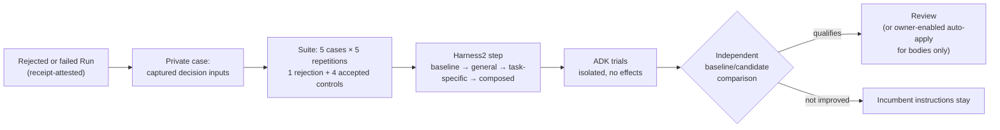

# Self-improvement

Obsidience improves its own **instructions**, not its code. Heimdall's
**Audit** Task (`Tasks/audit`) is the single improvement path: when a Run is
rejected or fails, Audit can search for a better Agent identity or Runbook
instruction body, measure it against the incumbent and stage it for Review.
The Tool is `harness.optimize`.

Audit uses Google Research **Harness2**'s pinned Propose–Probe–Compose method
as its search backend; **AutoSaddler** V2 retains immutable candidates, parent
lineage, durable attempts and an explicit rollback backend. Google ADK still
executes each isolated trial. How both are pinned, patched and installed is in
[Harness2 and AutoSaddler](../../integrations/harness2.md); the
[Harness2 integration notes](../../harness2.md) record the upstream review
behind this integration.

## How a job runs

- **Cases.** Bounded decision inputs are captured after the actual receipt
  commits. Cases are private evaluation Sources with exact receipt-attested
  inputs; they are never a full replay. A run that ended in a Tool-contract dead
  end is recorded as an implementation finding and admits no job.
- **One step, one worker.** The default performs one sequential refinement
  step: baseline, a general candidate, a task-specific candidate, then a
  composed candidate. The existing model owner handles every proposal and
  trial; no external agent CLI, provider server or second scheduler starts.
- **Trials dispatch no effect.** Each call is answered by frozen results or
  the contract validator. A captured decision may first take up to four
  read-only steps (Source and Article reads, search, `vault.validate`),
  answered from the current Vault. Executive trials run in an isolated
  in-memory session with no Hindsight recall or writeback.
- **Scope of edits.** Candidates change only the bound Agent identity or
  Runbook instruction body, by replacing one whole paragraph or list item or
  adding one after it. Links, metadata, grants, model configuration and code
  stay out of scope.

## Acceptance

Harness2's preference for a final candidate is not acceptance. The composed
candidate receives independent, full baseline/candidate measurements:

- it must pass every training trial, at least four of which the baseline
  failed;
- the controls must not pass less often in total, nor any single control by
  two or more repetitions, nor average over half a Tool call more;
- because controls the baseline mostly fails cannot show a regression, the
  candidate must itself pass at least three quarters of the control trials;
- for the Executive at reasoning `none`, a latency bound applies.

Missing evidence and execution errors never become success; the incumbent
instructions remain when no candidate qualifies. Only training evidence
reaches proposals, composition or lesson extraction; control cases stay
private.

## Publication

Publication revalidates inputs, code, model and the returned receipt. The
owner-set `optimization_auto_apply` field on `Tasks/audit` (default **off**)
may publish validated instruction bodies automatically; metadata, grants,
model configuration and code always keep Review. Retained lessons are bounded
private optimizer evidence, not accepted Knowledge or Hindsight memory.

## Backend selection and rollback

`OBSIDIENCE_OPTIMIZER_BACKEND=autosaddler` selects the retained original engine
(default `harness2`). Changing backend invalidates prepared cases; failed
Harness2 work never silently switches engines, and existing reports keep their
original backend identity.

## Related: Repair

Audit improves instructions; **Repair** recovers execution. Repair responds
automatically to degraded status (`harness.degraded`), selects one supported
`harness.repair` operation from fresh `harness.status` evidence and preserves
original Runs, committed effects and waiting queues. See
[Sources and Capabilities](../../sources-and-capabilities.md#receipts-and-no-replay).
