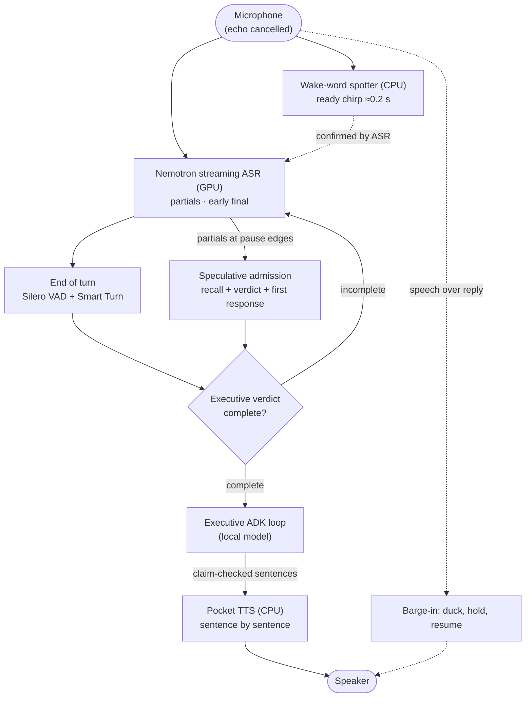

# Realtime voice

Fast voice agents do not wait for silence and then run the whole pipeline from
zero; they predict the end of the turn and start early. Obsidience's speech
path is built that way. Realtime is **speech connection infrastructure**: final
transcripts enter the same Executive conversation and ADK loop as typed Chat.
It is never a Task, Runbook, Agent, planner, memory or second reasoning path.

The upstream components (Pipecat, NeMo, Smart Turn, microWakeWord, Pocket TTS)
and how they are pinned are described in
[Voice stack](../../integrations/voice-stack.md).

## Pipeline

The contextual verdict and speculative admission are enabled by
`realtime_semantic_turns`; without it, final transcripts start work directly
after acoustic endpointing.

## Modes

The **Chat** pane owns the mode controls and the live transcript:

- **Wake word** (default). The wake word is the Executive's title (*Computer* in
  the starter Vault). No text before it is admitted or stored. An address
  starts a speech segment or follows a 0.4-second gap in recognized words,
  optionally after "hey", "ok" or "okay"; a trailing bare name waits up to
  0.35 s for a continuation. A trigger without a command allows an
  eight-second pause. Unaddressed speech never interrupts or enters the
  conversation.
- **Realtime**. Continuous conversation without the name.
- **Mute**. Closes the microphone.

Mode changes cancel the current turn and reject speech events from the old
revision. The mode persists per login and never becomes conversation, Task or
Knowledge state.

## Audio devices and echo cancellation

Pipecat's upstream `LocalAudioTransport` opens the microphone and speaker
selected in **Settings → AI & Voice**; there is no browser audio, audio
WebSocket or second capture lane. Devices and voice freeze when Realtime starts,
and streams forbid device fallback: device loss cancels the turn and drops
readiness.

Echo cancellation references the selected speaker's monitor. A supported DSP
microphone owns its reference links through one native PipeWire client; other
microphones use PipeWire's WebRTC module. A reference failure is reported,
never silently bypassed.

## Wake word

A small CPU keyword spotter hears the wake word about 0.2 s after it is spoken
and plays the ready chirp before ASR text arrives. Streaming recognition must
still confirm the word; an unconfirmed spot is dropped
(`realtime_wake_spotter`).

## Streaming recognition

NVIDIA NeMo runs **Nemotron Speech Streaming EN 0.6B** with a BF16 encoder on
the speech GPU (`realtime_asr_dtype`), with optional phrase boosting for names
(`realtime_asr_phrases`).

- **Silence gate.** GPU steps pause 0.7 s after VAD speech or the last
  recognized word; each VAD onset replays its 320 ms pre-roll
  (`realtime_asr_silence_gate`).
- **Fast final.** The end-of-turn tail is decoded in one encoder call, so the
  final transcript lands tens of milliseconds after the turn ends.
- **Early final.** With `realtime_asr_early_final`, the worker decodes the tail
  once more at the first 200 ms pause and sends the words as a pause edge.

## End of turn

NeMo owns acoustic turns. Silero VAD proposes a pause and
**Smart Turn v3.2** (CPU) judges whether it ends the turn
(`realtime_smart_turn`; without it, a fixed 700 ms pause). Complete short replies
such as "yes" or "never mind" end at the model's verdict
(`realtime_short_replies`). **A turn never ends on missing ASR words while VAD
still hears speech.**

### Contextual speech admission

With `realtime_semantic_turns`, the acoustic endpoint only *proposes* an
utterance. The Executive's own first response begins with a private
completion marker saying whether the utterance is complete, incomplete or worth
waiting on, in the same request that drafts the answer.

- Incomplete speech stays in the worker and joins the next segment.
- No public turn, conversation event, Tool dispatch or memory write happens
  before the verdict. A complete response binds the exact utterance,
  conversation window, model and instructions, then enters ADK once without
  regenerating the first response.
- Fresh audio, STOP, mode or session changes and teardown invalidate the
  owned inference. Missing or invalid markers fail closed.
- The completion protocol's rules live in the cached Executive system prompt,
  so admission, warmups and later ADK steps share one prompt prefix.

### Speculation

Each speech partial starts (or reuses) a Hindsight recall at once. The
admission itself (recall, verdict and first response) runs **speculatively at
pause edges**: words unchanged for 0.2 s, the VAD pause, or the worker's early
final. At most three speculations run per utterance, only on idle resident
capacity: model leases preempt them, busy hardware skips them, and exact HassIL
commands skip them. A speculation publishes, dispatches and writes nothing.
When the final candidate arrives, a speculation for the same words is adopted
after the live binding checks; otherwise it is cancelled and the final text is
admitted afresh.

Without contextual admission, the first partial instead starts one cancellable
warmup of the real prompt on idle hardware, discarding its single token.

## Speaking early

A direct answer is handed to speech at its control line while it is still
generating, sentence by sentence (`realtime_early_speech`). Each sentence must
pass the completion's own unsupported-claim check first. A later Tool call or a
rejected completion stops that audio and retracts the early speech; acceptance
speaks only the unspoken remainder.

## Barge-in

In Realtime mode, speech onset over a reply **ducks** it by 15 dB at once and
**holds** it after 0.5 s of speech. Recognized words commit the interruption;
1.5 s of quiet without them **resumes** the reply where it was held, with at
most 4 s of hold (`realtime_barge_in_ducking`).

## Cues

Cues are installation clips; missing clips are silent.

- The **ready chirp** opens the command window.
- A spoken **"On it."** plays once when a voice turn's Tool is still running
  after 1.5 s (or a usually slower Tool starts), never over the owner or after
  reply audio began.
- A **completion chirp** replaces spoken confirmation for receipt-verified
  reflex effects and for a short single voice command whose one effect Tool
  returned a verified receipt. Failures, uncertain effects, informational
  results and compound requests stay spoken, and never chirp success.
- In wake mode, a spoken reply that ends in a question reopens the command
  window as the name alone would.

## Pocket TTS

Pocket TTS synthesizes replies on CPU, sentence by sentence, with the voice the
installation selects (it must be one the installation has the right to use).

- Synthesis is serialized on the shared model; cancellation stops the native
  producer and drains its cleanup before the model is released.
- A synthesis failure is a delivery error that never erases the reply.
- `realtime_tts_quantize = true` uses dynamic **int8** weights in Pocket's
  FlowLM: CPU only, less memory, same voice file. It is read at speech worker
  start and is off by default (fp32).

The reply's PCM envelope drives the Executive orb in the graph through one
`/ws/realtime` subscription.

## Resources

Wake listening reserves the speech device with a yield callback: conflicting
model work drains the speech worker and releases the device, and the last
release restores listening. Realtime keeps a hard reservation. Neither waits
indefinitely for voice.

All voice settings are listed in [Configuration](../../configuration.md#voice).
