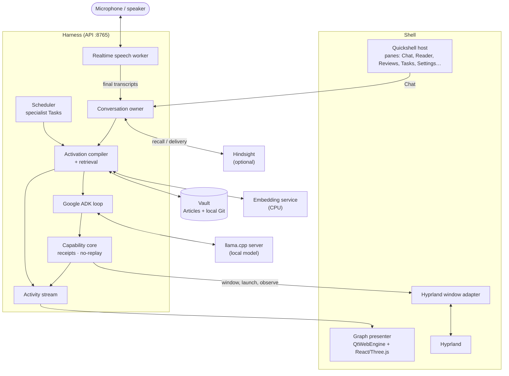

# Modules

A **Module** is a top-level physical product component of Obsidience. There
are four, listed once in the starter Vault's
[`Architecture`](https://github.com/Resource-Hacker/obsidience/blob/main/obsidience/defaults/vault/Architecture/Architecture.md)
Article. A Module is neither an Agent, a Task assignment nor an additional
runtime authority.

| Module | Directory | Owns |
| --- | --- | --- |
| [Harness](harness/index.md) | `obsidience/harness/` | Ontology, activation, retrieval, model selection, conversation memory, speech ingress, research, publication and the Capabilities behind every Tool |
| [Shell](shell/index.md) | `obsidience/shell/` (+ `obsidience/ui/`, `obsidience/browser/edge/`) | Compositor and native Surface ownership, desktop scene targeting and panes; the shared React/Three.js graph bundle; the Edge Cast client |
| [Media](media.md) | `obsidience/media/` | The independent catalogue and delivery service and its provider units |
| [TV](tv.md) | `obsidience/tv/` | The PC-hosted television session, its units and the Fire TV agent |

## How the pieces fit

- **Chat and speech** both enter the Executive's one ADK conversation. The
  speech connection is infrastructure: it has no Task, Runbook or second
  reasoning path.
- **The activation compiler** builds the Thinking Packet from the Agent's
  identity, bindings and up to five retrieved Knowledge Articles.
- **The ADK loop** streams model steps from the local llama.cpp server and
  hands every Tool call to the capability core.
- **The Shell** displays state and accepts typed commands. It adds no
  scheduler, memory store or reasoning engine; Hyprland owns composition and
  input.
- **The graph presenter** lights exactly what the activity stream reports:
  supplied context, Tool dispatch and results, Reader loads, committed writes
  and Review outcomes.

## Project layout

| Path | Responsibility |
| --- | --- |
| `obsidience/harness/` | API, CLI, conversation, execution, capabilities, models, knowledge and speech |
| `obsidience/shell/` | Native desktop and session adapters, panes and graph presenter |
| `obsidience/ui/` | Shared React/Three.js graph and interface bundle |
| `obsidience/browser/edge/` | Edge Cast extension, its native messaging host and theme policy |
| `obsidience/media/` | Media server units, provider launchers and mounts |
| `obsidience/tv/` | PC-hosted TV session (`host/`), its units (`systemd/`) and the Fire TV agent (`firetv-agent/`) |
| `obsidience/defaults/vault/` | Reviewed, distributable starter Articles |
| `obsidience/vault/`, `evidence/`, `state/` | Ignored live Vault, Sources and runtime state |
| `obsidience/scripts/` | Development and runtime entry points |
| `LICENSES/` | License texts of adopted code, recorded in `artifacts.lock.json` |

Unit sources live beside the code that owns them: `obsidience/harness/systemd/`,
`obsidience/shell/systemd/`, `obsidience/tv/systemd/` and the Media units in
`obsidience/media/`. An installation copies them into `~/.config/systemd/user`.

Optional integrations outside the four Modules (Discord, room lights) live in
`obsidience/discord/` and `obsidience/lights/` and use the same Agent, Tool and
receipt contracts.
