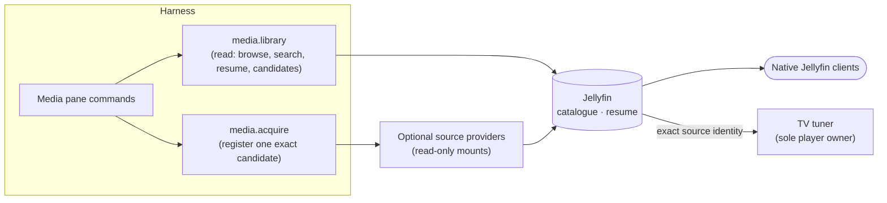

# Media

Obsidience Media (`obsidience/media/`) is an **independent media server and
catalogue**. Jellyfin owns the catalogue, native client delivery and per-user
resume; Obsidience adds discovery, explicit acquisition, a native Media pane
and ordinary capability receipts. The television is one optional destination
among desktop and other clients. Media bytes never pass through the model or
the Harness.

The integration is **optional and disabled by default**. See also the
[media integration](../integrations/media.md) page.

## Owners and configuration

- A private `obsidience/state/media.json` (or `OBSIDIENCE_MEDIA_CONFIG`) selects
  one authenticated Jellyfin instance and user, an encrypted credential name,
  non-overlapping catalogue and player root mappings, and optional acquisition
  and discovery. No credential value belongs in that file, the repository,
  command arguments or logs.
- The Harness owns its API clients in the existing lifespan; the TV tuner owns
  playback and progress reporting independently of Harness uptime.
- Jellyfin runs as a rootless Podman Quadlet publishing loopback port 8096,
  mounting media read-only. LAN access is an explicit installation choice, not
  implied by installation.
- Installed provider versions, revisions, licenses and local patches are
  recorded in `artifacts.lock.json`.

## Capabilities

| Tool | Does |
| --- | --- |
| `media.library` | Bounded reads: browse the catalogue, select an activation-only playback id, read saved resume, search metadata, list source candidates, plan a season, and search music. |
| `media.acquire` | Registers one exact, activation-bound candidate under the accepted source-selection policy. A registration receipt proves library registration only; catalogue readiness and playback are separate. |

Each has one real entrypoint, a code-owned schema and an exact Tool/Skill
binding; accepted Executive grants are still required. Browsing or searching
never registers anything, and acquisition is never purchase authority,
automatic season monitoring or autoplay. Uncertain or failed registrations are
never repeated.

## The Media pane

The pane pages library records, shows details and current TV state, previews
source discovery and submits deterministic owner commands through the
Executive's activation and receipt owner, with no model classification. A
request UUID binds each command, so reusing it observes the original result
instead of dispatching again. A selected source can open its exact native
Jellyfin item page independently of the TV.

## Playback and resume

The TV tuner is the only controller of its player. Sources carry the catalogue
instance, item, media source, root and revision identities; only admitted
MP4/M4V or Matroska/WebM files are played. Resume rereads Jellyfin's stored
position and uses it in a single load. Pause, seek, track selection and stop
bind the current source generation and verify fresh readback. A season plan can
play one finite sequence of already catalogued episodes and never acquires at
the end of a file.

## Music

`media.library search(query, type: music)` checks native Jellyfin Audio first.
Optional private configuration can enable public YouTube discovery for music,
delivered directly or through a configured provider; no other music service is
silently substituted. The Discord integration consumes those selections through
its own player.

## Optional source providers

An installation may connect optional virtual-file or debrid providers whose
read-only mounts feed dedicated Jellyfin libraries. Their adapters expose only
health, bounded search and a single exact registration; credentials stay in
encrypted user-scoped files, and expiring download URLs never enter titles,
receipts or model context. Provider details, mount lifecycle and the one-time
catalogue initialization are in the
[Media README](https://github.com/Resource-Hacker/obsidience/blob/main/obsidience/media/README.md).

## Deployment and rollback

Deploy with `obsidience/scripts/deploy`, which preserves active TV playback,
catalogue clients and virtual readers and never restarts the compositor or
locker. To roll back, disable new integration operations first, then restore
the previous code, provider generation and private configuration at an idle
boundary. Take provider backups through supported APIs or quiesced snapshots,
never by copying an active database file.
