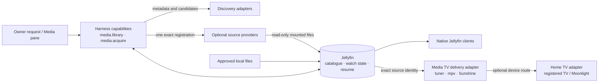

# Obsidience Media

Obsidience Media is an **independent media server, catalogue and playback
product**. Jellyfin owns library records, native client delivery and per-user
watch/resume state. Obsidience adds discovery, exact-source acquisition, a native
Media pane and ordinary capability receipts. Local libraries, desktop clients
and other native Jellyfin clients work independently of a television.

[Obsidience Home](home.md) owns lighting and physical TV control. Media can use
that TV as an optional device through the existing workstation playback route;
it does not require a TV or become the device's power/remote authority.
Media bytes travel through provider mounts and players, never through a model,
conversation history or a Harness streaming proxy.

The integration is optional and disabled by default. The
[integration reference](../integrations/media.md) records provider roles and
pins; the [Media README](https://github.com/Resource-Hacker/obsidience/blob/main/obsidience/media/README.md)
contains the operational configuration and lifecycle contracts.

## What Media provides

| Capability | Behaviour |
| --- | --- |
| Catalogue | Bounded browse/search, exact item and media-source selection, source readiness, watch state and saved resume from one authenticated Jellyfin user |
| Discovery | Title/edition/episode metadata, bounded release candidates and explicit ambiguity/quality information |
| Acquisition | One authorized exact source registration, followed by targeted catalogue reconciliation; existing registrations refresh instead of being created again |
| Presentation | A native Media pane and authenticated deterministic owner commands through the existing activation and receipt owner |
| Playback | Native Jellyfin clients, browser navigation, or the existing tuner-owned workstation route to an optional TV |
| Progress | Per-user saved state in Jellyfin; the tuner reports its own source generation without becoming a second progress database |

## Catalogue and selection

`media.library` reads the catalogue and creates short-lived selections in the
current activation. Browse results and title metadata are leads, not playback
authority. Selecting a source binds the catalogue instance, item, media-source
ID, approved root and source revision. The destination revalidates that binding
before loading bytes. A catalogue GUID, remembered title or previous-turn
selection cannot replace a current execution ID.

Ambiguous franchises, remakes, editions and episodes return choices. A different
title is never substituted because it happens to contain the requested words.
The existing TV title adapter resolves an ordinary named movie/show against the
catalogue first. Under an explicitly accepted source-selection policy, a clearly
named missing title may enter acquisition; ambiguity remains a selection step.
Live-channel and explicit app requests use their separate content route.

## Discovery and exact-source acquisition

Discovery separates metadata identity from release identity. Cinemeta provides
bounded title metadata; the configured source provider supplies releases.
Prowlarr's supported indexer route and Tiramisu's owner-only search adapter are
optional integrations. Metadata, filenames, quality labels and hashes remain
untrusted, even when ranking recommends a unique eligible match.

The normal acquisition sequence is:

1. Resolve the exact movie or series/season/episode, then inspect eligible
   candidates and their full registration scope.
2. Bind one opaque activation-bound candidate to the provider configuration,
   release/file identity and revision. A series pack must account for all video
   files; overlapping or unexplained episode coverage is rejected.
3. `media.acquire register` reconciles existing provider state, rechecks readiness
   and sends one registration. `refresh` reconciles an already registered source
   without registering it again.
4. Verify mounted file visibility and refresh only the exact configured Jellyfin
   library. Report catalogue readiness separately from registration.
5. Select the newly catalogued exact source before any destination playback.

With TorBox enabled, movie/series acquisition is cached-only. A configured
policy may allow a complete-series pack containing a requested episode, while
playback stays within the requested episode or season. The complete acquisition
scope is shown before selection. There is no hidden uncached-transfer or local
P2P fallback. Other provider configurations retain their own explicit admission
policy; acquisition is never purchase or subscription authority.

A registration receipt does not establish mounted visibility, a Jellyfin item,
player start or a picture on a TV. A pending catalogue refresh is observed or
reconciled; the registration is not resent. There is no autonomous watchlist
sync, upgrade scheduler, acquisition at EOF or unrequested autoplay.

## Playback destinations and controls

| Destination | Route and owner | What establishes completion |
| --- | --- | --- |
| Native Jellyfin client | Jellyfin's native authenticated client delivery | That client's playback and progress evidence; it needs no Home TV integration |
| Browser | Open the exact native Jellyfin item page; public music choices can supply a normal browser URL | Navigation receipt for an item page; navigation alone does not prove playback |
| Workstation route to TV | Existing `tv.control` composes Media source admission/tuner control with Home device verification | Exact source, player generation/start and intended TV-route readback |
| Live TV / streams | Native Jellyfin Live TV when configured, or the existing tuner/live-channel route | Current evidence from that specific route; channel or app metadata alone is insufficient |
| Screen mirror | Existing tuner-owned mirror route to the optional TV | Current capture/source and route evidence, separately from physical picture/sound |

The existing tuner is the sole controller of its mpv. Its local-file admission
holds a no-follow descriptor chain inside approved roots. Virtual sources must
match the live mount, provider file/revision and bounded actual-read probe.
Video admission accepts constrained MP4/M4V and Matroska/WebM containers, with
no external-reference escape. No fallback player starts when admission fails.

VOD state, pause/unpause, absolute seek, track selection and stop bind the
current generation plus exact source identity and verify fresh readback. Stop
ends playback without deleting or unregistering media. A later transport
`resume` means unpause; saved-position resume is a separate start option.

An explicit season plan binds up to 100 already catalogued sources from one
season using Jellyfin watch/resume state. Only the tuner advances after verified
natural EOF, revalidating the next source and assigning a new generation. Stop,
replacement, disconnect or shutdown revokes advancement. Missing or ambiguous
sources stop planning; EOF does not acquire more content. The initial receipt
attests only the first file.

## Saved progress and failure isolation

Starting with `resume:true` rereads Jellyfin's current saved position and applies
it in the single load command, without a corrective second play/seek. The tuner
reports bounded authenticated start/progress/stop events and reads stored state
back before claiming persistence. A reporting failure leaves playback running
and marks resume degraded; failed events do not queue for later replay. An
observed change by another client stops that reporter. Jellyfin offers no atomic
compare-and-set for this update, so a read/write race remains possible.

The tuner and its active ordinary local-file playback survive Harness restarts
or acquisition failure. Virtual provider loss closes new admission and may stop
the dependent Jellyfin service to prevent an empty-mount scan; it cannot promise
that provider-backed playback will continue. Mount readiness requires the exact
live mount owner and identity, not an existing directory. Provider shutdown drains
readers before ordinary unmount; deployments do not force or lazily unmount them.

## The Media pane and owner commands

The native pane pages library records, shows details and current TV state,
previews metadata and source discovery, and submits deterministic owner commands
without model classification. Reads are cancelled when hidden or stale.
Authenticated commands enter the existing Executive activation/capability owner;
a request UUID binds the complete command, so reuse observes the original result
rather than dispatching again. An active conversation refuses a new button command.

After registration the pane reports ready or pending and refreshes its Library
once. Opening an exact Jellyfin item page is independent of TV playback. Button
receipts remain durable without generating per-title Memory entries. The pane
adds no catalogue store, scheduler or playback authority.

## Music

`media.library search` with `type:music` checks native Jellyfin Audio first.
Optional configuration enables public YouTube music discovery using pinned
upstream extraction, with direct streaming or an explicitly configured provider.
Artist, recording and version still need exact selection; a verified uploader
alone does not establish the performer. Local audio uses the existing root and
source-admission contract; virtual torrent roots remain video-only.

Discovery does not start music. Public choices require a separately configured
destination; a browser URL can open at the desk through the existing application
launcher. No destination or alternate music service is silently created. Provider
URLs remain private and short-lived. Home lighting visualization is separately
opt-in and does not become a playback default.

## Configuration, source map and deployment

Private `obsidience/state/media.json` (or `OBSIDIENCE_MEDIA_CONFIG`) selects one
Jellyfin instance/user, encrypted credential names, non-overlapping root mappings
and optional providers. Jellyfin uses a rootless Podman Quadlet and read-only
media roots; its shipped exposure is loopback. Authenticated LAN reachability
is an explicit installation choice. No account value, credential, device address
or expiring provider URL belongs in public defaults or logs.

| Source | Responsibility |
| --- | --- |
| `obsidience/media/` | Provider launchers, mounts, units and operational README |
| `obsidience/harness/media/` | Catalogue, discovery, source admission, season and progress adapters; API-lifetime client ownership |
| `obsidience/harness/capabilities/media/` | Registered read/acquisition Tools and catalogue-first title orchestration |
| `obsidience/harness/interfaces/api/routes/media.py` | Native pane reads, previews and authenticated owner command ingress |
| `obsidience/tv/host/` | Existing workstation playback/delivery implementation, retained at its compatibility path |
| `obsidience/harness/capabilities/tv/control.py` | Current composed interface between content operations and Home TV device control |

Provider versions, revisions, licenses and reviewed patches live in
`artifacts.lock.json`. The Harness owns API clients in its existing lifespan;
cleanup remains paired with acquisition. Each callable Tool needs its exact
Tool/Skill binding and an accepted grant; shipped code or Articles grant nothing.

Use `obsidience/scripts/deploy` at an idle boundary. It preserves active TV,
Android, native catalogue clients and provider readers, and never restarts the
compositor or locker for Media changes. Rollback first disables new operations,
then restores matching code, private configuration and provider generation while
preserving registered content. Back up provider databases through supported APIs
or quiesced snapshots. Physical picture/sound and remote/pane interaction remain
installation acceptance checks; this module description does not claim them.
