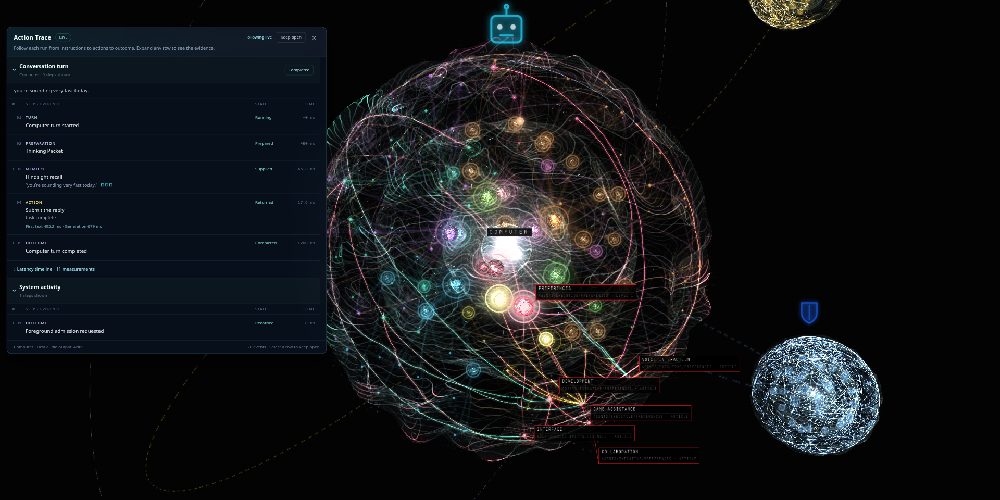
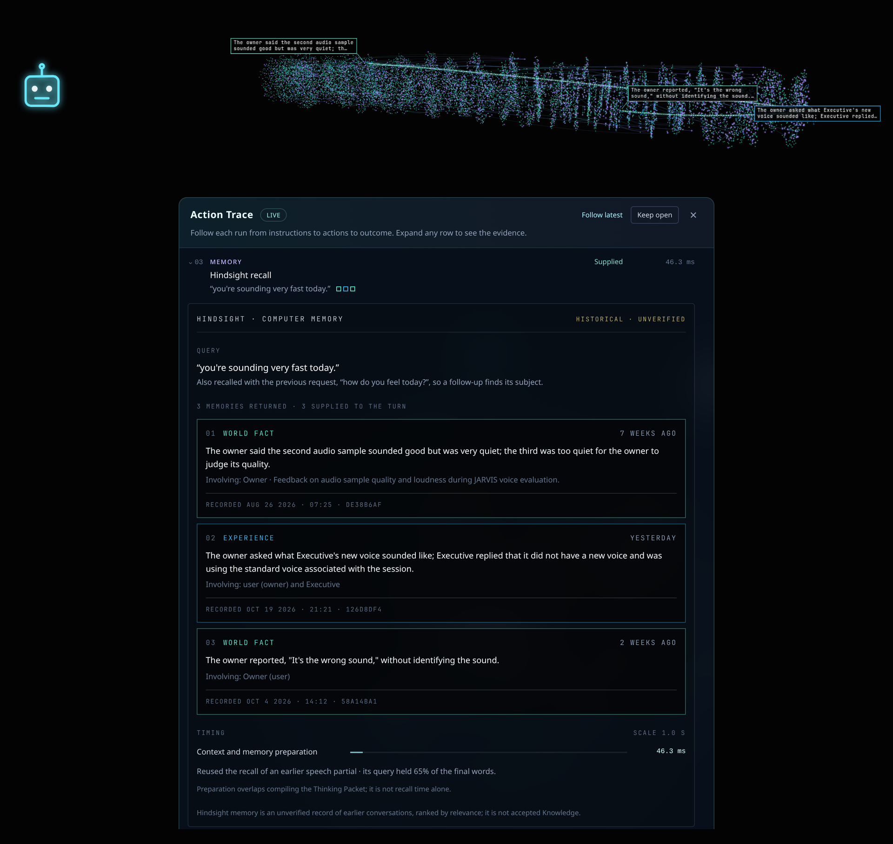

# Graph UI

The graph is a **presentation** of accepted Articles, memories and code, not
another knowledge store or execution engine. One Quickshell/QtWebEngine stage
owns every renderer and simulation (one Three.js + `d3-force-3d`
implementation, from `obsidience/ui/`); pane viewers receive frames from that
stage and own no scene. The stage lives for the Shell session, so a Harness
restart never stops it.

The **Graph** pane (placement id `knowledge-graph`) has three views, switched in
its header: Knowledge, Memory and Code. They share controls, background,
details and label style. Provider edges never become Article relationships or
permissions.

## Knowledge view

The Executive sits at the center (the Brain, pinned at the origin); its
subjects and Articles sit in craters on layered glass shells around it, with
hierarchy beams in each branch's color and links between Articles as fine
threads. Darwin, Alexandria and Heimdall orbit as their own smaller graphs. The
**Library** is an independent graph on its own stage, never a satellite. The
viewer can select the Executive, the Library or one specialist without changing
desktop membership.

- **Layout.** One shared spherical layout for every graph: first-level
  branches start on a common inner radius, deeper layers end on a common outer
  radius, and the radius grows automatically with population. Refreshes keep
  positions and cooling unless the physical inputs change; paint, labels and
  settings never reheat the simulation.
- **Navigation is the API's.** `/api/graph` navigation supplies exact
  identities, titles and parentage; the UI invents no kinds, names or
  relationships, and Source files do not become nodes because they exist on
  disk.

## What lights up, and why

The **thinking animation** ignites and labels exactly the Articles in the
Agent's supplied Thinking Packet and the refs its Tools returned. A pilot light
runs the route and the main beam follows it down the hierarchy to each supplied
Article. Hierarchy ancestors and Articles one link away from a supplied one are
*passed, not consulted*: they glow at under half strength, unlabelled, and
nothing lights beyond that one link. A Tool or Skill glow means its
instructions were supplied, not that it was called.

Actual operations show as halos and labels from the activity stream:

| Color | Means |
| --- | --- |
| Cyan breathing halo | Reads and searches (their exact returned refs) |
| Violet pulse | Tool calls |
| Amber | Changes awaiting Review |
| Green outward pulse | Committed edits and approvals |
| Red flash | Rejection, failure or interruption |

A returned Tool result does not assert that the real-world outcome succeeded.
The packet stays lit through speech; the route lingers six seconds after the
reply finishes, then fades. STOP clears it. Activity comes only from supplied
context, Tool dispatch and results, intentional Reader loads, committed writes
and Review outcomes, never hidden reasoning.

## Memory view

The Memory view reads one configured Hindsight bank (chosen in its Agent
dropdown) and draws it as a chronological **timeline tube**: records run oldest
to newest, spaced by activity (equal memory volume per length), colored by type
(world facts, experiences, consolidated observations). At rest each record shows
its strongest native ties; hover and selection reveal every incident link. When
a recall returns, a tendril reaches from the newest record back to each returned
memory, which lights as it arrives. Nothing lights without an operation that
names its records.

Time belongs to Hindsight: the timeline uses `mentioned_at`; import or
consolidation time never substitutes, and unknown dates stay undated. Requires
[Memory](../../memory.md).

## Code view

The Code view reads [codebase-memory-mcp](../../integrations/code-graph.md)'s
layout of a repository (configuration `[graphs] codebase_url`, default
`http://127.0.0.1:9749`, and `codebase_project`) and lays it out with the
Knowledge view's spherical solver: folders, files, classes and functions, with
calls and imports as cross-links. Layout ancestry is placement, never a
relationship.

- **Follow.** With Follow enabled, a saved file opens a **file lens** that
  unfolds that file into a local sphere with up to sixteen direct external
  neighbors; a click or search does the same. Right-click, Back and Fit return
  to the project camera.
- **Coding activity.** Public coding-agent MCP lookups and file saves light the
  exact files and symbols involved, using fixed labels and returned identities
  only, never source text, arguments or reasoning.
- The view reports *unavailable* while the provider is absent and never polls.

## Graph settings

Graph settings change presentation only:

| Setting | Controls |
| --- | --- |
| Branch clearance (Layout) | The one layout slider: padding around nodes and branches; the automatic radius follows. |
| Glass group | Per-layer shell solidity (counted outward from the core), crater depth, crater glow, seed glow, sheen lines and dust, per graph. |
| Beams group | Comet swell, both flares, their durations and the ripple. |
| Thinking speed | The speed of thinking routes. Selection sweeps keep their own fixed 340 ms timing. |

Hidden, locked or reduced-motion stages pause and never catch up; idle motion is
display-only and rate-capped.

The full renderer contract is the starter Vault Article
[Knowledge graph rendering](https://github.com/Resource-Hacker/obsidience/blob/main/obsidience/defaults/vault/Architecture/Shell/knowledge-graph-rendering.md).
