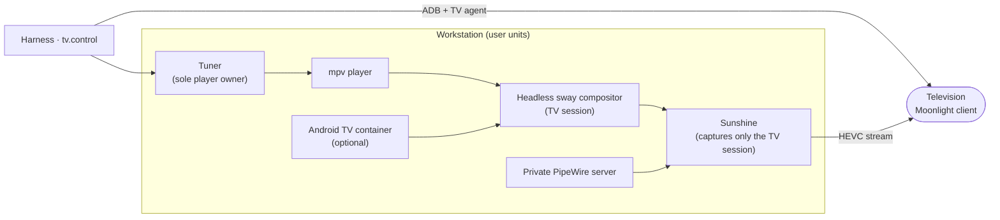

# TV

The TV Module (`obsidience/tv/`) hosts a television session **on the
workstation**: content plays on the PC, and the television only displays it
through a game-streaming client (Moonlight). The TV's own operating system is
the display client, not the place where channels or apps load. It is one
optional playback destination of [Media](media.md), controlled through the
`tv.control` Tool.

| Path | Holds |
| --- | --- |
| `obsidience/tv/host/` | What the units run: the tuner, remote and voice bridges, mode and source switches, compositor, streaming and audio configuration, the Android TV container recipe and checks |
| `obsidience/tv/systemd/` | The user-unit sources and a udev seat rule |
| `obsidience/tv/firetv-agent/` | The television-side agent app (accessibility service and notification listener) |

## How it works

- **One compositor, one audio server.** A headless sway compositor and a
  private PipeWire server belong to the TV session only; Sunshine captures that
  compositor and that audio server, never the desktop, and its input is
  disabled so the remote cannot reach the workstation.
- **The tuner owns playback.** The Harness asks the tuner, never the player,
  over one JSON-lines socket. Live channels and plain HTTPS streams play through
  it; it keeps playing while the Harness restarts.
- **Modes.** A `mode` script decides which GPU carries the session and its
  encoder; the stream's size follows the client's settings.
- **Android TV instance (optional).** An unmodified Android TV image runs in its
  own rootful Podman container, fully separate from any other Android container
  on the host, and appears as a workspace of the TV session; `show` switches
  between the player and Android.
- **The remote.** The television agent forwards remote keys, which reach the TV
  session through a Wayland virtual keyboard in that compositor only.
- **Executive voice on the TV (optional).** Snapcast plays the Executive's
  spoken replies on the television in step with the desk speakers.

## `tv.control`

`tv.control` controls one private, identity-bound LAN television through
upstream ADB: power with readback, registered app launch, state read from
Android services before any screen image, and intent calls (play, exact volume,
mute, pause and resume) that act only on a difference and confirm from fresh
readback. The sideloaded TV agent answers state, the UI tree and media-session
transport over an abstract Unix socket admitted only to the ADB shell user;
without it the Harness falls back to ADB. Navigation delivery is not proof of
playback, and uncertain effects are never replayed.

## Installing

Units are installed as copies of `obsidience/tv/systemd/` in
`~/.config/systemd/user` and name files in `obsidience/tv/host/` by absolute
path, so adapt them before installing. The complete contract, including
measurements, limits and checks for smoothness, is in the
[TV host README](https://github.com/Resource-Hacker/obsidience/blob/main/obsidience/tv/host/README.md).
