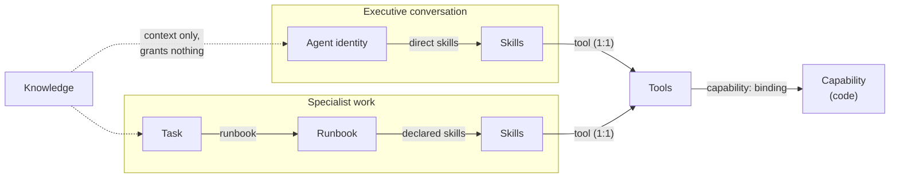

# Ontology

Obsidience classifies an object **by what it does**, never by its filename,
folder, screen label or package format. Every knowledge-graph node is an
**Article**, and an Article with descendants is their readable index and
condensation. This page summarizes the project's Golden ontology, the Article
[`Architecture/Harness/action-ontology`](https://github.com/Resource-Hacker/obsidience/blob/main/obsidience/defaults/vault/Architecture/Harness/action-ontology.md)
in the starter Vault, which is the authority for these rules.

> The knowledge graph is the harness, and each activation should give the model
> the smallest complete packet needed to succeed.
> — [DESIGN.md](https://github.com/Resource-Hacker/obsidience/blob/main/DESIGN.md)

## The six Article types

| Type | Meaning | Page |
| --- | --- | --- |
| `knowledge` | Useful context: facts, constraints, explanations, indexes, domains. The default type. | [Knowledge](../articles/knowledge.md) |
| `agent` | One accountable executor: role, assigned Tasks, scoped Knowledge, Memory. A conversational Agent carries its standing instructions and declares its Skills directly. | [Agents](../articles/agents.md) |
| `task` | A reusable outcome with inputs and an acceptance condition. | [Tasks](../articles/tasks.md) |
| `runbook` | Reusable ordered or branching operating instructions for completing a Task. | [Runbooks](../articles/runbooks.md) |
| `skill` | Exact instructions for using exactly one Tool correctly. | [Skills](../articles/skills.md) |
| `tool` | One registered executable interface to a real, Source-backed Capability: arguments, effects, failures. Its schema and execution live in code. | [Tools](../articles/tools.md) |

## How authority flows

Edges dispatch; retrieval informs. Only exact, accepted graph edges select
Agent, Task, Runbook, Skill or Tool authority. Similarity, links and model
output never create it.

- `Agent.tasks` assigns work; `Agent.skills` is the conversational catalog;
  `Agent.knowledge` and `exclude_knowledge` scope context and grant nothing.
  There is no Agent Tool list or Runbook list.
- A leaf Task must resolve an applicable accepted Runbook, and a Runbook loads
  only its declared Skills. Missing or malformed links fail closed; the model
  never invents replacements.
- Each callable Tool has exactly one Tool Article and one Skill titled
  `Using <tool.id>` that binds it.
- Task hierarchy expresses reusable scope, not chronological order. Only an
  explicit `subtasks` edge creates a child Task. Procedure, branching, retry and
  Tool order belong in the Runbook.
- A UI verb becomes a Task only when it names an independently queueable
  outcome with its own acceptance condition; otherwise it is a Runbook step or
  a Tool operation.

## What is not an Article type

Source, Capability and Module are real parts of the system, but they are not
Article types and never become authority:

| Identity | What it is | Read more |
| --- | --- | --- |
| **Source** | The real file or immutable evidence layer: a read-only view over System inventory, Knowledge Markdown, Evidence and Project Files. | [Sources and Capabilities](../sources-and-capabilities.md) |
| **Capability** | The executable code behind one Tool, at `obsidience/harness/capabilities/<segments>/<leaf>.py`. | [Sources and Capabilities](../sources-and-capabilities.md#capabilities) |
| **Module** | A top-level physical product component: Harness, Shell, Media, TV. | [Modules](../modules/index.md) |

Plugins, services, events, frameworks, activations and executions are
implementation or runtime roles, not Article types either.

## Runtime identities: Activation, Run and receipts

Definitions and execution are separate. Articles define reusable objects; their
occurrences live in one SQLite execution ledger:

- A **Task** is a reusable outcome definition.
- An **Activation** is one requested occurrence, with its own Objective, inputs
  and result.
- A **Run** is one attempt at an Activation.
- **Tool receipts** establish dispatch and delivery evidence for each call.

A Task's status is a view over its occurrences, not permission to replay a
failed effect. Conversation runs use the same receipts and activation ledger,
with the Agent as their owner. See
[Sources and Capabilities](../sources-and-capabilities.md#receipts-and-no-replay).

## The Library and Agent checkouts

The **Library** holds every accepted Article for the owner; it is a passive
catalog, never an Agent or an assignee. Each orbiting Agent **checks out**
shared Knowledge by exact Article identity and owns a scoped Hindsight memory
bank. Search, reads, graph expansion and displayed membership all use the same
Knowledge scope, applied before retrieval. A checked-out Article is one shared
identity, not a copy. Historical memory from another Agent is private; an
explicitly handed-off Source supplies evidence without granting access.
Neither Knowledge checkout nor model output can create a Tool grant.

## Document format

Each Article is one native **Open Knowledge Format** (OKF) Markdown file. The
Obsidience profile adds the six Article types (the required `type` field) and
the `obsidience` frontmatter namespace for bindings, triggers and permission
metadata; common document fields stay at the root. A parent Article uses its
own folder name (`Projects/Projects.md`), and body links are standard Markdown
links to exact Article files. See [Document format (OKF)](okf.md).

## Cordis principles

Every Obsidience component follows the composition principles of Cordis
([A Programming Paradigm for Spatiotemporal Composability](https://arxiv.org/abs/2608.25512)),
whatever runtime or framework hosts it:

1. **Contracts.** A component provides or consumes named service contracts and
   declares its required dependencies and optional integrations.
2. **Cleanup with acquisition.** Every subscription, listener, timer, worker,
   client and lease has one lifecycle owner that registers cleanup when it
   acquires the resource.
3. **Availability.** Work runs only while its required dependencies are
   available; cancellation, dependency loss or teardown stops and drains owned
   work.
4. **One authority.** Each durable store, conversation, scheduler, model
   reservation and desktop input path has one owner.
5. **Reversible composition, irreversible world.** Reloading a component never
   undoes a delivered effect; uncertain effects are never replayed.
6. **Short foreground path.** Keep the live path lean and measure real
   end-to-end boundaries before claiming a latency gain.
7. **Best available components.** Adopt a maintained framework or upstream
   component when it makes the system better: one per concern, pinned and
   recorded with its license in `artifacts.lock.json`. See
   [Integrations](../integrations/index.md).

## Design laws

From [DESIGN.md](https://github.com/Resource-Hacker/obsidience/blob/main/DESIGN.md#design-laws):

1. One Article graph is authoritative; UI trees, menus, schedules and prompts
   are projections.
2. Every Knowledge graph node is an Article.
3. Edges dispatch; retrieval informs.
4. Definitions and execution are separate.
5. Shallow is the default.
6. No fictional Tool: a Tool exists only with one real `capability:` binding
   and one Source-linked entrypoint.
7. Optimize for small models: explicit contracts, narrow choices, stable names,
   short Articles, closed Tool sets and deterministic validation.
8. Disk paths are literal.
