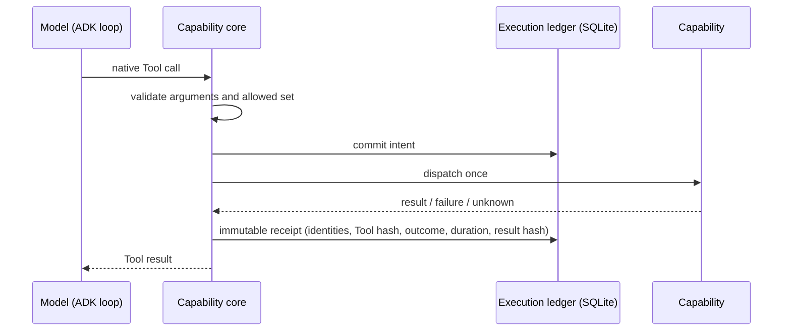

# Sources and Capabilities

Two parts of Obsidience are real and load-bearing but deliberately **not**
Article types: **Sources**, the evidence layer, and **Capabilities**, the code
behind every Tool. Neither can become an Article or grant authority (see
[Ontology](ontology/index.md#what-is-not-an-article-type)).

## Sources

A Source is a read-only view over four roots:

| Root | Holds |
| --- | --- |
| System | Immutable hardware and application captures under `obsidience/state/system/` |
| Knowledge Markdown | The Vault's Article files |
| Evidence | `obsidience/evidence/`: `incoming/` (drop folder), `raw/` captures, `inbox/` research handoffs, `system/` captures |
| Project Files | Selected source trees and top-level files of the repository (Harness, Shell, UI source, `docs/`, `DESIGN.md`, `README.md` and others) |

- Every leaf keeps its exact path; a shown Source path is the exact file
  opened. Synthetic view keys cannot invent branches.
- Source never grants trust, becomes a graph node, mutates Knowledge, collects
  hardware or starts research by itself. Source bytes are untrusted input.
- Articles cite Sources with `source://` URIs. Those citations are never
  Articles; a wikilink around one normalizes to the Source URI.
- `source.read` pages through a Source with visible offsets. `source.ingest`
  preserves external evidence as a new immutable Source, and
  `source.handoff` returns one finding into the Inbox.
- `web.fetch` validates addresses, redirects and size, extracts readable text
  with pinned Trafilatura (Markdownify as fallback) and never follows linked
  pages implicitly.
- Listings are bounded keyset pages; exact lookup never depends on a page.

The intake path from `incoming/` through Darwin and Alexandria to Review is
described on [Knowledge](articles/knowledge.md#how-knowledge-enters-the-vault).

## Capabilities

A Capability is the executable machinery behind one Tool, at
`obsidience/harness/capabilities/<dotted segments>/<leaf>.py`; the package tree
mirrors Tool ids (`vault/search.py` for `vault.search`). The static registry in
[`capabilities/registry.py`](https://github.com/Resource-Hacker/obsidience/blob/main/obsidience/harness/capabilities/registry.py)
is the one code-owned Tool definition: each registered name, the description
the model sees, its argument schema, its effect class and its adapter.

Google ADK owns the model/Tool loop, the conversation log and Tool sequencing.
Every advertised Tool call runs through one **capability core**
(`obsidience/harness/execution/capability_core.py`), which owns:

- argument validation against the code-owned contract, before dispatch;
- receipts and no-replay;
- fresh target verification and observation witnesses;
- the model lease, activity events and cancellation;
- completion acceptance (native text is accepted locally by the completion
  authority; `task.complete` remains for structured failure, Review and
  computer-state verification).

Dispatch rejects calls outside the allowed set even though full schemas stay
advertised. A schema advertisement is not an Article read, and not evidence
that the Tool was invoked.

## Receipts and no-replay

- **Intent before dispatch, receipt on return.** Interrupted effects, missing
  coverage, changed inputs, pending Reviews and continuations block replay.
  Only attested read-only or proven-undispatched work passes restart admission.
- **Cancellation** keeps completed results and marks in-flight effects
  *unknown*; lease cleanup always releases. A failed completion cannot conceal
  earlier effects.
- **Uncertain effects are never replayed.** An interrupted Tool call is
  recorded as outcome unknown. Owner Retry pins the failed Run and admits only
  read-only or no-Tool attempts.
- **Completion checks.** Every computer Tool used needs its own verified
  receipt; a later Tool cannot conceal an earlier failure. Claims such as
  "opened", "unlocked" or "paused" need the matching verified receipt from this
  Run, or they return to the loop.
- **Health and Repair.** Startup, Task completion and one filesystem observer
  drive reconciliation. Supported findings activate Heimdall's Repair, which
  uses only `harness.status` and `harness.repair`, at most one automatic retry
  per original key, committed atomically with its receipt. Unsupported or
  exhausted failures become persistent Review notifications that never clear
  the fault by being acknowledged.
- **Trace.** One sanitized ledger trace with bounded events and resumable
  cursors. Pixels, credentials, leases and private reasoning never enter trace
  or receipts.

## Computer use

Computer Tools follow the same contract, with extra binding to fresh
observations:

- Every activation carries a bounded semantic **Shell Scene** (applications and
  panes per Surface, awake state, a grid); compositor ids, geometry and pixels
  stay private.
- `computer.observe` captures one exact window without focusing it; the image
  goes only to the next model message and is never persisted.
- `computer.act` delivers one click at a point in the preceding image, bound to
  that image by a one-use lease. Any intervening Tool, invalid response,
  completion or cancellation discards the lease. Acknowledgement proves
  delivery only.
- `application.launch` dispatches once and waits for the Scene's readiness
  witness; nothing authorizes a replay after failure or timeout.
- `window.activate` and `window.place` are separate explicit effects verified
  by readback.
